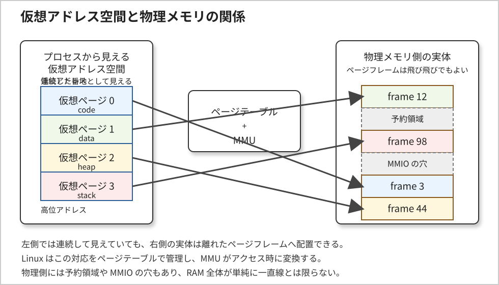
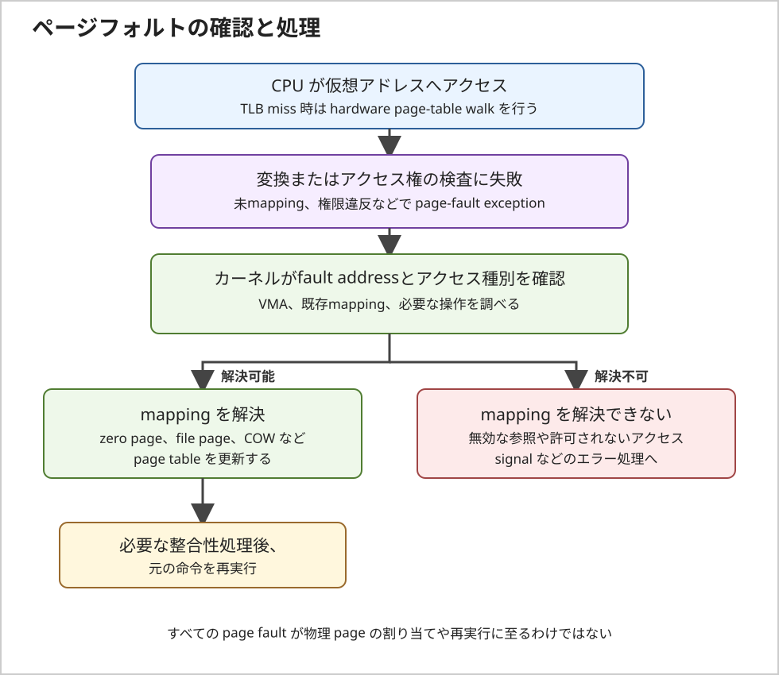
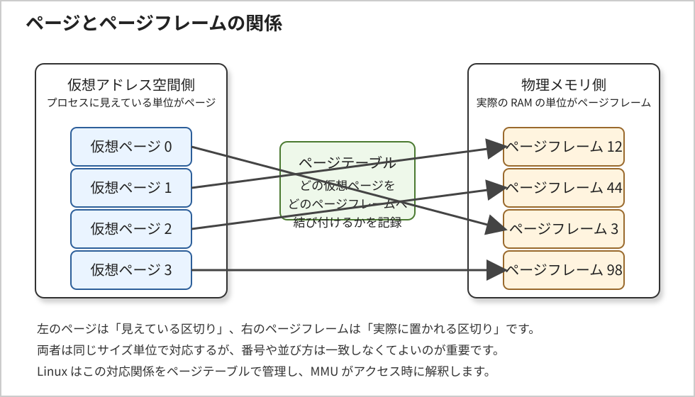
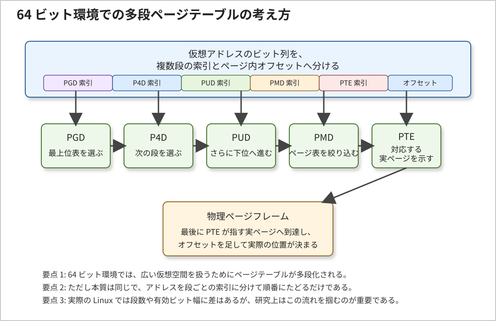
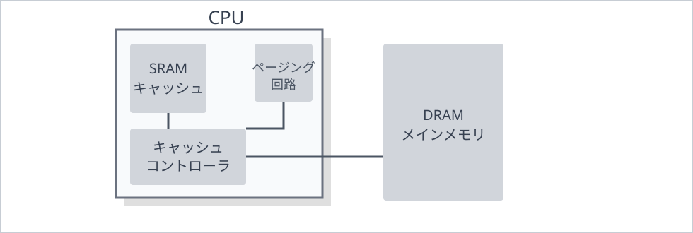
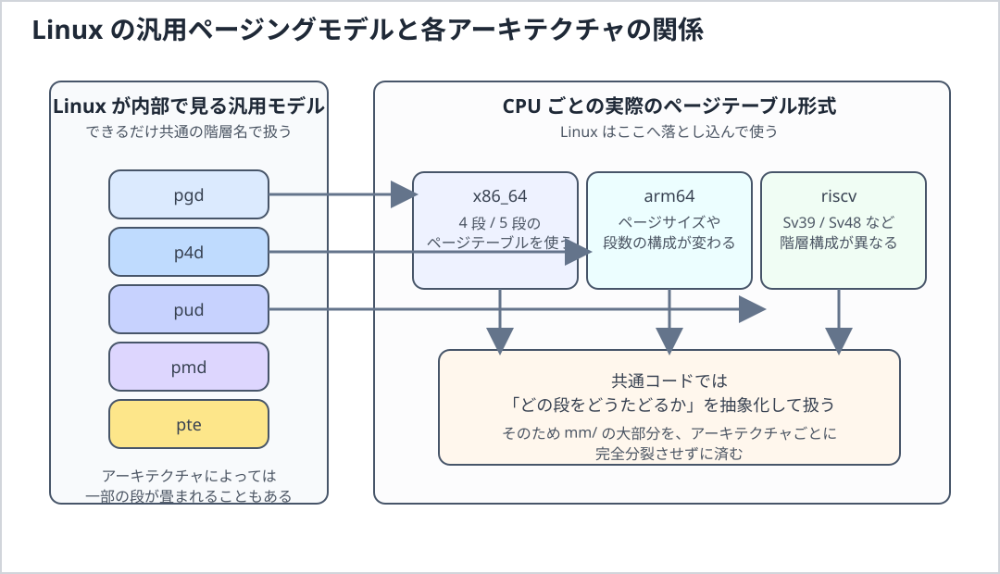

# LINUXカーネル6系の研究　２　メモリアドレッシング

この 2 章では、Linux カーネルを理解するうえで避けて通れないメモリアドレッシングの話に入っていきます。
1 章では、Linux 6.18 LTS を研究するときの全体像を先に整理しました。
ここからはもう少し踏み込んで、CPU が見ているアドレス、カーネルが扱っているアドレス、そして実際の 
RAM 上の位置が、どういう関係で結びついているのかを見ていきます。

古い Linux 2.6 系の参考書籍では、80x86 のセグメンテーションとページングをかなり丁寧に追いかけながら説明して
います。
この入口自体は今でもとても大事です。
ただし、Linux 6.18 LTS を研究する立場では、単に昔の x86 の仕組みを暗記するのではなく、
「Linux が実際にはどの抽象化を重視しているのか」「いま読むべき中心概念は何か」という視点で
整理した方が理解しやすいです。

特に重要なのは、プログラムが使うアドレス、CPU が変換途中で扱うアドレス、RAM 上の実アドレスを分けて
考えることです。
この区別が曖昧だと、ページテーブル、MMU（メモリマネジメントユニット）、TLB（トランスレーションルックアサイドバッファ）、mmap()、カーネル空間、ユーザー空間といった後続の話題が、ぼやけます。
UmuOS の研究でも、最初は単純なアドレス空間から始めるにしても、最終的にはこの整理がかなり効いてくると思います。

ここで、先に後続の重要語をかなり短く整理しておきます。

- ページテーブルは、仮想アドレスのどのページを、物理メモリ上のどのページフレームへ対応付けるかを
記録した表です。
Linux カーネルはこの表を用意し、CPU 側の変換機構がそれを見て実際のアクセス先を決めます。

- MMU は Memory Management Unit の略で、CPU がメモリアクセスするときに、仮想アドレスから物理アドレスへの
変換や、権限チェックを行うハードウェア機構です。
これは基本的に CPU に内蔵されているハードウェア回路と考えてよいです。
OS が毎回ソフトウェアだけで番地変換しているわけではなく、変換の本体は MMU が担います。

- TLB は Translation Lookaside Buffer の略で、最近使ったアドレス変換結果を覚えておく小さな高速キャッシュです。
ページテーブルを毎回最初からたどると遅いので、CPU はよく使う変換結果を TLB に残して高速化します。

- mmap() は、ファイルや匿名メモリをプロセスの仮想アドレス空間へ対応付けるための仕組みです。
これにより、read() や write() だけでなく、「メモリとして見せる」形でデータを扱えるようになります。
※この部分は、技術書なんかに詳しく記載あるので、今回はこのくらいにとどめます。

- カーネル空間は、Linux カーネル自身が使う仮想アドレス空間です。
ここにはカーネルコード、各種内部データ、デバイス制御用の領域などがあり、通常のユーザープログラムからは
自由に触れられません。

- ユーザー空間は、通常のアプリケーションが動く仮想アドレス空間です。
各プロセスは基本的に自分専用のユーザー空間を持ち、ほかのプロセスやカーネル内部へ勝手には触れられません。

この章では、これらを別々のこと、として覚えるのではなく、
「**ユーザー空間の仮想アドレスを、ページテーブルと MMU が物理メモリへ結び付け、その結果を TLB が高速化する**」
という 1 本の流れとして見ていきます。

## UmuOS との接続

UmuOS-0.1.7-base-stable は Linux 6.18.1 を QEMU/KVM 上で起動する環境です。
この章では、ゲスト Linux が扱う仮想アドレス・ゲスト物理アドレスと、ホスト側の物理メモリを別の層として考えます。

```text
ゲストのプロセス仮想アドレス
	|
	v
ゲスト Linux のページテーブル / ゲスト MMU
	|
	v
ゲスト物理アドレス
	|
	v
KVM の second-stage mapping（EPT/NPT）
	|
	v
ホスト側の backing memory
```

ゲスト内のページテーブルは、ゲスト仮想アドレスからゲスト物理アドレスへの対応を管理します。
仮想化環境では、その先のゲスト物理アドレスがホスト側の backing memory へ対応付けられます。
したがって、ゲストの物理アドレスをホストの物理アドレスと同一視しません。

#### UmuOS での観測入口

- `/proc/<pid>/maps`: プロセスの仮想アドレス領域を確認する。各領域の物理ページ配置は表示しない
- `/proc/meminfo`: ゲストから見えるメモリ利用状況の集計を確認する。個々のページテーブル対応は表示しない
- `dmesg`、`/proc/iomem`: ゲストが認識したメモリ範囲や予約領域を、利用可能な範囲で確認する
- QEMU のメモリ設定: ゲストに提供される RAM 容量を確認する。ホスト上の物理配置とは別の設定層

これらの観測値を Linux の仮想アドレス、ゲスト物理アドレス、ホスト側の memory mapping のどれに関する情報か分けて
読みます。
特に `/proc/<pid>/maps` だけから、仮想ページがどの物理フレームに載っているかを判断することはできません。

## 今回扱う範囲

- 原文対応: 2.1「メモリアドレス」から 2.5.7.2「TLB の制御」まで
- 主な論点: 論理/リニア/物理アドレス、x86 セグメント機構、ページング、Linux の汎用ページテーブル、物理メモリ layout、TLB/cache 整合性
- Linux 6.18 LTS の視点: x86-32 の説明を入口にし、現在の x86-64 と Linux 共通の仮想記憶モデルを中心に読む
- UmuOS の視点: QEMU/KVM ゲスト内の仮想アドレス・ゲスト物理アドレスと、ホスト側 memory mapping の境界を分ける
- 現在の進捗: 原文の 2.1〜2.5.7.2 を反映し、各節の再整備と2章全体の通読確認が完了

## 2章の研究観点

- x86 の論理アドレス、リニアアドレス、物理アドレスを区別し、現代 Linux で中心となる仮想アドレスとページングを見失わない
- CPU が提供するセグメント機能と、Linux が実際にメモリ管理で使うページテーブル機構を分けて考える
- 仮想ページ、物理ページフレーム、ページテーブル entry、TLB の役割を混同しない
- 32bit x86 の固定境界や RAM 容量別 mapping を、Linux 6.18 の一般仕様として扱わない
- ゲストの観測値、ゲスト物理アドレス、ホスト側物理メモリを別の層として照合する

## ２章　メモリアドレッシング

### 2.1 メモリアドレス

この節の中心は、**プログラムが指定する仮想アドレスと、メモリシステムが最終的に扱う物理アドレスは別の名前空間に属する**という点です。Cのポインタ値を見ただけでは、そのデータがRAMのどの場所に置かれているかは分かりません。Linuxはアドレス空間とページテーブルを管理し、CPUのアドレス変換機構が実際のアクセス時に対応関係を解釈します。

原文の図2-1は、x86のアドレスを論理アドレス→リニアアドレス→物理アドレスの順に示しています。Linux 6.18を読むときは、この段階を次のように区別します。

| 名称 | 意味 | 現代Linuxでの読み方 |
|---|---|---|
| 論理アドレス | x86のセグメントセレクタとオフセットで表される、命令側のアドレス形式 | 64-bit modeではセグメントの役割は限定的。通常のCS/DS/ES/SS baseは0として扱われ、FS/GS baseには用途がある |
| リニアアドレス | x86でセグメンテーション後、ページングに渡されるアドレス | x86上の仮想アドレスに相当する用語。Linux共通コードでは通常「仮想アドレス」と読む |
| 物理アドレス | ページングによる変換後にCPUのメモリシステムへ出されるアドレス | RAMだけでなくMMIO領域へ到達する場合もある。DMAデバイスが使うDMA addressと同じとは限らない |

Linux全体の中心はセグメント機構ではなくページングです。ページ単位の対応付けにより、プロセスごとの仮想アドレス空間、アクセス権、遅延割り当て、ファイルmapping、copy-on-writeなどを構成します。以後「仮想アドレス」と書く場合はLinuxの仮想記憶上のアドレスを指し、x86の変換段階を厳密に述べる場合に「リニアアドレス」を使います。

#### 論理アドレス

古典的なx86の論理アドレスは、セグメントセレクタとオフセットの組です。CPUはセグメントの情報を用いてリニアアドレスを得て、その後にページングを適用します。これはx86固有の用語であり、Linuxの全アーキテクチャに共通する段階ではありません。

x86-64の64-bit modeではセグメンテーションの多くがフラット化されていますが、FS/GS baseは依然として意味を持ちます。Linuxでは、ユーザー空間のthread-local storageやカーネルのper-CPUデータなどを読む際にFS/GSが現れます。したがって「セグメンテーションはLinuxでは完全に使われない」とは言わず、仮想記憶を作る主役ではない、と区別します。詳細は2.2・2.3で扱います。

#### リニアアドレス

リニアアドレスはx86でセグメンテーション後に得られるアドレスです。Linuxの仮想記憶を読む場面では仮想アドレスとほぼ同じ役割を指しますが、厳密には「リニアアドレス」はx86側の用語です。各プロセスの仮想アドレス空間には、コード、データ、heap、stack、共有library、file mappingなどの領域が置かれます。領域が存在することと、その全ページがすでに物理メモリへ割り当て済みであることは別です。

実行中のCポインタは、通常そのプロセスの仮想アドレスです。値が連続している配列でも、対応する物理ページフレームは連続とは限りません。また、同じ仮想アドレス値でも、異なるプロセスのページテーブルでは別の物理ページを指しえます。

Linuxの`/proc/<pid>/maps`はプロセスの仮想アドレス領域と権限などを示しますが、各仮想ページの物理配置を示すものではありません。ユーザーポインタをそのまま物理アドレスとして扱ったり、カーネルの`virt_to_phys()`を任意のユーザーポインタや`vmalloc`アドレスに適用したりしてはいけません。デバイス向けDMAではさらに別のDMA mapping APIを使い、CPUの物理アドレスとデバイスが使うDMA addressを区別します。

#### 物理アドレス

物理アドレスは、ページングによる変換後にCPUのメモリシステムへ渡されるアドレスです。メモリコントローラがRAMへ向ける場合もあれば、アドレスmapに従ってデバイスのMMIO領域へ向かう場合もあります。よって「物理アドレスはRAMチップの番地」とだけ覚えると、デバイス領域やDMAの説明で混乱します。

Linuxの物理メモリ管理では、ページフレームの確保、NUMA node、zone、物理連続性などを扱います。仮想アドレスと物理アドレスは異なる型・用途として追い、カーネルの仮想アドレスからCPU物理アドレスへの変換と、CPU物理アドレスからデバイス用DMA addressへのmappingを同一視しません。

次の図のように、プロセス側では連続して見える仮想ページが、物理メモリ側では飛び飛びの
ページフレームへ対応付けられることは普通にあります。



図 2-1 仮想アドレス空間と物理メモリの対応イメージ

物理アドレス空間には、利用可能RAMだけでなく予約領域やMMIOなどが含まれます。図の対応は概念例であり、特定のプロセスや実機の物理配置を表すものではありません。

#### 4 KiB ページでアドレス変換を数値で追う

x86-64、4 KiB page、通常の4-level pagingを仮定した概念例です。仮想アドレス`0x00007f12_3456789a`の下位12 bitはpage内offsetなので、`0x89a`です。仮想page numberは`0x00007f12_34567`となります。

仮に、その仮想pageに対応するpage-table entryが物理page frame number（PFN）`0x12345`を指すなら、変換は次のようになります。

```text
仮想アドレス: 0x00007f12_3456789a
仮想page:     0x00007f12_34567
page offset:  0x89a
対応PFN:      0x12345
物理アドレス: (0x12345 << 12) | 0x89a
              = 0x1234589a
```

この計算で変わるのはpage番号部分で、page内offsetは保たれます。PFNは説明用に置いた値で、Linuxがこの仮想アドレスに実際に割り当てる値ではありません。実際の対応はプロセス、時刻、memory pressure、mappingの種類などで変わります。また、巨大pageの場合はpage-table walkが途中の階層で終わり、offsetとして扱うbit数も大きくなります。

この例が示すのは、アドレス変換の考え方です。実際のx86-64で何段のpage tableを使うか、どの仮想アドレス範囲を利用できるかはCPU capabilityとkernel configurationなどに依存します。

#### MMU が行っていること

MMU（Memory Management Unit）はアドレス変換とアクセス権の検査を担います。通常、CPUはまずTLBを参照し、変換が見つからない場合にhardware page-table walkでページテーブルをたどります。したがって、CPUが毎回ソフトウェアへ変換を依頼するわけではありません。Linuxはページテーブルを設定し、mappingの作成・変更時には必要なTLB整合性処理も行います。

ページフォルトは「物理pageがない」ときだけ発生するわけではありません。対応するPTEが未設定の場合のほか、書き込み権限などの違反でも例外が起きます。カーネルはfault addressとアクセス種別をVMAなどの状態と照合し、遅延割り当て、file pageの読み込み、copy-on-writeなどで解決できればページテーブルを更新して命令を再実行させます。無効なアドレスや許可されないアクセスなら、プロセスへのsignalなどのエラー処理になります。



図 2-2 ページフォルト発生から再実行までの流れ

図は解決可能なfaultの一例です。すべてのpage faultがページ割り当てと再実行に至るわけではありません。

UmuOS のような自作 OS を考えるときも、この発想はかなり大事です。
最初は単純な 1 対 1 対応や固定マッピングから始めるとしても、
最終的にプロセス分離や安全なユーザー空間を実現したいなら、MMU とページングをどう使うかが
中心課題になります。

#### アドレス変換と並行実行

原文は、複数CPUやDMA controllerからのアクセスをmemory arbiterが調停するモデルを説明します。現代のシステムでもmemory controllerやinterconnectは要求を調整しますが、アクセスは単純に一つずつ直列処理されるわけではありません。複数の要求は並行して進みうるほか、cache coherence、memory ordering、DMA coherenceなど、それぞれ異なる仕組みが関わります。

ここで重要な区別は、**hardwareの調停・coherenceは、カーネル内の共有データに対する同期の代わりではない**ことです。複数CPUから同じデータを更新する競合は、適切なlockやatomic operationなどでカーネル側が解決します。一方、ページテーブル更新後のTLB整合性は、古い変換を使わせないためにLinuxがarchitecture-specificな仕組みを用いて維持します。DMAについても、deviceとCPU間の可視性・ownershipはDMA APIの契約に従います。

#### この節を Linux 6.18 LTS の研究へつなぐ

2.1では、アドレスの名前がどの段階を指すかを確認しました。具体的なコードを読むときは、仮想アドレス領域の存在、PTEによるpage frameへのmapping、物理メモリの管理、CPU TLB、device DMA mappingを別々の層として追います。

Linux 6.18 LTSのソースを読む入口:

- x86のpage-fault entryとuser address fault処理: `arch/x86/mm/fault.c`
- architecture共通のpage-fault処理とpage-table更新: `mm/memory.c`
- VMAおよび`mm_struct`の定義: `include/linux/mm_types.h`
- x86 page-table entryの形式: `arch/x86/include/asm/pgtable_types.h`
- TLB処理のx86実装: `arch/x86/mm/tlb.c`
- device向けmappingとDMA addressの契約: `Documentation/core-api/dma-api.rst`

この節で固定したいこと:

- Cポインタは通常仮想アドレスであり、物理アドレスやDMA addressと同じではない
- x86の論理→リニア→物理という段階と、Linux共通コードの仮想記憶の語彙を区別する
- 仮想pageと物理page frameはpage offsetで結ばれるが、物理配置は連続とは限らない
- page faultには解決可能な未mapping faultと、アクセス違反など解決できないfaultがある
- hardware memory arbitrationやcache coherenceは、カーネルデータのlock/atomicによる同期を代替しない

### 2.2 ハードウェアのセグメント機構

次に、古い x86 のメモリアドレッシングを理解するうえで必ず出てくるセグメント機構を見ていきます。
ここは、昔の Linux 解説書ではかなり重要な位置を占めていました。
実際、x86 という CPU 自体が、論理アドレスからリニアアドレスへ進む途中にセグメンテーションという
段階を持っているからです。

ただし、Linux 6.18 LTS を研究する立場では、この節の読み方に少し注意が必要です。

セグメント機構そのものは CPU の重要な機能ですが、現代 Linux がメモリ管理の主役として
積極的に使っているのは主にページングです。
そのため、この節は「現代 Linux が日常的に細かく使い倒している主役の仕組み」として読むよりも、
「x86 が本来どういう変換段階を持っていて、そのうち Linux は何を土台として残し、何を主役から外したのか」を
見分けるための節として読む方がよいです。

2.1 で見たように、**現代 Linux の読解では、各プロセスに見えている仮想アドレス空間と、それをページテーブルと**
**MMU でどう支えるかが本筋です。**
この節でセグメント機構を扱う意味は、その本筋へ入る前に、x86 には論理アドレスからリニアアドレスへ進む
前段があること、そして Linux はその前段を限定的に使っていることを確認するところにあります。

#### リアルモードとプロテクトモード

x86 系 CPU では、昔からリアルモードとプロテクトモードという動作の考え方があります。

リアルモードは、古い互換性を強く残した単純な実行形態で、主にブートのごく初期に関わります。
この段階では、まだ現代的な OS が前提にする保護や分離の仕組みは十分には使えません。
一方、プロテクトモードでは、特権レベル、保護機構、アドレス変換といった、OS を安全に動かすための土台を
利用できます。

Linux 6.18 LTS を研究するときに中心になるのは、ブート直後の古い実行形態そのものではありません。
重要なのは、Linux がその初期段階を抜けたあと、保護機構とアドレス変換が有効な環境を前提に動いている、
という点です。
つまり、この節で本当に押さえたいのは「モード名の暗記」ではなく、
Linux の資源管理や保護の議論は、特権レベルとページングが働く実行環境の上で成り立っている、
と理解することです。

#### 2.2.1 セグメントセレクタとセグメントレジスタ

古典的なx86の論理アドレスは、16-bitのセグメントセレクタとオフセットからなります。セレクタはベースアドレスそのものではなく、GDTまたはLDTのどのdescriptorを使うかを示す識別子です。原文の図2-2が示すビット配置は次のとおりです。

```text
 15                         3   2   1       0
+----------------------------+---+-----------+
|          Index             |TI |    RPL    |
+----------------------------+---+-----------+
```

- **Index (bits 15:3)**: GDTまたはLDT内のdescriptor番号
- **TI (bit 2)**: 0ならGDT、1ならLDTを選ぶ
- **RPL (bits 1:0)**: Requestor Privilege Level。セレクタを使う側が要求する特権レベルを表し、保護判定に参加する

セレクタ値の下位3 bitはTIとRPLで使うため、Indexはセレクタ値を3 bit右シフトして得ます。例えば説明用のセレクタ`0x2b`ならIndexは5、TIは0（GDT）、RPLは3です。この値はビットの読み方を示すだけで、Linuxが常にその番号へ同じdescriptorを置くという意味ではありません。実際に選択できるdescriptorとその意味は、OSが設定したテーブルによります。

CPUには`cs`、`ss`、`ds`、`es`、`fs`、`gs`のセグメントレジスタがあります。プログラムから見えるselector値だけでなく、selectorをロードした際にCPUが参照するdescriptor属性の一部も内部に保持されます。セレクタをロードする動作と、通常の汎用レジスタへ整数を代入することは同じではありません。

| レジスタ | 古典的な役割 | Linux 6.18 / x86-64で見る点 |
|---|---|---|
| CS | 命令実行用コードセグメント | selectorのRPLから現在のCPLを読み取る入口。Linuxは主にring 0とring 3を使う |
| SS | stack segment | stack操作に関係する。64-bit modeではbase/limitによる従来の領域分割は通常使わない |
| DS / ES | データ参照用 | 64-bit modeでは通常base/limitがアドレス形成に使われず、主役ではない |
| FS / GS | データ参照用 | 64-bit modeでもbaseが有効。ユーザーTLSのFS baseや、カーネルのper-CPU領域に使われるGS baseが重要 |

##### CPL・RPLと保護を混同しない

CSのselectorにあるRPLはCPLの判定に関係しますが、ユーザー空間とカーネル空間の保護全体をセレクタだけで説明することはできません。セグメントの特権属性に加え、ページテーブルのuser/supervisor権限や、特権遷移の入口・復帰規則も関わります。Linuxでは主にCPL 0（kernel）とCPL 3（user）を用いますが、「CSが違うだけで仮想アドレス空間の全mappingが切り替わる」と理解しないようにします。

##### FS/GS baseを追うときの入口

x86-64でTLSやper-CPU参照を調べる場合は、selectorのIndexだけでなくFS/GS baseがどこで設定され、context switch時にどう扱われるかを見ます。CPU capabilityによってFSGSBASE命令を使える場合もあります。Linuxの実際の設定・保存・復元はアーキテクチャ固有コードで確認し、一般的なCコードからFS/GS baseを直接操作する前提にはしません。

- selector定義: `arch/x86/include/asm/segment.h`
- descriptorとGDT操作: `arch/x86/include/asm/desc.h`
- GDT初期化とper-CPU segment setup: `arch/x86/kernel/cpu/common.c`
- FS/GS baseとthread contextの扱い: `arch/x86/kernel/process_64.c`

##### この小節で固定したいこと

- selectorはdescriptorを選ぶ値であり、ベースアドレスや物理アドレスそのものではない
- TIはGDT/LDTの選択、RPLは要求側特権レベルを示す。Index・TI・RPLのbit位置を原文図2-2と対応させる
- CPLは特権状態を読む手掛かりだが、Linuxの保護はページ権限や遷移規則も含む
- x86-64では通常のセグメントbase/limitの役割は限定される一方、FS/GS baseはTLS・per-CPU用途で現役
- Linux 6.18の実際のselector値やFS/GS運用は、x86実装を参照して確認する

#### 2.2.2 セグメントディスクリプタ

セグメントディスクリプタは、セレクタが選んだセグメントの属性をCPUへ与えるdescriptorです。原文の図2-3は、一般的なcode/data descriptorでbaseとlimitが複数のbit範囲に分割され、属性bitとともに格納されることを示しています。重要なのは図をそのまま暗記することではなく、CPUがbase・範囲・種別・権限をセットで検査する点です。

| フィールド | 役割 | 読み違えを避ける点 |
|---|---|---|
| Base | segmentの基準アドレス | 64-bit modeでは通常のCS/DS/ES/SSによるアドレス形成の中心ではない。FS/GS baseは例外的に有効 |
| Limit と G | 有効なsegment範囲。G=0はbyte単位、G=1は4 KiB単位 | G=1では有効limitは概ね`(limit_field << 12) | 0xfff`として解釈される |
| Type と S | code/dataの種別や属性、またはsystem descriptorの種別 | S=1は通常のcode/data、S=0はTSSやLDTなどのsystem descriptor |
| DPL と P | descriptor privilege levelとpresent状態 | Pはdescriptorの有効性を示すbitで、ページがRAMに常駐しているかを示すものではない |
| L と D/B | code descriptorの64-bit mode属性やoperand/address sizeに関係 | long modeの64-bit codeではL=1、D=0。データ用descriptorのD/Bの意味とは区別する |
| AVL | ソフトウェアが利用できるbit | CPUが一般用途の意味を決めるbitではない |

原文の表2-1はsegment limitを「終端のoffset」と説明しています。上限は含まれる値として扱われるため、limit値と「長さ」を厳密には同一視しないでください。また、P=0はsegment descriptorがpresentでない状態であり、Linuxのページフォルトやページ単位のswap状態を表すものではありません。

##### 64-bit modeでdescriptorを読む際の補足

x86-64のlong modeでは、通常のCS/DS/ES/SS descriptorのbaseとlimitによる従来の領域分割はほぼ使われません。CSのL bitなどの属性は実行モードや特権遷移の文脈で引き続き意味を持ち、FS/GS baseもアドレス形成に使われます。したがって、32-bit protected mode向けのdescriptor図をそのまま現代x86-64の全アドレス計算に当てはめないようにします。

サイズにも注意が必要です。Linux 6.18の`struct desc_struct`は通常の8-byte descriptorを表しますが、x86-64のTSSやLDTを指すsystem descriptorはbase addressの上位部分を含むため16-byte形式です。つまり「descriptorは常に8 byte」という説明は、古典的なcode/data descriptorについての説明として読む必要があります。

このdescriptorを操作するCコード例はここでは省きます。GDTの更新はCPU状態や実行CPUごとの初期化と結び付いており、単なる構造体代入を示す例では安全な更新手順を伝えられないためです。代わりにLinuxの定義・初期化コードを追います。

##### Linux 6.18 LTS のソースを追う入口

- descriptorのbit定義と通常descriptor構造: `arch/x86/include/asm/desc_defs.h`
- descriptorの作成・GDT操作・TSS設定: `arch/x86/include/asm/desc.h`
- kernel/user code/data descriptorの初期値: `arch/x86/kernel/cpu/common.c`
- selectorとGDT entry番号: `arch/x86/include/asm/segment.h`

##### この小節で固定したいこと

- descriptorはセレクタが選ぶ属性情報であり、base・limit・種別・権限などを持つ
- limitとGの解釈、P bitの意味をページの常駐状態と混同しない
- 64-bit modeでは通常segmentのbase/limitの役割は縮小するが、CS属性とFS/GS baseなどは残る
- 通常descriptorは8 byteでも、x86-64のTSS/LDT system descriptorは16 byte形式になりうる
- 現在のLinuxの実値・構造は`desc_defs.h`とGDT初期化コードで確認する

#### GDT と LDT

GDT（Global Descriptor Table）とLDT（Local Descriptor Table）はdescriptorを格納する表です。セレクタのTI bitが0ならGDT、1ならLDTを選びます。CPUのGDTRは現在のGDTのbaseとlimitを保持し、LDTRは現在のLDTを参照するselectorとdescriptor情報を保持します。LDT自身はGDT内のsystem descriptorによって登録されます。

名前に「Global」とありますが、Linux 6.18のx86-64ではGDTを単純に一つの全CPU共有表とみなせません。LinuxはGDTをCPUごとに持ち、CPUごとのTSSやper-CPU状態に対応するdescriptorを置きます。各CPUは自身のGDTをGDTRへロードして使います。一方、LDTは通常のプロセスすべてに必ず用意されるものではなく、必要な`mm`にだけ関連付けられる任意の仕組みです。

表の役割を現在のLinuxに引き付けると、次のように整理できます。

| 表 | CPUからの選択 | Linux 6.18での位置付け |
|---|---|---|
| GDT | selectorのTI=0。GDTRがbase/limitを保持 | x86ではCPUごとに構成され、kernel/user code・data、TSS、必要に応じてLDT descriptorなどを置く |
| LDT | selectorのTI=1。LDTR経由で現在のLDTを参照 | すべての`mm`に必須ではない。legacyなユーザー空間ABI等で必要な場合に設定される |

LinuxのLDTは「各プロセスに必ず固有の追加セグメントを持たせる標準機構」ではありません。実際には`mm_struct`のarchitecture-specific contextに保持され、タスクが別の`mm`へ切り替わる際に必要に応じて現在のLDTをロード・更新します。同じ`mm`を共有するタスクはそのLDT状態も共有します。ユーザー空間からの設定経路や対応範囲はアーキテクチャ・ABIに依存するため、LDTが使われていると一般化せず、対象環境の実装を確認します。

##### Linux 6.18 LTS のソースを追う入口

- CPUごとのGDT領域とGDT初期値: `arch/x86/include/asm/desc.h`、`arch/x86/kernel/cpu/common.c`
- GDTR/LDTRのロード、TSS descriptor、LDT descriptorの登録: `arch/x86/include/asm/desc.h`
- GDT selector番号とselector値: `arch/x86/include/asm/segment.h`
- LDTの`mm`単位の保持、切替、更新: `arch/x86/kernel/ldt.c`
- `modify_ldt` system callの入口とABI: `arch/x86/kernel/ldt.c`、`arch/x86/include/asm/ldt.h`

この小節ではGDT/LDTを直接書き換えるサンプルコードは置きません。descriptorの更新はCPUごとの状態、特権遷移、TSS、場合によっては他CPUへの反映と結び付いており、単独のテーブル操作例では安全な手順を示せないためです。構造体定義から初期化・ロード・context switchの経路へ進みます。

##### この小節で固定したいこと

- GDT/LDTはdescriptorの表であり、selectorのTI bitが参照先を選ぶ
- GDTRはGDTのbase/limitを持つ。LDTRはLDTを選択し、LDT descriptor自体はGDTに置かれる
- Linux 6.18 x86-64のGDTはCPUごとに構成され、「Global」を全CPUで一つと解釈しない
- LDTは各プロセスに必須ではなく、必要な`mm`で保持・切替される限定的な機能
- 実際のGDT/LDT管理はデータ構造だけでなくロード命令・CPU切替経路と一緒に追う

#### 2.2.3 セグメントディスクリプタへの高速アクセス

##### セレクタをロードするとdescriptor情報がCPU内部に取り込まれる

CPUが`CS`、`DS`、`ES`、`SS`、`FS`、`GS`のsegment registerへselectorをロードすると、selectorの値だけでなく、参照先descriptorの属性もCPU内部の非プログラマブルな状態へ取り込まれます。原文の図2-4は、プログラムから見えるselectorと、CPU内部に保持されるdescriptor情報を分けて示しています。

そのため通常のメモリアクセスごとにGDT/LDTを読み直す必要はありません。CPUはロード済みのsegment状態を使い、segment baseや権限など、該当modeで必要な情報を参照します。descriptor tableをメモリ上で書き換えただけでは、すでにsegment registerにロードされた内部状態が自動的に更新されるとは限りません。変更を反映するには、architectureの規則に従った再ロードなどが必要です。

一般的な8-byte code/data descriptorで、selectorのIndexが2なら、テーブル内のentry位置は`2 * 8 = 16` byteです。選択先のdescriptor addressは、概念上「選択した表のbase + 16」となります。TIが0ならGDTRが指すGDT、TIが1ならLDTRが指すLDTのbaseを使います。この計算は通常の8-byte entryの例です。x86-64のTSS/LDT system descriptorは16-byteを占有することがあるため、表全体のentry配置を考える際は別途サイズを確認します。

##### descriptor cacheとTLBは別の仕組み

両者は「変換に必要な情報をCPU内部に保持する」という点では似ていますが、同じcacheではありません。

| CPU内部の状態 | 保持するもの | 主に関係する変換 |
|---|---|---|
| segment registerに付随するdescriptor state | selectorに対応するbase、limit、属性など | x86の論理addressからlinear addressへのsegment処理 |
| TLB | 仮想pageから物理page frameへの変換と関連する権限情報 | pagingによるlinear/virtual addressからphysical addressへの変換 |

したがって、descriptorをロードし直す話と、ページテーブル更新に伴うTLB invalidationを混同してはいけません。TLBについては2.4.8と2.5.7.2で改めて扱います。

##### Linux 6.18を読むときの位置付け

x86-64では通常のCS/DS/ES/SS base/limitによる領域分割が限定的なため、この内部descriptor stateを毎回のメモリアドレス変換の主役と考える必要はありません。一方、selectorやFS/GS baseの変更、LDTの切替・更新、特権遷移の経路を読むときには、このCPU内部状態が重要になります。LinuxのLDT更新経路では、関連する`mm`を実行中のCPUへの反映やsegment registerの更新も考慮されるため、メモリ上のdescriptor tableだけ見て切替の完了を判断しません。

Linux 6.18 LTSのソースを追う入口:

- segment selectorのロード命令を包むhelper: `arch/x86/include/asm/segment.h`
- GDTR/LDTRのロードとdescriptor table操作: `arch/x86/include/asm/desc.h`
- FS/GSなどのsegment stateの切替: `arch/x86/kernel/process_64.c`
- LDTのCPUへのロード・更新と反映: `arch/x86/kernel/ldt.c`

この小節では、segment registerを直接操作するサンプルコードは置きません。特権状態や実行CPU、既存のdescriptor、context switch時の反映に依存するため、数行の命令例だけでは安全な操作条件を表せないからです。原文の図2-4が示す「selectorのロード時に対応するdescriptor情報もCPU側へ取り込まれ、以後のアクセスで利用される」という関係を、Linuxのload/switch経路で確かめます。

この小節で固定したいこと:

- selectorをsegment registerへロードすると、descriptor情報もCPU内部状態へ取り込まれる
- 通常の8-byte descriptorのentry位置はIndexに8を掛けて求める。GDTかLDTかはTIで選ぶ
- descriptor tableを書き換えただけで、すでにロード済みの内部descriptor stateまで更新されたと仮定しない
- descriptor stateはsegment処理用、TLBはpage mapping用であり、invalidatingの対象も目的も異なる
- Linux 6.18ではLDTやFS/GSの切替・更新経路まで追い、テーブルのメモリ内容だけでCPU状態を判断しない

#### 2.2.4 セグメンテーション回路

##### 古典的なセグメント変換の手順

原文の図2-5は、selectorとoffsetからlinear addressを得る処理を示しています。概念上、selectorをsegment registerへロードするときにdescriptorが選ばれ、その後のアドレス形成ではCPU内部に保持されたdescriptor stateが使われます。

```text
selector (Index, TI) ── selectorのロード時 ──> GDTまたはLDTのdescriptor
                                                    │
                                                    v
                                       CPU内部のdescriptor state
                                                    │
logical address = selector:offset                  │
                  │                                 │
                  └──────── offset + segment base ──┘
                                  │
                                  v
                           linear address
                                  │
                               paging
                                  v
                          physical address
```

古典的なprotected modeでdescriptorを選ぶ流れは、次のように読めます。

1. selectorのTI bitでGDTかLDTかを選ぶ。GDTのbaseはGDTRから、現在のLDTのbaseはLDTRが選択するLDT descriptorから得る。
2. selectorのIndexにdescriptorの大きさを掛け、選択した表のbaseに加えてentry位置を求める。通常のcode/data descriptorなら8 byte単位である。
3. selectorをロードする命令に対してCPUがdescriptorの存在・種類・権限などを検査し、必要な情報をsegment registerに付随する内部状態へ取り込む。
4. アドレス形成では、該当するsegment baseとoffsetからlinear addressを作る。従来の保護モードではsegmentのlimitやアクセス種別なども保護判定に関係する。
5. pagingが有効ならlinear addressを入力としてページ変換・アクセス権確認を行い、physical addressへ進む。

手順1〜3を毎回のメモリアクセスでやり直すわけではありません。descriptor選択とロード時の検査はselectorをsegment registerへロードするときの処理であり、通常のアドレス形成では2.2.3で見たCPU内部状態が使われます。また、segmentの保護検査とpagingの保護検査は別段階です。一方を通過しても、もう一方の権限確認が不要になるわけではありません。

##### Linux 6.18のx86-64ではどこが異なるか

上の手順は、segment baseやlimitがアドレス空間の分割に使われる古典的なモデルです。Linux 6.18のx86-64が通常動作する64-bit modeでは、CS/DS/ES/SSのbaseは通常のアドレス形成に使われず、これらのsegment limitによる従来型の範囲制限も適用されません。FS/GS baseは例外で、対応する参照ではlinear addressの形成に使われます。したがって、selector:offsetを見ただけで全segmentについて「descriptor base + offset」と計算するのは誤りです。

64-bit modeでもsegment registerとdescriptorは不要になるわけではありません。特権レベルの遷移やsegment selectorのロードに関する規則は残り、FS/GS baseはTLSやper-CPU accessなどに関わります。ただし、一般的なプロセス仮想アドレスの中心的なmappingと保護はpagingが担います。x86-64ではlinear addressの形式がcanonicalであることも必要で、pagingによる変換・権限確認と合わせて実際のアクセス可否が決まります。

例えばFS-relative accessは、概念的には「FS base + 命令が指定するoffset」からlinear addressを作り、そのaddressをpagingへ渡します。これはselectorのIndexで指したsegmentが任意の領域を切り出す古典モデルとは異なる使い方です。Linuxが設定するFS/GS baseや、実際にどの経路で保存・復元するかは、汎用的な足し算の例だけで決めつけず、x86の実装を追います。

Linux 6.18 LTSのソースを追う入口:

- selector定義とsegment関連helper: `arch/x86/include/asm/segment.h`
- descriptor構造・GDT/LDTR操作: `arch/x86/include/asm/desc.h`
- FS/GS baseとthread contextの切替: `arch/x86/kernel/process_64.c`
- LDTの保持・ロード・更新: `arch/x86/kernel/ldt.c`

この小節では、segment registerを直接操作するC/assembly例は置きません。selectorのロードにはCPU mode、権限、descriptorの妥当性が関係し、64-bit modeではregisterごとにbase/limitの扱いも異なります。代わりに、古典的な変換の段階と64-bit modeで実際に使われる部分を分けて、Linuxの設定・切替経路を読むことを優先します。

この小節で固定したいこと:

- 古典的なモデルでは、selectorがGDT/LDTのdescriptorを選び、segment baseとoffsetからlinear addressを作る
- descriptorの選択・検査・内部状態へのロードと、通常のアドレス形成を区別する
- 64-bit modeではCS/DS/ES/SSのbase/limitを古典モデルのように適用しない。FS/GS baseは用途が残る
- segment段階の保護とpaging段階のmapping・権限確認は別の仕組み
- Linux 6.18の通常の仮想記憶の中心はpagingであり、x86固有のsegmentの例外的な用途は実装と合わせて読む

#### この節を Linux 6.18 LTS の研究へつなぐ

2.2 は、古い x86 の機能説明として読むと、かなり細かい話が続きます。
けれど Linux 6.18 LTS の研究として重要なのは、x86 が持つセグメント管理機能の全貌を
覚えることではありません。
むしろ、Linux がその豊富な機能をあえて限定的に使い、より移植しやすく整理しやすい形へ
寄せていることを理解する方が大事です。

要するに、この節で持つべき見方はこうです。
x86 には、論理アドレスからリニアアドレスへ変換する仕組み、権限を段階的に管理する仕組み、
セグメント属性を持つ仕組みがある。
しかし Linux 6.18 LTS は、その仕組みを主役にはせず、フラットに近い空間とページング中心の設計を
選んでいる。
この「使える機能」と「実際に採用している設計」を分けて見られるようになると、Linux のメモリ管理は
かなり読みやすくなります。

次に読むべき入口としては、x86 に限定するなら arch/x86/include/asm/ 配下で特権や例外や
メモリ関連の定義を見つつ、より本筋としては 2.3 以降の「Linux がセグメント機構を
どう割り切って使っているか」へ進むのが自然です。

### 2.3 Linux のセグメント機構

Linux 6.18を読むときは、x86が持つ機能とLinuxが仮想記憶の中心に据える機構を分けます。セグメント機構はselector、特権遷移、TSS、FS/GS base、互換用途のLDTなどで現在も使われますが、プロセスの仮想アドレス空間を作り、物理pageへのmappingや大部分のアクセス権を管理する中心はpagingです。

原文はLinux 2.6時代のx86実装を説明しています。特にGDTの固定的なentry配置や標準LDT、BIOS用descriptorなどは、その時代の実装事情を反映しています。現行カーネルの仕様として引き継がず、6.18のコードで現存する用途を確認します。

#### なぜ Linux はセグメント機構を主役にしないのか

セグメントだけでプロセスごとに異なる領域を作る設計では、selectorやsegment base/limitの状態がアドレスの意味に深く入り込みます。Linuxは、共通の仮想記憶の抽象化の上に各アーキテクチャのpaging機構を実装し、page tableを通じてmappingや権限を管理します。x86固有のセグメントをOS全体の仮想記憶モデルにしないことで、他のアーキテクチャとも概念やmmの仕組みを共有できます。

ただし「ページング中心」は、各プロセスが同じ仮想address spaceを持つという意味ではありません。各`mm`は独自のmappingを持ち、同じ仮想addressが異なる物理pageへ対応することがあります。セグメントのbaseを0に近づけるフラットな構成は、segment段階の変換を単純化する説明であり、プロセス間の仮想memoryを共有する説明ではありません。

#### フラットに近いアドレス空間という考え方

「フラットに近い」とは、通常のコードやデータ参照でsegment baseによる複雑な再配置を前提にしない、という意味です。古典的なprotected modeの説明では、主要なsegment baseを0にするためoffsetとlinear addressが一致します。x86-64の64-bit modeではさらにCS/DS/ES/SSのbase/limitの役割が限定されますが、FS/GS baseは引き続き用途があります（2.2.4参照）。

この性質から、コードやデータの仮想addressをsegmentごとに再解釈せずに扱い、後段のpagingでプロセスごとのmappingを実現できます。CPUにsegment機構が残っていることと、Linuxがそれを仮想記憶の主役にすることは別の話です。

#### ユーザー空間とカーネル空間の区別

原文のユーザー/カーネルcode/data segmentという区分は、selectorと特権レベルの対応を理解するために有用です。ただし、現代のユーザー空間とカーネル空間の保護を「4種類のsegmentが別々のメモリを作る」と捉えてはいけません。x86-64ではpage tableのuser/supervisor権限や現在のCPL、entry/return規則が保護に関わり、カーネルmappingの見え方はKPTIの有効性など構成にも左右されます。フラットなsegment構成は、ユーザーとカーネルが同じ権限で互いのmemoryへアクセスできるという意味ではありません。

#### CPL と実行レベルの切り替え

現在の特権レベル（CPL）はx86の実行状態の一部で、Linuxは通常CPL 3のユーザーモードとCPL 0のカーネルモードを使います。CPLは保護判定の一要素ですが、単独で全アクセス可否が決まるわけではありません。ページ権限、descriptor属性、命令ごとの特権条件、entry/returnの規則も関わります。

したがって、syscallや例外の読解では、どの入口で特権状態が変わり、どのstackやpage tableが使われ、どう復帰するかを合わせて追います。「CPLが変わる」ことと「仮想address spaceのmappingが変わる」ことも同義ではありません。

#### 2.3.1 Linux の GDT

GDTはCPUが参照するdescriptor tableです。Linux 6.18のx86ではCPUごとにGDTが用意され、entryにはselectorのコードsegmentやdata segment、TSS descriptor、必要に応じてLDTやTLS関連の状態などが配置されます。個々のentryや配置は32/64-bit対応、CPU機能、設定によって異なるため、原文の2.6時代のentry番号・総数を現行の固定仕様として暗記しません。

| GDTに関係するもの | Linux 6.18での読みどころ |
|---|---|
| kernel/user code selector | 特権レベルやsyscall/returnのselector規則と対応する。x86-64ではcompatibility mode用selectorも関係する |
| TSS descriptor | CPUごとのTSSを指す。Linuxでは特権遷移時のstackやIST、I/O permission bitmapなどに関わる。古典的なhardware task switchを通常のtask切替に使う意味ではない |
| TLS descriptor / FS・GS base | 32-bit互換ABIではGDT TLS entryが関係する。64-bit user TLSでは主にFS baseを扱うなど、modeとABIを区別する |
| LDT descriptor | `mm`にLDTが設定された場合に使用する。すべてのプロセスに常設されるものではない |

GDTがCPUごとにある理由は、TSSなどCPU固有の実行状態を参照するためです。一方、GDTのすべてのentryがCPUごとに意味の異なる値とは限りません。初期化・CPUごとの複製・実行中の更新を追うには、定義だけでなくセットアップ経路を見る必要があります。

Linux 6.18 LTSのソース入口:

- selector定義と32/64-bit別GDT layout: `arch/x86/include/asm/segment.h`
- descriptorの作成・TSS/LDT登録・GDTロード: `arch/x86/include/asm/desc.h`
- GDTとTSSのCPU初期化: `arch/x86/kernel/cpu/common.c`
- TSSやstack stateの定義・利用: `arch/x86/include/asm/processor.h`、`arch/x86/kernel/`

#### 2.3.2 Linux の LDT

LDTはGDTとは別にselectorから参照できるdescriptor tableですが、Linux 6.18で全プロセスが常用するものではありません。x86の`modify_ldt` ABIを必要とするlegacy softwareや互換実行が主な入口です。原文にあるdefault LDTやiBCS/Solaris向けcall gateなどの説明は、Linux 2.6時代の実装記述として読み、現行の標準的なLinux実行モデルへそのまま一般化しません。

LDTは`mm`単位の状態として管理され、タスクが別の`mm`へ移る場合には必要に応じてCPUへロードされます。LDTが変更されると、その`mm`を実行中のCPUへの反映や、ロード済みのDS/ES descriptor stateの更新も必要です。これは2.2.3で見た「表のメモリを書き換えればCPU内部状態も自動で更新されるわけではない」という注意の具体例です。

確認するコードの入口は`arch/x86/kernel/ldt.c`です。`switch_ldt()`と`load_mm_ldt()`で切替を、更新経路で有効なCPUへの反映を追います。PTIが有効な場合にはLDTのmappingにも特別な処理があるため、単にLDT descriptorのbaseを設定するだけの仕組みと考えないようにします。

#### この節を Linux 6.18 LTS の研究へつなぐ

2.3の要点は、Linux 6.18がx86のセグメント機構を完全に捨てたのではなく、CPUの実行・特権・TSSや限定的なABI用途に使い、一般的な仮想memory mappingの中心はpagingに置いていることです。フラットなsegment構成、プロセスごとのpage table、ユーザー/カーネルの保護は、それぞれ別の層として読みます。

次の2.4では、linear addressをpagingで変換する手順と、そのhardware保護を扱います。Linux共通のmemory管理との対応は、後続の2.5で`mm/`や`include/linux/pgtable.h`の抽象化へつなげます。

この節のソース読解の入口:

- GDT layoutとselector: `arch/x86/include/asm/segment.h`
- GDT/TSS/LDT descriptor操作: `arch/x86/include/asm/desc.h`
- CPUごとのGDT/TSS初期化: `arch/x86/kernel/cpu/common.c`
- LDTの`mm`単位の管理とCPU反映: `arch/x86/kernel/ldt.c`
- 仮想memory管理との対照: `mm/`、`include/linux/pgtable.h`

この節で固定したいこと:

- フラットなsegment構成は、全プロセスが同じpage tableや同じmappingを持つという意味ではない
- ユーザー/カーネル保護はCPLだけではなく、paging権限やentry/return規則も含めて考える
- GDTはx86の低レベル制御基盤で、Linux 6.18ではCPUごとに構成される。entry番号や構成はmode/config依存
- x86-64のTLSはFS/GS baseとの関係を、32-bit TLS descriptorと区別して読む
- LDTは任意の`mm`で使われる限定的な機能であり、更新時にはCPUにロード済みの状態も考慮する
- 仮想address spaceと物理pageのmappingを構成する主役はpagingである

### 2.4 ハードウェアのページング機構

ページングでは、CPUのMMUが仮想address（x86の用語ではlinear address）をpage tableに従って物理addressへ変換し、各階層の権限も検査します。Linuxはpage tableを構成・更新し、どの仮想範囲に何を対応付けるかを管理します。MMUが行うhardware page walkと、カーネルがmappingを決める処理は役割が異なります。

page table entryが有効な物理pageを指していない場合でも、それだけでアクセスが常に失敗するとは限りません。アクセス時にpage faultが起き、Linuxが匿名pageの割り当て、file-backed pageの用意、copy-on-writeなどで解決できれば、命令を再実行できます。無効な範囲や許可されないアクセスなら、faultを解決できずエラーになります（2.1参照）。ページングはmappingと保護の仕組みであり、必要なRAMを必ず事前に割り当てる方式ではありません。

この後の小節は、page sizeと多段page table、巨大page、protection、具体的な変換例、PAEおよび64-bit paging、hardware cache、TLBへ進みます。原文の32-bit x86の2段構造は基本原理を掴む入口として使い、Linux 6.18のx86-64では構成や段数がCPU機能・kernel configurationで変わる点を区別します。さらにLinux共通のpage-table abstractionとの対応は2.5で整理します。

読むときは、次の3つを分けます。

- **hardware translation**: MMUがpage tableをwalkし、mappingと権限を確認する
- **kernel memory management**: Linuxが仮想memory領域、物理page、page tableの作成・更新・解放を管理する
- **translation acceleration**: TLBが最近のaddress translationを保持し、page table walkを省ける場合がある

したがって、page faultを「RAMにpageがない場合だけの例外」と考えたり、TLBをpage tableそのものと考えたりしないことが、この節を通しての要点です。

#### 2.4.1 通常のページング

##### ページとページフレーム

仮想アドレス空間は一定サイズの**仮想ページ**に分けられ、物理アドレス空間も同じ粒度の**ページフレーム**に分けられます。4 KiB pageを使う構成なら、仮想page内のoffsetは12 bitで、対応する物理page frame内の同じoffsetへ引き継がれます。基本page sizeはarchitectureとkernel configurationに依存するため、4 KiBはx86の通常ページングを説明する例として扱います。

page tableが表すのは仮想pageと物理page frameの対応です。仮想pageが常に専用のframeを一つ持つとは限りません。複数の仮想mappingが同じ物理pageを共有することもあれば、まだpresentなmappingを持たず、アクセス時のpage faultで解決される場合もあります。Linuxの`struct page`は主に物理メモリ側のpageを表すdescriptorであり、仮想pageそのものを表すものではありません。

図にすると、関係は次のように見られます。



図 2-5 仮想ページと物理ページフレームの対応イメージ

ページキャッシュ、匿名メモリ、copy-on-write、swap、NUMA、huge pageを読むときは、仮想mapping、物理page、backing objectのどれを指しているかを区別します。用語としての「page」は文脈によって物理pageを指す場合もあるため、Linuxの型や関数を読む際には対象を確認します。

##### ページテーブルという対応表

page tableは、仮想addressから物理page frameへの変換と、変換に付随するアクセス属性を保持する階層構造です。MMUは現在のpage-table rootを起点に各levelをたどり、最終entryからframeのbaseを得て、仮想addressのpage offsetを加えます。変換結果はTLBに見つかればpage-table walkを省略できることがあります。

###### 32-bit x86・4 KiBページの2段階例

原文の通常ページングは、PAEを使わない32-bit x86の2段構造です。linear addressはpage directory index 10 bit、page table index 10 bit、page offset 12 bitに分かれます。page directoryはCR3が指し、各PDEが次のpage tableを指し、PTEが物理page frameを指します。

```text
31             22 21             12 11             0
+----------------+-----------------+-----------------+
| directory (10) | table index (10)| offset (12)     |
+----------------+-----------------+-----------------+
        │                 │                 │
        v                 v                 v
   CR3 -> directory -> page table -> page frame + offset
```

各表は4 KiBで、4-byte entryを1024個格納します。1つのpage tableは1024個の4 KiB page、すなわち4 MiBの仮想範囲を記述できます。全4 GiBを単一levelのleaf entryで表すなら約4 MiB分のentry storageが要りますが、2段構造ならpage directoryに加え、実際に必要な範囲のpage tableだけを割り当てられます。ここでいう「必要なtableの割り当て」と、データ用の物理page frameを割り当てることは別の管理です。

数値例として、非PAE・4 KiB pageを仮定し、linear address `0x12345678`を分解します。

| 部分 | 計算 | 値 |
|---|---|---:|
| directory index | `(address >> 22) & 0x3ff` | `0x48` |
| table index | `(address >> 12) & 0x3ff` | `0x345` |
| page offset | `address & 0xfff` | `0x678` |

CR3から始まるwalkで、説明用にPDEが物理address `0x00111000`のpage tableを指し、そのtableのPTEがframe base `0x00abc000`を指すとします。このとき最終的な物理addressは`0x00abc000 + 0x678 = 0x00abc678`です。PDE/PTEの値は計算を示すための仮定であり、Linuxの実mappingを表すものではありません。

###### Linux 6.18のページテーブル階層

この32-bit例の「addressをindexに分けて段階的にたどる」という原理は現在も有効ですが、表の段数やentryの幅はarchitectureとpaging modeで異なります。x86-64ではpage-table entryは64 bitで、4 KiB pageを用いる標準的な4-level pagingでは、各levelに9-bit indexを使い、下位12 bitをpage offsetとして扱います。CPUとkernelが5-level pagingを有効にする構成では、さらに上位levelが加わり、利用できるlinear-address幅も広がります。どちらのmodeかは対象のCPU・起動構成を確認します。

Linuxのgeneric page-table modelでは、上から`PGD`、`P4D`、`PUD`、`PMD`、`PTE`という名前で階層を表します。hardware levelが少ない構成では一部のlevelを**fold**し、同じ汎用コードを複数architectureで使えるようにします。したがって、これら5つの名前が常に5つの別々なhardware tableを意味するわけではありません。huge-page mappingでは、walkが通常の最終PTEより上のlevelで終わる場合もあります（2.4.2参照）。



図 2-6 64ビット環境での多段ページテーブルの概念図

Linux 6.18のソースを追う入口:

- genericなpage-table操作とlevel folding: `include/linux/pgtable.h`
- x86-32の2-level/PAE構成: `arch/x86/include/asm/pgtable_32_types.h`
- x86-64の4/5-level paging定義: `arch/x86/include/asm/pgtable_64_types.h`
- process address spaceとpage fault処理の接点: `mm/memory.c`

実際のmappingを追う際は、hardwareが読むPTEだけでなく、Linuxが保持するVMA・`mm_struct`、page allocationやpage cacheとの関係も併せて確認します。page fault時の解決とPTE設定は、すべての仮想pageにdata frameを事前割り当てする方式とは異なります。

#### 2.4.2 拡張ページングと巨大ページ

##### 4 MiB拡張ページングの原理

原文の「拡張ページング」は、PAEを使わない32-bit x86のPSE（Page Size Extension）による4 MiB pageを指します。通常の2段walkではPDEが次のpage tableを指しますが、CR4.PSEが有効でPDEのPS（Page Size）bitが1なら、そのPDE自体が4 MiB範囲のmappingを表します。page tableを1段省略し、linear addressの上位10 bitでPDEを選び、下位22 bitをpage offsetとして使います。

```text
31             22 21                           0
+----------------+------------------------------+
| PDE index (10) | offset within 4 MiB (22)     |
+----------------+------------------------------+
        │                         │
        v                         v
 page directory entry ──> 4 MiB-aligned physical base + offset
```

この方式では、物理baseが4 MiB境界に整列している必要があります。4 KiB pageを1024個並べて表す代わりに一つのPDEで範囲を示せるため、page table memoryを節約し、TLB entry一つでより広い範囲をカバーできます。原文の4 MiB値はこの非PAE・32-bit x86の方式に固有であり、現在のx86-64の巨大pageサイズと同一視しません。

##### Linux 6.18のx86で使われる大きなmapping

x86-64の4 KiB base-page構成では、通常の階層の途中にあるentryをleafとして使うことで、大きな範囲を直接mappingできます。代表例はPMD levelの2 MiB pageと、CPUが対応する場合のPUD levelの1 GiB pageです。いずれも対応する物理baseのalignmentが必要で、page-table entryのPS bitなどによりleafとして識別されます。

| x86での例 | page-table level | 4 KiB pageで同じ範囲を表す場合 | 主な効果 |
|---|---|---:|---|
| 2 MiB mapping | PMD | 512個 | PTE tableの節約、TLB reachの拡大 |
| 1 GiB mapping | PUD | 262,144個 | より広い範囲を少ないentryでmapping |

この表は4 KiB base-page構成のx86-64に限った概念例です。CPU capability、kernel configuration、対象memoryやmapping用途によって利用可能なsizeは変わります。Linux共通の階層では、hardwareがどのlevelでwalkを終えるかを`pmd_leaf()`や`pud_leaf()`などarchitecture helper経由で扱います。

大きなpageは、page-table memoryとTLBの節約につながりますが、無条件に速くなる保証ではありません。mappingや物理領域に大きなalignmentが必要になり、細かい単位での保護・解放・入れ替えがしにくくなります。必要な物理メモリをまとまった大きさで確保できないこともあり、memory compactionの負担や内部断片化が生じる場合もあります。

##### Transparent Huge Pagesとhugetlbを分ける

Linuxは用途に応じて複数の経路を用意します。代表的な違いは、巨大pageをアプリケーションが明示的に要求・管理するか、通常の匿名memoryなどでkernelが透過的に利用するかです。

| 仕組み | 基本的な考え方 | 研究時の着眼点 |
|---|---|---|
| Transparent Huge Pages（THP） | 通常のmemory利用を大きく変えず、kernelが巨大mappingを割り当てたり、既存pageをcollapseしたりする。必要に応じてsplitも行う | どのmemory種別・page sizeが対象か、設定・allocation・collapse/splitとfallback |
| hugetlb | poolで管理するhugetlb pageを、アプリケーションが`mmap`やSystem V shared memory等で明示的に利用する | poolの確保・予約・枯渇時の挙動、HugeTLB filesystemやmapping条件 |

Linux 6.18のTHPはPMD-sizeだけに限定されず、multi-size THP（mTHP）でbase pageより大きくPMD-sizeより小さいsizeを扱う構成もあります。したがって「THPなら常に2 MiB」とは限りません。一方、hardwareがTLBで扱う通常の巨大leaf mappingと、複数の小さなPTEをまとめて割り当てるmTHPは同じ形のpage-table mappingとは限らず、実際のlevelやTLB動作はsizeとarchitectureに照らして確認します。

なお、THPとhugetlbは単なる「自動」と「手動」の呼び分けだけではありません。確保・予約の意味、failure時のfallback、mapping ABI、memory reclaimなどが異なる別の仕組みです。用途を調べる際は一括して「huge page」と済ませず、どちらの実装経路かを特定します。

Linux 6.18 LTSのソース・文書を追う入口:

- x86の大きなpageを示すentry bit: `arch/x86/include/asm/pgtable_types.h`
- THPとmTHPの挙動: `Documentation/admin-guide/mm/transhuge.rst`
- hugetlb poolとmapping: `Documentation/admin-guide/mm/hugetlbpage.rst`
- THPの実装: `mm/huge_memory.c`
- HugeTLBの実装: `mm/hugetlb.c`
- 汎用page-table levelとleaf判定: `include/linux/pgtable.h`

この小節で固定したいこと:

- 原文の4 MiB拡張ページは、非PAE・32-bit x86のPSEの説明である
- x86-64の4 KiB base-page構成では、代表的な大きなmappingはPMDの2 MiBと、対応環境でのPUDの1 GiB
- 大きなmappingはpage-table memoryとTLB reachを改善しうるが、alignment・確保・断片化・粒度とのtrade-offがある
- THP/mTHPとhugetlbはallocation・管理・failure時の意味が異なるLinuxの機構である
- page sizeだけで性能を断定せず、hardware mapping levelとLinuxのallocation/mapping経路を合わせて読む

#### 2.4.3 ハードウェア保護機構

ページテーブルentryは変換先だけでなくアクセス権も表します。CPUは実際のaccess type（read/write/execute）、現在の特権状態、各levelの権限、制御registerや有効なCPU機能を組み合わせて許可を判定します。禁止されたaccessではpage fault（`#PF`）が起きますが、それが直ちにプロセス終了を意味するわけではありません。Linuxはfaultの理由とVMA・PTEの状態を調べ、COWなどで解決するか、最終的にsignalを通知するかを判断します。

##### x86 pagingの基本的な権限

Linux 6.18のx86 page-table entryでまず読むbitは、Present、RW、User/Supervisor、NXです。entryの解釈や使えるbitはpaging modeやCPU機能に依存します。

| 属性 | 意味の要点 | 研究時の注意 |
|---|---|---|
| Present (`P`) | hardwareが有効なmappingとしてwalkを継続できるか | non-present entryは未割当てだけでなく、Linuxがswap等の情報を符号化している場合がある。fault後に解決可能かを別途見る |
| Read/Write (`RW`) | write accessを許すか | 階層の権限を組み合わせて判定する。Linuxは通常`CR0.WP`を有効にし、supervisorによるread-only pageへのwriteも保護する |
| User/Supervisor (`U/S`) | user-mode accessを許すか | user accessにはwalkの各levelでuser許可が必要。supervisor accessも他の保護機構により制限されうる |
| No Execute (`NX`) | instruction fetchを禁止する | NXを使えるCPU機能と`EFER.NXE`の設定が必要。NXは「execute許可bit」ではなく「実行禁止bit」 |

古典的な説明でのUser/Supervisorは、CPLのように4段階の権限を表すものではなく、userとsupervisorの大きな区分です。Linuxが通常使うCPL 3とCPL 0に対応します。ただし、ページアクセスの可否はCPLだけでは決まりません。たとえばユーザー読み取り専用mappingへのwriteは、ページ権限違反としてfaultになり得ますが、VMAが書き込み可能なCOW mappingならLinuxが複製を作って解決する場合があります。

##### 階層全体で決まる実効権限

x86の通常のmulti-level pagingでは、権限は最終PTEだけでなくwalk中の上位entryも含めて判定されます。概念的には、途中のlevelでwriteやuser accessを制限すれば、その下により許可的なPTEがあってもアクセスを許可できません。NXについても、walk経路のNX指定が実行可否に関わります。このため、page-table更新を読むときはleaf entryだけでなく、上位levelのentry flagsやarchitecture helperの処理も追います。

ユーザー/カーネル境界では、user page table mappingのU/S、実行中のCPL、syscall/exception entryの流れを合わせて見ます。さらにCPU対応とkernel設定に応じて、SMEPはsupervisor modeからuser page上の命令を実行することを抑止し、SMAPはsupervisor modeからuser pageをdata accessすることを制限します。これらはU/S bitを置き換えるものではなく、supervisor accessに追加の条件を設ける保護機能です。

Protection Keysなど、対応CPU・設定に応じた追加機能もあります。したがって「PTEにRWとU/Sがあるから保護条件は尽きる」「CPL 0なら全てのpageに無条件でアクセスできる」とは考えません。

##### Linuxのpage fault処理とつなぐ

`#PF`は、non-present mappingだけでなく、write/read/execute権限違反などでも発生します。CPUはfault addressや原因を示す情報を保存し、Linuxのx86 fault handlerがそれを解釈します。ユーザー範囲の合法なCOW writeや遅延mappingなら解決して命令を再実行できる一方、VMAが許可しないアクセスやkernelの不正なaccessは別のエラー経路になります。

Linux 6.18 LTSのソースを追う入口:

- x86 PTE権限bitとNX定義: `arch/x86/include/asm/pgtable_types.h`
- x86 CPU機能の定義: `arch/x86/include/asm/cpufeatures.h`
- x86 page fault entry・原因判定: `arch/x86/mm/fault.c`
- VMA/PTEを使ったfault解決: `mm/memory.c`
- x86 page-table helperとpermission操作: `arch/x86/include/asm/pgtable.h`

この小節で固定したいこと:

- page tableはmappingだけでなく、Present・write・user/supervisor・execute制御の情報を持つ
- effective permissionはleaf PTEだけではなく、walkの上位entryやCPUの制御状態にも依存する
- NXは対応機能と有効化条件を持つ実行禁止bitである
- SMEP/SMAPやProtection Keysなどが、基本のU/S・RW判定へ追加制約を加える場合がある
- `#PF`の発生は即座に失敗を意味せず、Linuxがmappingの意味を調べて解決可否を判断する

#### 2.4.4 通常ページングの例

ここでは原文と同じ非PAE・32-bit x86の通常ページングを使い、addressからdirectory index、table index、offsetを取り出して、仮定したpage-table entryを順にたどります。これはhardware walkの仕組みを追うための例であり、Linux 6.18のx86-64で実際に使われるpage-table構成ではありません。

##### 原文の範囲を使った例

仮想範囲`0x20000000`から`0x2003ffff`は256 KiB、4 KiB pageで64 page分です。非PAEの32-bit pagingでは、この全範囲のdirectory indexは`0x080`で同じになり、table indexは`0x000`から`0x03f`までを使います。したがって、この例では一つのPDEが一つのpage tableを参照し、そのtableの先頭64個のentryが範囲に対応します。

例としてaddress`0x20021406`を1 byte読み出すとします。32-bit・4 KiB pageのbit分割は次の通りです。

```text
31             22 21             12 11             0
+----------------+-----------------+-----------------+
| directory (10) | table index (10)| offset (12)     |
+----------------+-----------------+-----------------+
        0x080             0x021             0x406
```

| 段階 | 参照・計算 | この例の値 |
|---|---|---:|
| PDE選択 | CR3が示すpage directoryのentry | `0x080` |
| PTE選択 | PDEが示すpage tableのentry | `0x021` |
| page内位置 | PTEのmapping先frame内のoffset | `0x406` |

PDEが指すpage tableが物理address`0x00111000`にあり、PTE`0x021`がframe base`0x00abc000`を指すと仮定すると、読み出される物理addressは`0x00abc000 + 0x406 = 0x00abc406`です。page offsetは変換前後で保持されます。ここで示したtable addressとframe baseは説明用の仮定であり、実際のLinux mappingではありません。

Linux 6.18のx86-64で4 KiB pageを使う場合は、indexの段数と幅がこの例とは異なります。4-level pagingなら4つの9-bit indexと12-bit offset、5-level pagingならさらに上位のindexが加わります。変換の考え方は同じですが、32-bit例の`0x080`や`0x021`を64-bitのtable indexと混同しないようにします。

##### ページテーブルにentryがないとき

このアドレスが属する範囲のpage tableが存在しない、または対象PTEがpresentでない場合、MMUのwalkはpage faultになります。しかし、faultの発生だけでは「物理RAMにデータが存在しない」「プロセスが不正アクセスした」とは決められません。Linuxはfault addressがVMAの範囲と権限に合うか、匿名memory・file mapping・COW・swap等の状態がどうなっているかを調べ、mappingを作って命令を再実行できるか判断します。VMAの範囲外や権限違反なら解決できず、通常ユーザープロセスにはsignalとして通知されます。

また、page tableをどのように共有・複製するかはLinuxの実装やmappingに依存します。「各プロセスが自分だけの完全に独立した全page-table群を持つ」と単純化せず、`mm_struct`が表すaddress space、共有memory、copy-on-write、kernel mapping、page-table levelごとの実装を分けて追います。同じ仮想addressが異なる物理pageを指すことはプロセス分離の基本的な例ですが、すべてのmappingが常に別個という意味ではありません。

Linux 6.18 LTSのソースを追う入口:

- x86のpage-fault entryとfault原因の解釈: `arch/x86/mm/fault.c`
- VMAとpage tableを調べてfaultを解決する経路: `mm/memory.c`
- page-table hierarchyとarchitecture helper: `include/linux/pgtable.h`、`arch/x86/include/asm/pgtable.h`
- address spaceとVMAの構造: `include/linux/mm_types.h`

この小節で固定したいこと:

- 32-bit非PAE・4 KiBの例では、`0x20021406`の各fieldはdirectory=`0x080`、table=`0x021`、offset=`0x406`
- PDEとPTEをたどってframe baseを得た後、page offsetを加えて物理addressを作る
- 例示用のentry値はLinuxの実際のmappingではない
- non-present entryによるpage faultは、Linuxが解決可能な場合と不正アクセスの場合の両方がある
- process address spaceとpage-table storageの共有・複製を一律に「全て専用」としない

#### 2.4.5 物理アドレス拡張（PAE）ページング

##### 32-bit PAEが変えるもの

PAE（Physical Address Extension）は、32-bit x86のlinear addressを32 bitのまま保ちながら、page-table entryの形式と階層を変えて、より広いphysical addressを扱う機構です。従って、PAEだけで一つの32-bit processに4 GiBを超える連続した仮想address spaceを与えるわけではありません。一方、カーネルはシステム全体のRAMをより広いphysical address範囲で管理し、異なる物理pageを各processの限られた仮想範囲へ順次mappingできます。

原文が前提にする36-bit physical addressなら理論上の範囲は2^36 byte、すなわち64 GiBです。ただし、これは原文のCPU世代の説明値であり、実際に利用できるRAM容量はCPU、platform、kernel configurationなどで決まります。Linux 6.18のx86-32 PAE用定義でもphysical address幅の上限を36 bitとして扱いますが、ハードウェアがその全範囲を必ず実装しているという意味ではありません。

##### PAEでのpage-table walk

32-bit PAEではentry幅が32 bitから64 bitになり、4 KiBのtable pageに512 entryを置きます。また、CR3が指す4-entryのPDPTが加わり、通常pageのwalkはPDPT → page directory → page table → page frameの順になります。

```text
31       30 29                 21 20                 12 11          0
+-----------+-------------------+-------------------+--------------+
| PDPT (2)  | directory (9)     | table (9)         | offset (12)  |
+-----------+-------------------+-------------------+--------------+
      │              │                    │                 │
      v              v                    v                 v
     PDPT ─────> page directory ─────> page table ─────> 4 KiB frame
```

各entryに物理addressの上位bitを保持できるため、32-bit virtual addressから36-bit physical addressへの変換が可能になります。PAEではPDEのPS bitを使う2 MiB pageもあります。その場合はpage tableを経由せず、linear addressの下位21 bitが2 MiB page内offsetです（2.4.2参照）。これは非PAE時代の4 MiB PSE mappingとは別のサイズ・table形式です。

この方式の限界は、virtual addressが依然32 bitであることです。個々のprocessの仮想範囲は最大4 GiBの枠内で、kernel/userのsplitや実際に使える範囲はOS構成に依存します。また、32-bit kernelが高位physical memoryを扱う方法には追加の制約・mapping管理があります。したがって「PAEなら各processが64 GiBを直接使える」と読み替えてはいけません。

##### Linux 6.18とx86-64を混同しない

Linux 6.18のx86-32では、PAE構成と非PAE構成でpage-table entryの幅やhierarchyが異なります。`arch/x86/include/asm/pgtable-3level_types.h`には64-bit entry、4-entry top level、36-bit physical address上限などが定義されています。x86-32のpage-table type選択は`arch/x86/include/asm/pgtable_32_types.h`から追えます。

x86-64のlong modeも64-bit paging entryとPAEに由来する階層形式を使い、hardware上PAEを前提とします。しかし、それは「x86-64が32-bit PAEを使って4 GiB超のRAMを足している」という意味ではありません。long modeではvirtual addressのcanonicality、4/5-level paging、CPUごとのvirtual/physical address widthが関わります。32-bit PAEは「virtual widthとphysical widthを別々に扱える」ことを示す比較対象として捉えます。

Linux 6.18 LTSのソースを追う入口:

- x86-32 PAEのentry型、level数、physical address幅: `arch/x86/include/asm/pgtable-3level_types.h`
- x86-32でPAE/non-PAEの型を選ぶ定義: `arch/x86/include/asm/pgtable_32_types.h`
- x86-64のphysical/virtual maskとpaging level: `arch/x86/include/asm/page_64_types.h`、`arch/x86/include/asm/pgtable_64_types.h`

この小節で固定したいこと:

- 32-bit PAEは32-bit virtual addressを保ち、より広いphysical addressを指せるようにする
- Linux 6.18のx86-32 PAE定義は36-bit physical addressを上限とするが、実装容量はCPU・platform等に依存する
- PAEは64-bit entry、4-entry PDPTを含む階層を用い、4 KiB pageはPDPT→directory→tableをたどる
- 32-bit processの仮想空間を4 GiBより広げる機構ではない
- x86-64のlong-mode pagingと32-bit PAEはentry形式に歴史的な関係があるが、同じ動作modeとして混同しない

#### 2.4.6 64 ビットアーキテクチャにおけるページング

64-bit architectureでは、address幅が広くなるため、階層を増やしてpage tableを疎に構成します。ただし、x86-64で「64 bitすべてがvirtual addressとして使える」わけではありません。CPUが実際に対応するvirtual/physical address幅と、kernelが選択したpaging modeを区別して読みます。

##### x86-64の4-levelと5-level paging

4 KiB pageを使うx86-64ではoffsetに12 bitを使い、各page-table pageは512 entryを持つため、各levelのindexは9 bitです。4-level pagingは`9 + 9 + 9 + 9 + 12 = 48` bitを変換に使います。LA57に対応したCPUと有効なkernel構成では5-level pagingとなり、`9 + 9 + 9 + 9 + 9 + 12 = 57` bitを使います。

```text
4-level: [ PML4 9 ][ PDPT 9 ][ PD 9 ][ PT 9 ][ offset 12 ] = 48 bits
5-level: [ PML5 9 ][ PML4 9 ][ PDPT 9 ][ PD 9 ][ PT 9 ][ offset 12 ] = 57 bits
```

4-levelでaddress translationに使われる48 bitの上位側は、canonical address規則に従いbit 47を上位bitへsign-extendした形でなければなりません。5-levelではbit 56がsign bitになります。範囲の間にある非canonical addressを使うと、page-table walkによる通常のmappingとは別にCPU例外の対象になります。従って、アプリケーションのpointer widthが64 bitであることと、任意の64-bit値が有効なuser pointerであることは同じではありません。

4-level pagingのcanonical範囲は低位側128 TiBと高位側128 TiBに分かれ、その間はholeです。5-levelではそれぞれ64 PiBずつの範囲となります。Linuxのuser address spaceがその全範囲を必ず使うという意味ではなく、kernelのtask sizeやmemory layout、compat ABI、設定等の制約も受けます。x86-64のLinux memory mapは4-level/5-level別に確認し、古い本の48-bitモデルを5-level環境にも無条件に当てはめないようにします。

##### Linuxの汎用階層とhardware level

Linuxのgeneric page-table modelは、概念上`PGD → P4D → PUD → PMD → PTE`の階層を持ちます。x86-64の4-level pagingでは`P4D`がfoldされ、5-level pagingでは実際のhardware levelとして使われます。他のarchitectureやpaging modeでも不足するlevelをfoldできるため、generic codeは共通の階層APIを使えます。ソースに5種類のlevel名があることから、必ずhardwareが5回tableを読むと結論しないことが重要です。

通常の4 KiB mappingならwalkはPTEまで進みますが、2 MiB/1 GiB mappingではPMD/PUD entryがleafになる場合があります（2.4.2参照）。hardware上のtable構造と、Linuxがgeneric APIで表現するlevel、実際のmapping sizeを照合しながら読むと、抽象化の役割が見えてきます。

また、physical address widthはvirtual address widthとは別にCPU・platformで定まります。Linux 6.18のx86-64定義は最大52-bit physical memory幅を想定しますが、個々のCPUが使える実幅は異なります。4-level/5-levelの選択だけから搭載RAMの上限を決めず、CPU featureと起動後のkernel情報を確認します。

Linux 6.18 LTSのソースを追う入口:

- x86-64 paging level、index幅、物理アドレス上限: `arch/x86/include/asm/pgtable_64_types.h`
- 4-level/5-levelでのvirtual/physical address幅とmemory map: `arch/x86/include/asm/page_64_types.h`、`Documentation/arch/x86/x86_64/mm.rst`
- Linux共通のpage-table levelとfolding: `include/linux/pgtable.h`、`include/asm-generic/pgtable-nop4d.h`
- address-space layoutの実際の定義: `arch/x86/mm/`

この小節で固定したいこと:

- x86-64の4 KiB pageでは各indexが9 bit、offsetが12 bitで、4-levelは48-bit、5-levelは57-bitのcanonical addressを扱う
- canonical addressは上位bitのsign extension条件を満たす必要があり、64-bit pointer値すべてが有効とは限らない
- LA57による5-level pagingは対応CPUとkernelの構成に依存する
- LinuxのPGD/P4D/PUD/PMD/PTEはgenericな階層で、hardware levelが少ない場合は一部がfoldされる
- virtual address幅、physical address幅、user task sizeは別々に確認する

#### 2.4.7 ハードウェアキャッシュ

##### CPU cacheが隠すmemory latency

CPU cacheは、DRAMより近く速い記憶階層に最近・頻繁に使われる命令やdataを保持し、平均的なaccess latencyを下げます。これは時間的局所性（同じdataを再利用する）と空間的局所性（近接addressを続けて参照する）を利用する仕組みです。L1、L2、最終level cacheなどの構成や共有関係はCPU microarchitectureに依存します。

CPUは通常、byte単位ではなく**cache line**単位でdataを転送・保持します。そのため、隣接要素を順番に読む処理は局所性を活かしやすい一方、複数CPUが同じcache line上の別々の変数を頻繁に更新すると、必要以上にlineの所有権がCPU間を移動することがあります。これはfalse sharingと呼ばれ、変数自体が別でも性能に影響します。cacheline sizeやalignmentが性能設計に関係する理由の一つです。

図にすると、CPU 内部のキャッシュと外側の DRAM の関係は次のようなイメージです。



図 2-10 プロセッサのハードウェアキャッシュ

この図は概念図です。現代のCPUではL1 instruction/data cache、複数levelのcache、複数coreで共有するcacheなどがあり、単純に「SRAM cacheがpaging回路とDRAMの間に一つある」とは限りません。またcacheとTLBは別の仕組みです。data/instruction cacheはmemory内容を保持し、TLBはaddress translationと権限情報を保持します（次の2.4.8参照）。

##### cache coherenceとLinuxの同期を区別する

一般的なx86 SMP systemでは、CPU core間のcache coherenceをhardwareが維持し、同じ通常memory addressについて各CPUのcacheが異なる値を恒久的に返すことを防ぎます。しかし、coherenceは「複数CPUの更新順序をプログラムの意図どおりにする」「複数fieldの更新をatomicにする」「raceをなくす」機能ではありません。共有dataへの並行アクセスには、Linuxのlock、atomic operation、適切なmemory orderingが必要です。hardware coherenceをspinlockの代わりとして扱ってはいけません。

##### device DMAとCPU cacheは別の整合性経路

deviceがDMAでmemoryを読み書きするとき、CPU cacheとdeviceの観測が必ず自動で一致するとは限りません。coherent DMAとnon-coherent DMAの差はarchitectureやplatformに依存し、driverはCPU physical addressを勝手にdevice addressとみなさず、DMA APIでmapping・同期を行います。LinuxのDMA APIは必要なcache maintenanceやIOMMU/bus address変換をarchitecture側で扱うための抽象化です。deviceとmemoryのownershipを移す前後に、適切なDMA APIを使うことが重要です。

ここでのcache maintenanceとmemory barrierも別物です。cache clean/invalidateはcache lineとmemory/device間のdata visibilityに関係し、memory barrierはCPUやcompilerによるmemory operationの順序を制御します。barrierを置くだけでnon-coherent device向けのcache同期が完了するわけではなく、逆にcache invalidateだけで複数CPU間のraceが解決するわけでもありません。

Linux 6.18 LTSのソース・文書を追う入口:

- cacheとTLB flushのLinux VM interface: `Documentation/core-api/cachetlb.rst`
- DMA mappingとdevice向けcache同期: `Documentation/core-api/dma-api-howto.rst`、`include/linux/dma-mapping.h`
- cacheline・alignmentに関するarchitecture定義: `include/linux/cache.h`、`arch/x86/include/asm/cache.h`
- CPU間のmemory ordering: `Documentation/memory-barriers.txt`

この小節で固定したいこと:

- CPU cacheはmemory data/instructionをcacheline単位で保持し、TLBはaddress translationを保持する別の機構
- cache階層・共有構成はCPU依存であり、原文の単純な直列図は概念図として読む
- CPU間のcache coherenceはdataの一貫性を支えるが、race防止・atomicity・必要なorderingを提供するlockの代替ではない
- DMAの整合性はCPU cache coherenceだけで一般化せず、driverはDMA APIのmapping/sync規約に従う
- cache maintenance、memory barrier、lockはそれぞれ異なる問題を扱う

#### 2.4.8 アドレス変換バッファ（TLB）

##### TLBが保持するもの

TLB（Translation Lookaside Buffer）は、最近使われた仮想/linear pageから物理page frameへの変換と、それに付随する権限情報を保持するhardware cacheです。TLB hitなら、MMUは毎回page-table hierarchy全体をwalkせずに変換を使えます。missの場合はhardware page walkなどでtranslationを取得しますが、page-table entryがCPU cacheにある場合もあるため、「毎回DRAMまで取りに行く」とは限りません。TLBはdata/instruction cacheとも、メモリ上のpage tableそのものとも異なります。

多くのCPUではTLBはCPU coreごとに管理され、他coreのTLB entryが自動的にcoherentになるとは限りません。さらにtranslationはaddress spaceやpage size等のcontextに結び付いています。したがって、同じvirtual addressでも異なる`mm`では別のphysical mappingになり得る一方、同じ`mm`を複数CPUが同時に使っている場合は、そのaddress spaceに属する各CPU上の古いtranslationを適切に処理する必要があります。

##### address-space切替とPCID

原文のx86例では、CR3を別のpage-table rootへ切り替えるとlocal TLBが無効化される、と説明しています。これは未taggedな従来動作を理解する入口になりますが、Linux 6.18のx86-64の全動作を表すものではありません。CPUがPCID（Process-Context Identifier）をサポートし、kernelが利用する場合、TLB entryにaddress-space識別子を結び付け、CR3切替時に他contextのentryを保持できるため、毎回の全面flushを避けることがあります。どのentryが再利用可能かはLinuxが管理し、必要なinvalidateを省略してよいかを判断します。

よって、「CR3を書き換えれば必ずTLB全体が空になる」「別processへ切り替わるたびに必ず全entryを捨てる」と一般化しません。PCIDの有無、CR3 loadの形、kernelのTLB generation管理などに依存します。

##### page-table変更とTLB invalidation

page tableを変更してmappingや権限を変えても、CPUに古いtranslationが残っていれば、古いphysical pageへアクセスしたり、新しい権限を適用できなかったりする可能性があります。そのためkernelは、変更範囲や対象address spaceに応じたTLB flush interfaceを使います。SMPでは、対象の`mm`を過去または現在実行しているCPUを追跡し、必要なCPUにもinvalidateを反映します。この他CPUへの反映が一般にTLB shootdownと呼ばれる処理です。全CPU・全entryを常にflushするのではなく、対象範囲、CPU mask、PCID、世代番号などに応じて最小限にする最適化があります。

LinuxのVM subsystemが使う概念的な範囲は、単一page、address range、`mm`全体、kernel mapping全体などです。architecture固有の実装や最適化は異なりますが、software page tableの変更後にCPUが古いtranslationを使わない状態にすることがinterfaceの契約です。page table更新の正しさは、memory上のentryだけでなくTLBの状態が反映されたところまで含みます。

Linux 6.18 LTSのソース・文書を追う入口:

- genericなcache/TLB flush interfaceと契約: `Documentation/core-api/cachetlb.rst`
- x86のPCID、address-space切替、TLB generationおよびflush実装: `arch/x86/mm/tlb.c`
- x86のTLB flush helperと対象範囲: `arch/x86/include/asm/tlbflush.h`
- VMからのTLB invalidation呼び出し: `include/asm-generic/tlb.h`、`mm/mmu_gather.c`

この小節で固定したいこと:

- TLBはtranslationと権限情報のhardware cacheであり、data cacheやpage table本体とは別
- translationはaddress-space contextに結び付く。同じvirtual addressでも`mm`により物理mappingは異なり得る
- CR3切替が常にTLB全面flushを意味するわけではなく、PCID等によりentryを保持できる
- page-table変更後は、影響範囲・address spaceに対応するstale translationをinvalidateする必要がある
- SMPで同一`mm`を使うCPUへのTLB shootdownは必要性と対象範囲を管理して行い、無条件の全CPU flushではない

#### この節を Linux 6.18 LTS の研究へつなぐ

2.4 のいちばん大きな意味は、ページングが Linux の仮想記憶の主役であることをはっきり掴む点にあります。
ページ、ページフレーム、ページテーブル、保護ビット、ページフォルト、巨大ページ、TLB とキャッシュ。
これらは別々の話ではなく、ひとつの大きな仕組みの各部品です。

この節の要点を短く言えば、**Linux は仮想アドレス空間をページ単位で管理し、ページテーブルによって物理メモリと結び付け、**
**ハードウェア保護と例外機構を使って安全性を守り、TLB とキャッシュで性能を稼いでいる**、ということです。
この見方が入ると、次の Linux のページング機構の節で、なぜカーネルが汎用的な多段ページモデルを持つのかがかなり
理解しやすくなります。

次に読むべき入口としては、概念面では mm/ のページフォルト、仮想メモリ領域、ページアロケータへ進むのが本筋です。
アーキテクチャ実装側では、x86_64 を前提にするなら arch/x86/mm/ や arch/x86/include/asm/pgtable 系を意識すると、
この節の説明が現代の Linux 6.18 LTS のコードと結びついてきます。

### 2.5 Linux のページング機構

2.4では、MMUがhardware page tableをたどり、translationとpermissionを処理する仕組みを見ました。ここからはLinuxがそのpage tableをどう表現・更新し、hardwareやarchitectureの違いをmemory-management codeからどう隠すかを追います。

Linux 6.18の共通コードは、概念上`PGD → P4D → PUD → PMD → PTE`という階層を使います。一方、hardwareの階層数はarchitecture、CPU機能、paging modeで異なります。hardware levelが少ない構成ではLinux側のlevelをfoldするため、共通コードは同じ種類のAPIで階層をたどれます。したがって、Linuxのlevel名と実際にCPUが読むtable levelを同一視せず、architectureの定義・helperと一緒に確認します。

この節では、まずaddress bitの分割と汎用階層を見てから、entry型・属性の読み書き、table walkやmemory管理との接続、領域の初期化へ進みます。以後の記述では、hardwareが参照するpage-table entryだけでなく、VMAや`mm_struct`が表す仮想領域、物理pageの割り当て、page fault時の更新も別の層として追います。

図にすると、この節で見たい関係は次のようなイメージです。



図 2-11 Linuxの汎用階層とarchitecture固有のhardware page tableとの関係

#### 2.5.1 リニアアドレスフィールドと汎用ページングモデル

##### addressをlevel indexとpage内offsetに分ける

Linuxのgeneric page-table modelでは、仮想addressを各levelのindexと最下位のpage内offsetとして扱います。各levelのentry数やbit幅はarchitecture・page size・paging modeで定まり、Linuxはそれらを定数やhelperにまとめます。したがって、原文の図2-12のlevel名はLinux側の抽象階層を示し、全architectureで同じbit分割やhardware table数を示すものではありません。

```text
virtual address
      │
      ├─ pgd_index ─> PGD
      ├─ p4d_index ─> P4D   (hardware levelでない構成ではfold)
      ├─ pud_index ─> PUD
      ├─ pmd_index ─> PMD
      ├─ pte_index ─> PTE
      └─ page offset ─> page/frame内のbyte位置
```

indexの考え方は共通です。level `X`のentry indexは概念上、addressをそのlevelのshift量だけ右へ移動し、levelのentry数から求めるmaskを適用して得ます。page offsetは`PAGE_SHIFT`未満のbitです。Linux 6.18の`include/linux/pgtable.h`には`pte_index()`、`pmd_index()`、`pud_index()`、`pgd_index()`等があり、generic codeがaddressの該当fieldからentryを選ぶために使います。architecture固有のshift、entry数、型定義は`asm/pgtable*`側で提供されます。

##### アドレスのビット分割を抽象化する意味

代表的な定義の役割は次のとおりです。

| 定義 | 意味 |
|---|---|
| `PAGE_SHIFT` / `PAGE_SIZE` | base page内offsetのbit数とbyte size |
| `PMD_SHIFT` / `PUD_SHIFT` / `PGDIR_SHIFT` | 各levelの一entryがcoverするaddress範囲の大きさを決めるshift |
| `PTRS_PER_PTE`等 | そのlevelのtableにあるentry数 |
| `pte_index()`等 | 仮想addressからそのlevelのentry番号を計算するhelper |

x86-64の4 KiB base-page・4-level pagingを例にすると、各table pageに512 entryがあるため、各indexは9 bit、page offsetは12 bitです。Linuxのgeneric modelでは`PGD → P4D → PUD → PMD → PTE`と表現しますが、この構成ではP4Dがfoldされ、hardwareはそのlevelの別tableをたどりません。5-level paging構成ではP4Dがhardware levelとなり、さらにPGD側にPML5相当のlevelが現れます。実際の設定による差は2.4.6を参照してください。

folded levelもgeneric APIからは消えません。対応するlevelのentry数を1として扱い、そのindex helperは0を返すため、上位・下位levelを順にたどる共通コードを維持できます。これが「汎用階層」の具体的な仕組みです。一方、hardwareが実際に参照するentry layoutや属性の意味はarchitecture依存なので、共通helperだけで全動作を説明できるわけではありません。

また、walkが常にPTEまで進むとは限りません。huge-page mappingではPMDやPUDがleafになる場合があり、そこでtranslationが完了します。address fieldのindex計算、Linuxの抽象level、hardwareのleaf levelは、対応付けて読みます。

Linux 6.18 LTSのソースを追う入口:

- generic index helperとlevel foldingの前提: `include/linux/pgtable.h`
- foldされたlevelの実装例: `include/asm-generic/pgtable-nop4d.h`、`include/asm-generic/pgtable-nopmd.h`
- x86-64のlevel shiftとentry数: `arch/x86/include/asm/pgtable_64_types.h`
- x86-32のPAE/non-PAE別定義: `arch/x86/include/asm/pgtable_32_types.h`、`arch/x86/include/asm/pgtable-3level_types.h`

この小節で固定したいこと:

- addressはarchitecture定義のshift・entry数を使って各level indexとpage offsetに分ける
- `PGD/P4D/PUD/PMD/PTE`はLinuxのgeneric hierarchyで、hardware level数と常に一対一ではない
- folded levelはgeneric APIに残りながら、実質1 entry/index 0として扱われる
- huge-page mappingではPTEより上のPMD/PUD等がleafになり得る
- generic helperは共通の階層操作を支えるが、entry形式・権限bitの解釈はarchitecture側も読む

#### 2.5.2 ページテーブルの処理とエントリ操作

##### entryの型はlevelと意味を示す

Linuxは各page-table levelのentryを整数そのものではなく、意味を持つ型で扱います。

| 型 | 表すentry |
|---|---|
| `pgd_t` / `p4d_t` / `pud_t` / `pmd_t` | 各上位levelのentry |
| `pte_t` | 最終page-table levelのentry。通常はbase page mappingを表す |
| `pgprot_t` | page mappingに設定するprotection属性 |

これらの型の内部表現やbit幅はarchitectureとmodeに依存します。例えばx86-32のPAE有無でentry幅が変わり、x86-64のentryもCの`unsigned long`へそのまま読み替えるべきではありません。`__pte()`や`pte_val()`等の変換helperもありますが、用途を限定して使い、通常のコードではarchitecture helperを通じて意味を扱います。raw valueへ直接bit操作すると、software-defined bits、PROT_NONE、swap entry、暗号化bitなどの解釈を壊す可能性があります。

##### 状態の判定は専用helperで読む

`pte_none()`はentryが未設定か、`pte_present()`はLinuxの定義上presentなmappingか、`pte_write()`はwrite属性を持つか、`pte_dirty()`や`pte_young()`はdirty/accessed状態を持つか、といった性質を調べます。`pte_present()`の意味はhardwareのPresent bitをそのまま読むことと同じではありません。例えばx86のPROT_NONE mappingはhardware accessを禁止しつつLinux上はpresentとして扱われます。`pte_pfn()`はpresent entryのPFNを取り出す用途で、entryがpresentであるという前提が必要なhelperもあります。全てのnon-present entryを「空」と解釈してはいけません。Linuxはnon-present PTEにswapやprotection marker等のsoftware stateを表現する場合があります。

読み取り側の短い例です。

```c
pte_t pte = ptep_get(ptep);
bool present = pte_present(pte);
bool writable = pte_write(pte);
unsigned long pfn = 0;

if (present)
        pfn = pte_pfn(pte);
```

この断片はhelperの役割を示す概念例です。`present`はLinux上のentry状態、`writable`はPTEのwrite属性であり、どちらもそのaccessが現時点で実際に許可されることを単独で保証しません。実際のMM codeでentryを読む場合は、その場所のpage-table lock、RCU、mappingの寿命、architecture要件を確認します。VMA permission、fault理由、上位levelやCPU保護状態も含む実効アクセス可否とは区別します。

比較・判定のhelperにも意味上の違いがあります。`pte_same()`は二つのPTEが同じかをarchitecture定義に従って比べ、`pmd_leaf()`等はそのlevelのentryが下位table pointerでなくleaf mappingかを調べるために使われます。原文の`pmd_large()`など古いmacro名を、現行の全architecture共通APIだと決めつけず、Linux 6.18の呼び出し側と`asm/pgtable.h`を確認します。

##### entryの更新は単なる代入ではない

PTEを設定・変更・消去する場合も、`set_pte_at()`、`ptep_get_and_clear()`等のarchitecture-aware helperを使います。architectureによってはentry更新のatomicityや順序、hardwareが更新するaccessed/dirty bit、paravirtualization、page-table lock、TLB invalidationとの連携が必要です。単純な`*ptep = pte`や整数代入で置き換えてよいとは限りません。

原文にあるPAE用の`set_pte_atomic`説明は、特定の32-bit PAE環境におけるentry幅と更新要件を説明する歴史的文脈です。Linux 6.18でもatomic update helperはarchitectureごとに提供されますが、その名前・適用条件・保証は実装とcall siteで確認します。entryを変えた後に古いtranslationが残り得る場合はTLB flush interfaceも必要で、helperで値を書き換えればCPUのtranslation cacheまで自動的に整合する、とは限りません。

Linux 6.18 LTSのソースを追う入口:

- generic index・page-table traversal helper: `include/linux/pgtable.h`
- generic page-table allocation/freeとentry操作の呼び出し側: `mm/memory.c`
- x86のentry型・bit・hardware helper: `arch/x86/include/asm/pgtable.h`、`arch/x86/include/asm/pgtable_types.h`
- PTE更新後のTLB invalidation: `include/asm-generic/tlb.h`、`arch/x86/include/asm/tlbflush.h`

この小節で固定したいこと:

- `pte_t`等はarchitecture依存のentry表現を包む型で、raw integerとの無条件な相互変換を避ける
- `pte_none()`、`pte_present()`、`pte_write()`等は別の性質を判定し、non-presentは必ずしもemptyではない
- PTE helperの判定はVMAや実効permission全体の判定と同じではない
- entryの設定・消去はarchitecture-aware helper、適切なlock/atomicityと更新規約に従う
- page-table entryの更新とTLB invalidationは別の処理としてcall siteで追う

#### 2.5.3 物理メモリレイアウト

##### 物理アドレス空間はRAMの一覧ではない

CPUが扱う物理アドレス空間には、RAMだけでなく、デバイスのMMIO領域、ファームウェア用の領域、予約領域などが含まれます。したがって、「物理アドレスが存在する」ことと「そのアドレスを一般のページとして割り当てられる」ことは別です。OSは起動時に得た情報から、どの範囲をRAMとして扱い、どこを予約するかを確定させます。

原文の2.5.3は、PC/BIOSとLinux 2.6/x86-32を前提に、BIOS memory mapや1MiB境界を説明しています。Linux 6.18のx86では、起動方式に応じてboot protocolやEFIなどから渡される情報を使い、アーキテクチャ固有の初期化処理が物理範囲を整理します。BIOSのE820 mapはその歴史的な流れを理解する入口ですが、現在の全環境を「カーネルがBIOSを直接呼び出して調べる」と一般化してはいけません。

物理範囲には、使用可能RAM、firmwareが予約する範囲、ACPI関連領域、デバイス用領域など異なる性質があります。範囲の意味や、初期化後に再利用可能になるかは種類と利用箇所によって異なります。メモリマップは物理アドレス空間の地図であり、そこに載るすべての範囲が同じ扱いを受けるわけではありません。

##### 起動時の範囲情報からページ割り当てへ

Linux 6.18では、ページアロケータが通常の割り当てを始める前に、起動初期のコードがメモリ範囲と予約範囲を記録し、カーネルが安全に使える物理メモリを絞り込みます。初期化中に使われる`memblock`は、概念的には利用可能なmemory regionと、重ねて管理するreserved regionを扱います。カーネルイメージ、初期化データ、initrd、起動データ、各種予約など、後から通常ページとして割り当ててはならない範囲もここで考慮します。

```text
boot protocol / firmware information
                 │
                 v
architecture-specific early setup
                 │  RAM範囲・予約範囲を整理
                 v
             memblock
                 │  初期化に必要な範囲を確保・予約
                 v
 node / zone / page metadata の初期化
                 │
                 v
       buddy page allocator へ引き継ぐ
```

この図は処理の役割を示す概念図で、すべてのarchitectureで同じ関数順やデータ形式になるという意味ではありません。`memblock`は起動初期の用途に適したallocator・範囲管理機構であり、通常運用時のページ割り当てを担うbuddy allocatorとは役割が異なります。初期化処理が終わると、利用可能と確定したページがページアロケータへ渡されます。逆に、予約範囲はその理由や解放条件が満たされない限り、通常の空きページとして扱われません。

ここで追うべきなのは、単一の「RAM容量」ではなく、少なくとも次の区別です。

| 対象 | 意味 |
|---|---|
| 物理アドレス範囲 | CPU物理アドレス空間上の区間。RAM以外の領域も含み得る |
| 利用可能メモリ | カーネルがRAMとして管理し、予約等を除いた後にページとして利用できる範囲 |
| reserved memory | カーネルイメージやfirmware、デバイス等のため、一般のページ割り当てから除外する範囲 |
| direct map | 物理メモリの一部をカーネル仮想アドレスへ対応付ける仕組み。物理アドレス空間の全域をRAMとして扱うこととは異なる |

カーネル自身が占有する範囲も予約対象です。原文にある`_text`、`_etext`、`_edata`、`_end`は、当時のカーネルイメージ内のコード・データ境界を説明するためのlinker symbolです。現行カーネルにもイメージ配置を追うためのlinker symbolはありますが、シンボル名、配置、物理アドレスはarchitectureやbuild configuration、起動方式に依存します。原文の「物理アドレス0x00100000から配置」「カーネルは3MB未満」といった数値をLinux 6.18の固定仕様として使わず、対象architectureのlinker scriptと起動経路で確認します。

##### low memory / high memoryを現行の配置と混同しない

原文にある1MiBの境界や、後続節の896MiBという値は、旧PC/x86-32のメモリ地図やカーネル仮想アドレス空間の制約を説明するものです。特に32-bit環境では、物理メモリの一部をカーネル仮想アドレスへ常時直接mappingできず、直接mappingできるlow memoryと、必要に応じて一時mappingするhigh memoryを区別する必要がありました。

x86-64では、旧x86-32の「896MiBを境にする」モデルをそのまま当てはめません。direct mapや利用可能な物理範囲は、architecture、CPU、設定、起動時のメモリマップに依存します。またdirect mapがあることは、すべての物理アドレスがRAMであることや、どの物理ページにも常に同じ形でアクセスできることを意味しません。NUMA nodeやzoneは、メモリの位置や割り当て制約を扱う別の分類軸であり、firmware mapの「使用可能/予約」と同じ分類ではありません。

Linux 6.18 LTSのソースを追う入口:

- x86 boot protocolとbootloaderから渡される情報: `Documentation/arch/x86/boot.rst`
- x86のE820 memory map処理: `arch/x86/kernel/e820.c`
- x86起動時のmemory setup: `arch/x86/kernel/setup.c`、`arch/x86/mm/init_64.c`
- early memory region管理と`memblock`: `mm/memblock.c`、`include/linux/memblock.h`
- 通常ページ割り当てとnode/zoneの初期化: `mm/page_alloc.c`

この小節で固定したいこと:

- 物理アドレス空間全体をRAMや割り当て可能ページと同一視しない
- firmware/boot情報の範囲を、architecture固有のearly setupと`memblock`が整理し、通常のページアロケータへ引き継ぐ
- カーネルイメージやinitrd等の予約範囲は、通常ページとして再利用できる時点まで空きページ扱いしない
- direct mapはカーネル仮想アドレスから物理メモリへアクセスするためのmappingで、物理範囲の種類そのものではない
- 1MiBや896MiBは旧x86-32の説明上の値であり、Linux 6.18の共通境界ではない

#### 2.5.4 プロセスのページテーブル

##### プロセスの仮想アドレス空間を持つ主体

Linuxでは、仮想アドレス空間の管理単位はtaskそのものではなく`mm_struct`です。`mm_struct`はVMA群などのユーザー空間情報と、最上位ページテーブルを指す`pgd`を保持します。通常のprocessは自身の`mm_struct`を持ちますが、同じアドレス空間を共有するthreadは同じ`mm_struct`を参照します。`clone()`で`CLONE_VM`を指定するかどうかが、代表的な共有の違いです。

```text
task A ─┐
        ├──> mm_struct ───> pgd ───> lower-level page tables
task B ─┘       (shared)

task C ───────> another mm_struct ─> another pgd / page tables
```

この図ではAとBがthreadとして同じアドレス空間を共有し、Cは別のアドレス空間を持つ例を示しています。ページテーブルはアドレス空間の全域を最初から埋めるものではありません。VMAが存在しても、実際にアクセスされるまでPTEが作られない領域があり、page faultを契機に匿名ページやfile-backed page等がmappingされることがあります。したがって、VMAの存在、PTEの存在、物理ページの常駐は別々の状態です。

##### context switchとアドレス変換の切り替え

実行taskが別の`mm_struct`へ移ると、カーネルは次に実行するアドレス空間に対応するページテーブルをCPUから使わせます。x86ではCR3がその入口となるため、原文がCR3の切り替えに注目するのは有効な読み方です。ただし、CR3への書き込みが常に単純な「全TLBを捨てて別の表にする」操作とは限りません。PCIDやCPUごとのTLB管理、同じ`mm`を使う複数CPUの状態に応じて、TLB entryの保持や無効化が制御されます。

同じ`mm_struct`を使うthread間の切り替えでは、別のユーザー仮想アドレス空間に移る場合と同じ意味のページテーブル切り替えは必要ありません。一方、kernel threadのように通常のユーザー`mm`を持たないtaskでは、直前の`mm`を`active_mm`として借りる仕組みがあり、全taskがそれぞれ独立したユーザー用ページテーブルを持つわけでもありません。具体的な動作はarchitectureとswitch pathを見て確認します。

##### ユーザー空間の分離とカーネルmapping

別々の`mm_struct`は、同じ数値のユーザー仮想アドレスを異なる物理ページや異なるbacking objectへ対応付けられます。これにより、process間の仮想アドレス空間を分離できます。一方、通常のカーネルmappingは、従来、多くのprocessのページテーブルで共通の内容として管理され、system callやinterruptからカーネル処理へ移る際に利用されてきました。ユーザー側のmappingが個別で、カーネル側が共通部分を持つ、という大枠は重要です。

ただし「ユーザーから見えないカーネル領域は、常に全processのページテーブルに同じ形で存在する」と単純化しないでください。x86のPage Table Isolation（PTI/KPTI）が有効な構成では、ユーザーmodeで使うページテーブルからカーネルmappingの大部分を外し、entry/exitに必要な限定的mappingを残す構成を取ります。kernel modeへの遷移時には適切なページテーブルへ切り替えます。これはユーザー・カーネル仮想アドレス空間の基本的な分離モデルを変えるのではなく、CPUが参照するmappingを安全性のためにさらに分離する仕組みです。

原文にある`0x00000000`〜`0xbfffffff`と`0xc0000000`以降の区分、および`PAGE_OFFSET = 0xc0000000`は、Linux 2.6/x86-32の特定の仮想アドレス配置です。Linux 6.18共通の境界ではありません。x86-64ではcanonical address、ユーザー・カーネルのvirtual address配置、5-level pagingの有無などが関係し、実際の境界はarchitectureと設定に依存します。

Linux 6.18 LTSのソースを追う入口:

- `mm_struct`とアドレス空間の主要データ構造: `include/linux/mm_types.h`
- `mm_struct`の複製・生成とprocess作成: `kernel/fork.c`（`dup_mm()`、`copy_mm()`周辺）
- ページテーブルを使うCPU contextの切り替え: `kernel/sched/core.c`、`arch/x86/mm/tlb.c`
- x86のPage Table Isolation: `Documentation/arch/x86/pti.rst`、`arch/x86/mm/pti.c`
- 仮想メモリ領域とpage faultによるmapping: `mm/mmap.c`、`mm/memory.c`

この小節で固定したいこと:

- ユーザー仮想アドレス空間は`mm_struct`が管理し、taskと1対1とは限らない
- `CLONE_VM`等で複数taskが同じ`mm_struct`を共有できる
- VMAの存在、ページテーブルentryの存在、物理pageの常駐は別の状態
- 異なる`mm`への切り替えはCPUが参照するtranslation contextに関係し、TLBの扱いはPCID等も含めて読む
- カーネルmappingの共有は基本構造として重要だが、PTIなどでユーザーmode用page tableから大部分が分離される場合がある
- `0xc0000000`などの境界値は旧x86-32固有で、Linux 6.18全体へ一般化しない

#### 2.5.5 カーネルのページテーブル

Linuxはカーネル自身が使うmappingを管理し、それを各アドレス空間のページテーブルから適切に利用できるようにします。従来の構成では、ユーザー側mappingは`mm_struct`ごとに異なる一方、カーネル側mappingの多くは共通の構造を通じて参照されてきました。ただし「全プロセスが同じマスタPGDを丸ごと使う」という意味ではありません。ユーザー用の最上位ページテーブルはアドレス空間ごとにあり、kernel mappingの共有・複製・同期方法はarchitectureと設定に依存します。

起動時には、通常運用時のmappingが完成する前に、カーネル自身が次の初期化段階へ進むための小さなページテーブルが必要です。その後、利用可能な物理メモリ範囲、kernel image、direct map、固定用途のmappingなどを反映した構成へ移ります。さらに、x86のPTIが有効な場合、ユーザーmodeで使うページテーブルからkernel mappingの大部分を外すため、「全プロセスのページテーブルに同じkernel mappingが常に見える」という単純な説明は成立しません。

```text
起動初期: transitionに必要な限定的mapping
                 │
                 v
通常運用: kernel image / direct map / 各種kernel mapping
                 │
                 ├── kernel実行用のpage table
                 └── PTI有効時: user実行用の限定的page table
```

原文の2.5.5.1〜2.5.5.4はLinux 2.6/x86-32の起動経路と、RAM容量別のmappingを扱います。項番の対応は保ちますが、以下の説明ではLinux 6.18の一般化できる考え方を中心にし、旧カーネルの具体的なentry数や境界値を現行仕様として使いません。

##### 2.5.5.1 暫定的なカーネルページテーブル

起動直後のCPUは、まだ通常のkernel virtual address配置を前提にできません。x86-64では、初期段階で実行位置からの移行に必要なidentity mappingを含む暫定ページテーブルを使い、その後、kernelの仮想アドレスから実行するための初期ページテーブルへ切り替えてidentity mappingを外していきます。さらに通常のmemory mappingを構成する処理が続きます。

これは起動時の制約を解くための段階的なmappingです。旧x86-32における「先頭8MiBを二つの仮想領域に重ねる」といった範囲や構成を、x86-64の固定動作と見なしてはいけません。必要なidentity mappingの範囲や解消時点は、boot protocol、kernel imageの配置、CPU起動経路などによって異なります。

##### 2.5.5.2 RAM が 896MB 未満の場合の最終 mapping

原文の前提では、`PAGE_OFFSET`から始まるkernel virtual addressが物理アドレスへ線形に対応し、RAM全体をその範囲に収められる場合を説明しています。`__va()`や`__pa()`のような変換も、そのarchitectureで対応するdirect mappingの範囲など前提を満たすときにのみ意味を持ち、任意の物理アドレスと任意のkernel pointer間の一般変換ではありません。

Linux 6.18のx86-64でもdirect mapは重要ですが、その開始位置・物理範囲・paging level・large-page利用などは構成に応じて決まります。「RAMが896MiB未満ならこのentry構成」という境界は現行のモデルではありません。変換macro/helperの前提と、実際に対象範囲がdirect mapされているかを確認します。

##### 2.5.5.3 RAM が 896MB 以上 4096MB 未満の場合の最終 mapping

この区分は、旧32-bit x86のkernel virtual address空間が限られ、物理RAMの全体を同時にdirect mapできない状況を表しています。直接mappingできないhigh memoryは、カーネルが必要な範囲を別の仮想領域へmappingしてアクセスする必要がありました。ここでの主題はRAM容量の数値そのものではなく、仮想アドレス空間の上限が物理メモリの直接参照可能範囲を制約することです。

Linux 6.18のx86-64では、この896MiBの境界を使いません。一方、アーキテクチャや構成によっては直接mappingに関する制約が残り、すべての物理ページが同一のkernel virtual addressから常時アクセスできるとは限りません。highmemの有無やdirect mapの限界は、対象architectureとconfigurationを個別に読みます。

##### 2.5.5.4 RAM が 4096MB 以上の場合の最終 mapping

原文は、PAEを有効にした32-bit x86で、仮想アドレス幅は32-bitのまま物理アドレス幅を広げる場合を説明しています。PAEによりカーネルが4GiBを超える物理RAMを管理できても、単一の32-bit仮想アドレス空間から全RAMを同時にdirect mapできるわけではありません。これは「物理アドレス幅」と「仮想アドレス幅」が別の制約であることを示す例です。

このRAM容量別の初期化手順や、掲載されているPAE page-table entryの構築コードは、Linux 2.6/x86-32の説明です。Linux 6.18のx86-64はlong modeのページング階層を使い、物理アドレス幅もCPU機能とkernel構成の範囲で扱います。現行のコードを追うときは、PAE用の旧手順を流用せず、実際の起動時page-table setupと物理範囲のmappingを見ます。

Linux 6.18 LTSのソースを追う入口:

- x86-64の起動と暫定ページテーブルからの切り替え: `arch/x86/kernel/head_64.S`
- x86-64の物理メモリmappingとpage-table初期化: `arch/x86/mm/init_64.c`
- identity mappingの構築helper: `arch/x86/mm/ident_map.c`
- 初期アドレス空間やkernel mappingを扱うgeneric MM: `mm/memory.c`、`include/linux/mm_types.h`
- PTIのmapping構成とentry/exitの考え方: `Documentation/arch/x86/pti.rst`、`arch/x86/mm/pti.c`

この小節で固定したいこと:

- 起動時の暫定mappingと通常運用時のkernel mappingは、別の段階として追う
- identity mappingは起動時に必要となる場合があるが、最終的なkernel mappingと同じものではない
- direct mapは物理RAMの全アドレスを無条件にkernel pointerへ変換できることを意味しない
- 896MiB/4GiBごとの区分とPAEの手順は旧x86-32固有の説明である
- kernel mappingの共有方法はarchitecture・設定依存であり、PTIが有効な場合はuser mode用page tableから大部分が分離される

#### 2.5.6 固定マップ用リニアアドレス

##### fixmapが解決する問題

Linuxのfixmap（fixed mapping）は、コンパイル時に決まる仮想アドレスslotを用意し、起動時または実行時にそのslotへ物理アドレスを対応付ける仕組みです。仮想アドレスはindexから計算できるため、用途ごとに既知のアドレスを使えます。一方、そのslotが指す物理アドレスやprotection属性はmapping設定によって決まり、仮想アドレスから物理アドレスを単純な足し引きで求められるとは限りません。

概念としては、次の二つの段階を分けます。

```text
固定slot index ── fix_to_virt(index) ──> 固定のkernel virtual address
                                                │
                                  __set_fixmap(index, phys, flags)
                                                │
                                                v
                                         指定物理範囲
```

Linux 6.18のx86では、`enum fixed_addresses`が用途別slotを定義し、`fix_to_virt()`がindexを仮想アドレスへ変換します。`set_fixmap()`系helperはそのslotのmappingと属性を設定し、`clear_fixmap()`は対応を解除する用途です。indexの値からアドレスを計算することと、そのアドレスに有効なmappingが設定済みであることは別の状態です。使用前に、設定箇所・寿命・並行実行時の規約を追います。

##### direct mapやioremapとの違い

direct mapは物理RAMの範囲をカーネル仮想アドレスへ広く線形対応させるmappingです。fixmapは、それとは別に、限られた用途・slotに対してmappingを作る仕組みです。slotを利用する固定性は「物理アドレスが固定」という意味ではなく、「その用途が使う仮想アドレス位置が既知」という意味です。

また、fixmapを一般的なデバイスmapping全体と同一視しません。通常のI/O領域をkernel virtual addressへmappingするには`ioremap()`等のI/O mapping APIが使われ、resourceの範囲やmemory attributeを考慮します。fixmapは早期boot時の一時mappingや、APICなど特定の用途で使われることがあります。どちらを使うかは呼び出し側の用途とAPI契約で判断し、MMIOを通常RAMのようなcache属性でmappingしてはいけません。

早期起動では通常の`ioremap()`がまだ利用可能でない段階があるため、x86は`early_ioremap()`等のtemporary mappingを用意します。temporary mappingはその用途・期間に限って利用し、不要になれば解除します。これを恒久的なdirect mapや、任意の高位メモリへの汎用アクセス方法と混同しないことが重要です。

原文にある`0xffffc000`、4GiB空間の末尾からslotを割り当てる配置、`FIX_IOAPIC_BASE_0`のindex値は、Linux 2.6/x86-32の例です。Linux 6.18でもfixmapの抽象はありますが、slot一覧、配置、定数値、利用条件はarchitectureとconfigurationに依存します。また、固定アドレスを使う主な理由を「ポインタ変数の間接参照を省いて高速化すること」と捉えるのは適切ではありません。用途が明確な仮想アドレスslotと、mappingの制御・初期化上の要件が中心です。

Linux 6.18 LTSのソースを追う入口:

- 共通のindex・仮想アドレス変換とhelper: `include/asm-generic/fixmap.h`
- x86のslot一覧・範囲・設定関数: `arch/x86/include/asm/fixmap.h`
- 起動初期のtemporary mapping: `mm/early_ioremap.c`、`arch/x86/include/asm/fixmap.h`
- 通常のI/O memory mappingとの比較: `arch/x86/mm/ioremap.c`、`include/linux/io.h`

この小節で固定したいこと:

- fixmapの仮想slotは既知の位置だが、物理アドレスとの対応は設定によって決まる
- `fix_to_virt()`によるアドレス計算だけではmappingの有効性は保証されない
- fixmap、direct map、`ioremap()`は用途とmapping範囲が異なる
- MMIOでは用途に応じたI/O mapping APIとprotection/cache属性を使う
- 旧x86-32の固定アドレスやindex値をLinux 6.18の共通仕様として扱わない

#### 2.5.7 ハードウェアキャッシュと TLB の制御

CPU cacheとTLBは、どちらも性能を上げるためにCPUが利用するcacheですが、保持する情報と整合性の契約が異なります。CPU cacheは命令やデータを保持し、TLBは仮想addressから物理addressへの変換とpermissionを保持します。page tableを変更したときに問題となるのはTLBの古いtranslationであり、デバイスDMAで問題となるのはCPUとdevice間のデータ可視性やownershipです。この二つを同じ「cache flush」として扱わないことが出発点です。

##### 2.5.7.1 ハードウェアキャッシュの制御

通常のCPU同士がcache-coherentなメモリを読み書きする場合、同一メモリに対するcache-lineの整合性は多くの場合hardwareのcoherence機構が担います。これはメモリアクセスの順序や、複数CPU間のraceを自動的に解決するという意味ではありません。必要な排他やmemory orderingはlockやatomic operation、barrier等で別に保証します。また、cache line sizeやaliasingの条件はarchitecture依存なので、原文のPentium世代別の数値をLinux 6.18共通の定数として使いません。

deviceがDMAで同じメモリを読む・書く場合は、CPUのcache coherenceだけではdeviceとの可視性を保証できません。DMA addressはCPU virtual addressやCPU physical addressと別のaddress spaceであり、IOMMU等による変換もあり得ます。driverはDMA APIでbufferをmapし、deviceへ渡すDMA addressを使い、transfer完了後はunmapするか、再利用するstreaming mappingなら`dma_sync_*_for_cpu()` / `dma_sync_*_for_device()`でownershipを切り替えます。coherent DMA memoryとstreaming DMA mappingでは同期の契約が異なるため、各APIの説明に従います。driverが独自にCPU cacheをflushして帳尻を合わせる設計にはしません。

```text
CPUがbufferを使う ── DMA APIでdevice向けにmap/sync ──> deviceがDMA
       ^                                                   │
       └──────────── sync/unmap後にCPUへ返す ──────────────┘
```

Linux VM内部にも、architectureのcache特性に応じた`flush_cache_*()`等のinterfaceがあります。これはmappingの置換、実行可能page、cache aliasing等の必要条件を満たすためのkernel/MM向け契約です。一般のdriverが任意のcache flush関数を呼ぶ代わりに、DMA APIや適切なmemory mapping APIを使います。

Linux 6.18 LTSのソースと文書を追う入口:

- VMのcache/TLB flush interfaceと呼び出し順: `Documentation/core-api/cachetlb.rst`
- DMA bufferのaddress spaceとmapping・同期契約: `Documentation/core-api/dma-api-howto.rst`、`Documentation/core-api/dma-api.rst`
- DMA同期API: `include/linux/dma-mapping.h`
- memory orderingとCPU間同期: `Documentation/memory-barriers.txt`

この小節で固定したいこと:

- CPU data/instruction cacheとTLBは保持する情報が異なり、別々の整合性問題として扱う
- CPU cache coherenceは排他制御やmemory orderingの代わりではない
- DMA addressはCPU virtual/physical addressと同一とは限らず、device accessはDMA APIを通す
- streaming DMAではmap/sync/unmapとCPU/deviceのownership移行をAPI契約どおりに行う
- cache maintenanceはarchitecture・用途依存であり、driverが独自のflushで代替しない

##### 2.5.7.2 TLB の制御

page table entryを変更しても、CPUが古いtranslationや古いpermissionをTLBに保持していれば、そのCPUは変更前のmappingを使い続ける可能性があります。unmapや物理pageの再利用では特に危険です。page tableの更新とTLB invalidationは一組の整合性処理として考え、必要な範囲・対象CPU・無効化の完了時点をcall siteから追います。

Linuxは用途に応じて、address space全体、仮想address範囲、単一page、kernel mappingなど異なる範囲のTLB flush interfaceを用意します。代表的なAPIには`flush_tlb_mm()`、`flush_tlb_range()`、`flush_tlb_page()`、`flush_tlb_kernel_range()`がありますが、実装方法やcostはarchitecture依存です。小さい範囲を個別に無効化するか、広い範囲をまとめてflushするかはhardwareとkernelの判断に委ねられます。

SMPでは、同じ`mm`を実行した可能性のある他CPUのTLBも考慮します。Linuxは必要なCPUへTLB shootdownを伝達しますが、すべてのCPUへ常に無条件のIPIを送るわけではありません。どのCPUがそのaddress spaceを使用しているか、CPUごとのTLB contextやgenerationがどうなっているかを記録し、不要なflushを省く最適化を行います。x86ではPCID等によりaddress spaceの切り替えをまたいでTLB entryを保持できるため、process switchのたびに全TLBをflushする、という説明は現行の一般則ではありません。

複数pageを解除する経路では、`mmu_gather`を使ってTLB flushとpage-table/pageの解放をまとめて処理する場合があります。これは、古いtranslationが使われ得る間に、その物理pageやpage-table pageを再利用しないという寿命管理と密接に関係します。個々のPTEを見ただけでは完結せず、呼び出し側のlock、mapping更新、flush・解放の順序まで読みます。

```text
page tableを変更
       │
       v
影響範囲・対象mm/CPUを決定
       │
       v
必要なCPUでTLB invalidation完了
       │
       v
古いmapping/page-table/pageを安全に再利用
```

原文のLinux 2.6のAPI一覧やPentium向けCR3/INVLPGの説明は、当時のinterfaceとhardware機能の例です。Linux 6.18でもarchitecture向けTLB interfaceの概念は続きますが、関数の実装、PCID、世代管理、範囲のまとめ方は変化しています。古い関数表をそのまま現在の呼び出し規約とみなさず、generic MMの契約とarchitecture実装を併せて確認します。

Linux 6.18 LTSのソースを追う入口:

- VMから呼び出すTLB flush契約: `Documentation/core-api/cachetlb.rst`
- generic TLB gatherとpage解放の連携: `include/asm-generic/tlb.h`、`mm/mmu_gather.c`
- x86のTLB context、PCID、flush実装: `arch/x86/include/asm/tlbflush.h`、`arch/x86/mm/tlb.c`
- unmap等のページテーブル変更とTLB処理: `mm/memory.c`、`mm/mmap.c`

この小節で固定したいこと:

- page table変更後も古いTLB translationが残り得るため、必要なinvalidationが正しさの一部となる
- flushの範囲はmm全体、address range、single page、kernel mappingなどから選ばれ、architectureで実装が異なる
- SMPでは対象CPUとの同期が必要だが、Linuxは利用状況等を追跡して無駄なshootdownを避ける
- PCID等のcontext保持があるため、process switchごとに全TLBをflushするとは限らない
- `mmu_gather`等によりflush完了とpage再利用・page-table解放の順序を一体として追う

#### この節を Linux 6.18 LTS の研究へつなぐ

2.5のページング機構を読む際は、仮想addressからpage-table階層をたどるtranslationだけでなく、物理pageの状態、VMA、hardware permission、TLBに残るtranslationの寿命を結び付けます。generic MMのhelperはarchitecture差を隠す一方、entryの形式・更新条件・flush実装のすべてを抽象化しきるものではありません。Linux 6.18を調べるときは、呼び出し側の目的を`mm/`で追い、必要な契約をgeneric headerとarchitecture実装で確かめるのが基本です。

この土台は、page fault、`mmap()`、`fork()`、copy-on-write、page cache、slab、NUMA、DMAなどの理解へつながります。ページテーブルの一行だけで結論を出さず、mappingの作成から利用、無効化、物理page再利用までのライフサイクルとして追います。

次の入口は、`mm/memory.c`のfault処理と`mm/mmap.c`のVMA操作です。必要に応じて`mm/page_alloc.c`の物理page割り当てや、`arch/x86/mm/`のpage-table・TLB実装へ降りて対応を確認します。

### UmuOS の観点で見るとどう役立つか

この 2 章全体を UmuOS の観点で見ると、重要なのは「アドレス空間は自然に存在するものではなく、
OS が設計して見せるものだ」という点です。
最初は物理メモリへほぼそのまま触る単純な世界から始めた方が実装しやすいですし、UmuOS でもそれは正しい出発点だと思います。
しかし、Linux 6.18 LTS が見せているのは、その先にある本格的な世界です。
つまり、ユーザーごとに別の仮想空間を持たせ、保護をかけ、必要なときだけページを用意し、複数 CPU 間で整合性まで取る、
という世界です。

UmuOS で最初から Linux 並みの多段ページングや NUMA や huge page を全部実装する必要はありません。
でも、設計の順番はかなり参考になります。
まず物理メモリの把握がある。
次にカーネル自身が安全に動くためのマッピングがある。
その次に、ユーザー空間とカーネル空間の分離がある。
さらに、ページ単位の保護、ページフォルト処理、fork 的なアドレス空間複製、共有メモリや mmap 的な仕組みへ進んでいく。
この順番はかなり自然です。

特に重要なのは、UmuOS の研究で「ポインタの値 = そのまま物理位置」と思わない癖をここで付けることだと思います。
OS が成熟していくほど、見えているアドレスと実際の物理位置は分離されます。
さらに、正しく動かすには MMU、ページテーブル、例外、TLB の整合性まで視野に入れなければなりません。
つまり、メモリアドレッシングは単なる番地の話ではなく、OS 設計そのものの核です。

UmuOS 向けにこの章を実務的に読み替えるなら、次の順で考えるとよいです。
最初に、ブート直後の物理メモリ配置とカーネル配置をどうするか。次に、固定のカーネル仮想アドレス空間を持つかどうか。
その次に、ユーザー空間を分離するなら、どの例外でカーネルへ入るか。さらに、ページフォルトを「異常」だけでなく
「遅延割り当ての入口」として使うか。最後に、SMP 化したとき TLB の整合性をどう取るか。
Linux 6.18 LTS は、これらを全部すでに巨大な形で解いています。

なので、この 2 章は UmuOS のためにもかなり大事です。
単に Linux の事情を知るためではなく、自作 OS をこれからどこまで育てるか、その設計地図を得るための章として読む価値が
あります。
