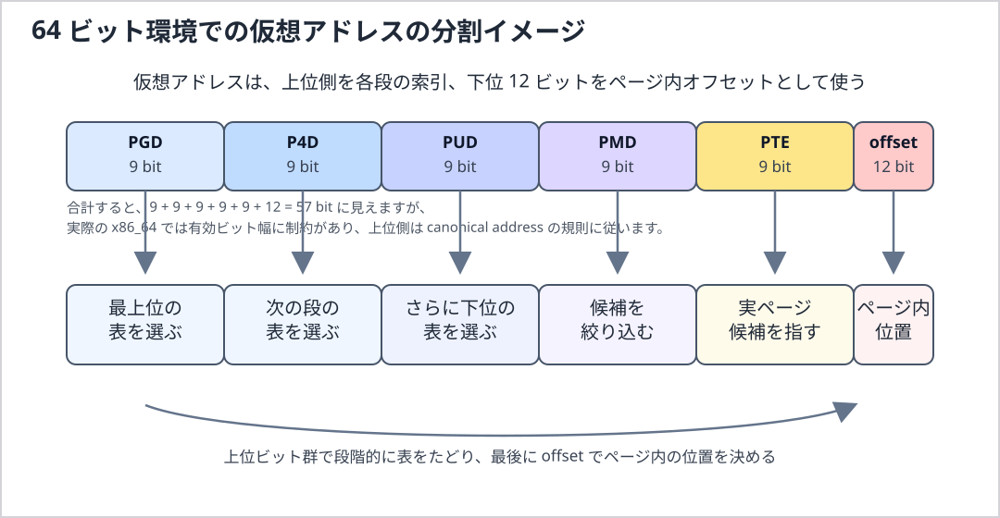

# LINUXカーネル6系の研究　２

この 2 章では、Linux カーネルを理解するうえで避けて通れないメモリアドレッシングの話に入っていきます。
1 章では、Linux 6.18 LTS を研究するときの全体像を先に整理しました。
ここからはもう少し踏み込んで、CPU が見ているアドレス、カーネルが扱っているアドレス、そして実際の 
RAM 上の位置が、どういう関係で結びついているのかを見ていきます。

古い Linux 2.6 系の本では、80x86 のセグメンテーションとページングをかなり丁寧に追いかけながら説明して
います。
この入口自体は今でもとても大事です。
ただし、Linux 6.18 LTS を研究する立場では、単に昔の x86 の仕組みを暗記するのではなく、
「Linux が実際にはどの抽象化を重視しているのか」「いま読むべき中心概念は何か」という視点で
整理した方が理解しやすいです。

特に重要なのは、プログラムが使うアドレス、CPU が変換途中で扱うアドレス、RAM 上の実アドレスを分けて
考えることです。
この区別が曖昧だと、ページテーブル、MMU、TLB、mmap()、カーネル空間、ユーザー空間といった後続の話題が
全部ぼやけます。
UmuOS の研究でも、最初は単純なアドレス空間から始めるにしても、最終的にはこの整理がかなり
効いてくると思います。

ここで、先に後続の重要語をかなり短く整理しておきます。

- ページテーブルは、仮想アドレスのどのページを、物理メモリ上のどのページフレームへ対応付けるかを
記録した表です。
Linux カーネルはこの表を用意し、CPU 側の変換機構がそれを見て実際のアクセス先を決めます。

- MMU は Memory Management Unit の略で、CPU がメモリアクセスするときに、仮想アドレスから物理アドレスへの
変換や、権限チェックを行うハードウェア機構です。
これは基本的に CPU に内蔵されているハードウェア回路と考えてよいです。
OS が毎回ソフトウェアだけで番地変換しているわけではなく、変換の本体は MMU が担います。

- TLB は Translation Lookaside Buffer の略で、最近使ったアドレス変換結果を覚えておく小さな高速キャッシュです。
ページテーブルを毎回最初からたどると遅いので、CPU はよく使う変換結果を TLB に残して高速化します。

- mmap() は、ファイルや匿名メモリをプロセスの仮想アドレス空間へ対応付けるための仕組みです。
これにより、read() や write() だけでなく、「メモリとして見せる」形でデータを扱えるようになります。
※この部分は、技術書なんかに詳しく記載あるので、今回はこのくらいにとどめます。

- カーネル空間は、Linux カーネル自身が使う仮想アドレス空間です。
ここにはカーネルコード、各種内部データ、デバイス制御用の領域などがあり、通常のユーザープログラムからは
自由に触れられません。

- ユーザー空間は、通常のアプリケーションが動く仮想アドレス空間です。
各プロセスは基本的に自分専用のユーザー空間を持ち、ほかのプロセスやカーネル内部へ勝手には触れられません。

この章では、これらを別々のこと、として覚えるのではなく、
「**ユーザー空間の仮想アドレスを、ページテーブルと MMU が物理メモリへ結び付け、その結果を TLB が高速化する**」
という 1 本の流れとして見ていきます。

## UmuOS との接続

UmuOS-0.1.7-base-stable は Linux 6.18.1 を QEMU/KVM 上で起動する環境です。
この章では、ゲスト Linux が扱う仮想アドレス・ゲスト物理アドレスと、ホスト側の物理メモリを別の層として考えます。

```text
ゲストのプロセス仮想アドレス
	|
	v
ゲスト Linux のページテーブル / ゲスト MMU
	|
	v
ゲスト物理アドレス
	|
	v
KVM の second-stage mapping（EPT/NPT）
	|
	v
ホスト側の backing memory
```

ゲスト内のページテーブルは、ゲスト仮想アドレスからゲスト物理アドレスへの対応を管理します。
仮想化環境では、その先のゲスト物理アドレスがホスト側の backing memory へ対応付けられます。
したがって、ゲストの物理アドレスをホストの物理アドレスと同一視しません。

#### UmuOS での観測入口

- `/proc/<pid>/maps`: プロセスの仮想アドレス領域を確認する。各領域の物理ページ配置は表示しない
- `/proc/meminfo`: ゲストから見えるメモリ利用状況の集計を確認する。個々のページテーブル対応は表示しない
- `dmesg`、`/proc/iomem`: ゲストが認識したメモリ範囲や予約領域を、利用可能な範囲で確認する
- QEMU のメモリ設定: ゲストに提供される RAM 容量を確認する。ホスト上の物理配置とは別の設定層

これらの観測値を Linux の仮想アドレス、ゲスト物理アドレス、ホスト側の memory mapping のどれに関する情報か分けて読みます。
特に `/proc/<pid>/maps` だけから、仮想ページがどの物理フレームに載っているかを判断することはできません。

## 今回扱う範囲

- 原文対応: 2.1「メモリアドレス」から 2.5.7.2「TLB の制御」まで
- 主な論点: 論理/リニア/物理アドレス、x86 セグメント機構、ページング、Linux の汎用ページテーブル、物理メモリ layout、TLB/cache 整合性
- Linux 6.18 LTS の視点: x86-32 の説明を入口にし、現在の x86-64 と Linux 共通の仮想記憶モデルを中心に読む
- UmuOS の視点: QEMU/KVM ゲスト内の仮想アドレス・ゲスト物理アドレスと、ホスト側 memory mapping の境界を分ける
- 現在の進捗: 原文の 2.1〜2.5.7.2 は一通り反映済み。内容の再確認と補強を小節単位で進行中（2.1、2.2.1〜2.2.4、2.3、2.4導入を再整備、次は2.4.1）

## 2章の研究観点

- x86 の論理アドレス、リニアアドレス、物理アドレスを区別し、現代 Linux で中心となる仮想アドレスとページングを見失わない
- CPU が提供するセグメント機能と、Linux が実際にメモリ管理で使うページテーブル機構を分けて考える
- 仮想ページ、物理ページフレーム、ページテーブル entry、TLB の役割を混同しない
- 32bit x86 の固定境界や RAM 容量別 mapping を、Linux 6.18 の一般仕様として扱わない
- ゲストの観測値、ゲスト物理アドレス、ホスト側物理メモリを別の層として照合する

## ２章　メモリアドレッシング

### 2.1 メモリアドレス

この節の中心は、**プログラムが指定する仮想アドレスと、メモリシステムが最終的に扱う物理アドレスは別の名前空間に属する**という点です。Cのポインタ値を見ただけでは、そのデータがRAMのどの場所に置かれているかは分かりません。Linuxはアドレス空間とページテーブルを管理し、CPUのアドレス変換機構が実際のアクセス時に対応関係を解釈します。

原文の図2-1は、x86のアドレスを論理アドレス→リニアアドレス→物理アドレスの順に示しています。Linux 6.18を読むときは、この段階を次のように区別します。

| 名称 | 意味 | 現代Linuxでの読み方 |
|---|---|---|
| 論理アドレス | x86のセグメントセレクタとオフセットで表される、命令側のアドレス形式 | 64-bit modeではセグメントの役割は限定的。通常のCS/DS/ES/SS baseは0として扱われ、FS/GS baseには用途がある |
| リニアアドレス | x86でセグメンテーション後、ページングに渡されるアドレス | x86上の仮想アドレスに相当する用語。Linux共通コードでは通常「仮想アドレス」と読む |
| 物理アドレス | ページングによる変換後にCPUのメモリシステムへ出されるアドレス | RAMだけでなくMMIO領域へ到達する場合もある。DMAデバイスが使うDMA addressと同じとは限らない |

Linux全体の中心はセグメント機構ではなくページングです。ページ単位の対応付けにより、プロセスごとの仮想アドレス空間、アクセス権、遅延割り当て、ファイルmapping、copy-on-writeなどを構成します。以後「仮想アドレス」と書く場合はLinuxの仮想記憶上のアドレスを指し、x86の変換段階を厳密に述べる場合に「リニアアドレス」を使います。

#### 論理アドレス

古典的なx86の論理アドレスは、セグメントセレクタとオフセットの組です。CPUはセグメントの情報を用いてリニアアドレスを得て、その後にページングを適用します。これはx86固有の用語であり、Linuxの全アーキテクチャに共通する段階ではありません。

x86-64の64-bit modeではセグメンテーションの多くがフラット化されていますが、FS/GS baseは依然として意味を持ちます。Linuxでは、ユーザー空間のthread-local storageやカーネルのper-CPUデータなどを読む際にFS/GSが現れます。したがって「セグメンテーションはLinuxでは完全に使われない」とは言わず、仮想記憶を作る主役ではない、と区別します。詳細は2.2・2.3で扱います。

#### リニアアドレス

リニアアドレスはx86でセグメンテーション後に得られるアドレスです。Linuxの仮想記憶を読む場面では仮想アドレスとほぼ同じ役割を指しますが、厳密には「リニアアドレス」はx86側の用語です。各プロセスの仮想アドレス空間には、コード、データ、heap、stack、共有library、file mappingなどの領域が置かれます。領域が存在することと、その全ページがすでに物理メモリへ割り当て済みであることは別です。

実行中のCポインタは、通常そのプロセスの仮想アドレスです。値が連続している配列でも、対応する物理ページフレームは連続とは限りません。また、同じ仮想アドレス値でも、異なるプロセスのページテーブルでは別の物理ページを指しえます。

Linuxの`/proc/<pid>/maps`はプロセスの仮想アドレス領域と権限などを示しますが、各仮想ページの物理配置を示すものではありません。ユーザーポインタをそのまま物理アドレスとして扱ったり、カーネルの`virt_to_phys()`を任意のユーザーポインタや`vmalloc`アドレスに適用したりしてはいけません。デバイス向けDMAではさらに別のDMA mapping APIを使い、CPUの物理アドレスとデバイスが使うDMA addressを区別します。

#### 物理アドレス

物理アドレスは、ページングによる変換後にCPUのメモリシステムへ渡されるアドレスです。メモリコントローラがRAMへ向ける場合もあれば、アドレスmapに従ってデバイスのMMIO領域へ向かう場合もあります。よって「物理アドレスはRAMチップの番地」とだけ覚えると、デバイス領域やDMAの説明で混乱します。

Linuxの物理メモリ管理では、ページフレームの確保、NUMA node、zone、物理連続性などを扱います。仮想アドレスと物理アドレスは異なる型・用途として追い、カーネルの仮想アドレスからCPU物理アドレスへの変換と、CPU物理アドレスからデバイス用DMA addressへのmappingを同一視しません。

次の図のように、プロセス側では連続して見える仮想ページが、物理メモリ側では飛び飛びの
ページフレームへ対応付けられることは普通にあります。


図 2-1 仮想アドレス空間と物理メモリの対応イメージ

物理アドレス空間には、利用可能RAMだけでなく予約領域やMMIOなどが含まれます。図の対応は概念例であり、特定のプロセスや実機の物理配置を表すものではありません。

#### 4 KiB ページでアドレス変換を数値で追う

x86-64、4 KiB page、通常の4-level pagingを仮定した概念例です。仮想アドレス`0x00007f12_3456789a`の下位12 bitはpage内offsetなので、`0x89a`です。仮想page numberは`0x00007f12_34567`となります。

仮に、その仮想pageに対応するpage-table entryが物理page frame number（PFN）`0x12345`を指すなら、変換は次のようになります。

```text
仮想アドレス: 0x00007f12_3456789a
仮想page:     0x00007f12_34567
page offset:  0x89a
対応PFN:      0x12345
物理アドレス: (0x12345 << 12) | 0x89a
              = 0x1234589a
```

この計算で変わるのはpage番号部分で、page内offsetは保たれます。PFNは説明用に置いた値で、Linuxがこの仮想アドレスに実際に割り当てる値ではありません。実際の対応はプロセス、時刻、memory pressure、mappingの種類などで変わります。また、巨大pageの場合はpage-table walkが途中の階層で終わり、offsetとして扱うbit数も大きくなります。

この例が示すのは、アドレス変換の考え方です。実際のx86-64で何段のpage tableを使うか、どの仮想アドレス範囲を利用できるかはCPU capabilityとkernel configurationなどに依存します。

#### MMU が行っていること

MMU（Memory Management Unit）はアドレス変換とアクセス権の検査を担います。通常、CPUはまずTLBを参照し、変換が見つからない場合にhardware page-table walkでページテーブルをたどります。したがって、CPUが毎回ソフトウェアへ変換を依頼するわけではありません。Linuxはページテーブルを設定し、mappingの作成・変更時には必要なTLB整合性処理も行います。

ページフォルトは「物理pageがない」ときだけ発生するわけではありません。対応するPTEが未設定の場合のほか、書き込み権限などの違反でも例外が起きます。カーネルはfault addressとアクセス種別をVMAなどの状態と照合し、遅延割り当て、file pageの読み込み、copy-on-writeなどで解決できればページテーブルを更新して命令を再実行させます。無効なアドレスや許可されないアクセスなら、プロセスへのsignalなどのエラー処理になります。


図 2-2 ページフォルト発生から再実行までの流れ

図は解決可能なfaultの一例です。すべてのpage faultがページ割り当てと再実行に至るわけではありません。

UmuOS のような自作 OS を考えるときも、この発想はかなり大事です。
最初は単純な 1 対 1 対応や固定マッピングから始めるとしても、
最終的にプロセス分離や安全なユーザー空間を実現したいなら、MMU とページングをどう使うかが
中心課題になります。

#### アドレス変換と並行実行

原文は、複数CPUやDMA controllerからのアクセスをmemory arbiterが調停するモデルを説明します。現代のシステムでもmemory controllerやinterconnectは要求を調整しますが、アクセスは単純に一つずつ直列処理されるわけではありません。複数の要求は並行して進みうるほか、cache coherence、memory ordering、DMA coherenceなど、それぞれ異なる仕組みが関わります。

ここで重要な区別は、**hardwareの調停・coherenceは、カーネル内の共有データに対する同期の代わりではない**ことです。複数CPUから同じデータを更新する競合は、適切なlockやatomic operationなどでカーネル側が解決します。一方、ページテーブル更新後のTLB整合性は、古い変換を使わせないためにLinuxがarchitecture-specificな仕組みを用いて維持します。DMAについても、deviceとCPU間の可視性・ownershipはDMA APIの契約に従います。

#### この節を Linux 6.18 LTS の研究へつなぐ

2.1では、アドレスの名前がどの段階を指すかを確認しました。具体的なコードを読むときは、仮想アドレス領域の存在、PTEによるpage frameへのmapping、物理メモリの管理、CPU TLB、device DMA mappingを別々の層として追います。

Linux 6.18 LTSのソースを読む入口:

- x86のpage-fault entryとuser address fault処理: `arch/x86/mm/fault.c`
- architecture共通のpage-fault処理とpage-table更新: `mm/memory.c`
- VMAおよび`mm_struct`の定義: `include/linux/mm_types.h`
- x86 page-table entryの形式: `arch/x86/include/asm/pgtable_types.h`
- TLB処理のx86実装: `arch/x86/mm/tlb.c`
- device向けmappingとDMA addressの契約: `Documentation/core-api/dma-api.rst`

この節で固定したいこと:

- Cポインタは通常仮想アドレスであり、物理アドレスやDMA addressと同じではない
- x86の論理→リニア→物理という段階と、Linux共通コードの仮想記憶の語彙を区別する
- 仮想pageと物理page frameはpage offsetで結ばれるが、物理配置は連続とは限らない
- page faultには解決可能な未mapping faultと、アクセス違反など解決できないfaultがある
- hardware memory arbitrationやcache coherenceは、カーネルデータのlock/atomicによる同期を代替しない

### 2.2 ハードウェアのセグメント機構

次に、古い x86 のメモリアドレッシングを理解するうえで必ず出てくるセグメント機構を見ていきます。
ここは、昔の Linux 解説書ではかなり重要な位置を占めていました。
実際、x86 という CPU 自体が、論理アドレスからリニアアドレスへ進む途中にセグメンテーションという
段階を持っているからです。

ただし、Linux 6.18 LTS を研究する立場では、この節の読み方に少し注意が必要です。

セグメント機構そのものは CPU の重要な機能ですが、現代 Linux がメモリ管理の主役として
積極的に使っているのは主にページングです。
そのため、この節は「現代 Linux が日常的に細かく使い倒している主役の仕組み」として読むよりも、
「x86 が本来どういう変換段階を持っていて、そのうち Linux は何を土台として残し、何を主役から外したのか」を
見分けるための節として読む方がよいです。

2.1 で見たように、**現代 Linux の読解では、各プロセスに見えている仮想アドレス空間と、それをページテーブルと**
**MMU でどう支えるかが本筋です。**
この節でセグメント機構を扱う意味は、その本筋へ入る前に、x86 には論理アドレスからリニアアドレスへ進む
前段があること、そして Linux はその前段を限定的に使っていることを確認するところにあります。

#### リアルモードとプロテクトモード

x86 系 CPU では、昔からリアルモードとプロテクトモードという動作の考え方があります。

リアルモードは、古い互換性を強く残した単純な実行形態で、主にブートのごく初期に関わります。
この段階では、まだ現代的な OS が前提にする保護や分離の仕組みは十分には使えません。
一方、プロテクトモードでは、特権レベル、保護機構、アドレス変換といった、OS を安全に動かすための土台を
利用できます。

Linux 6.18 LTS を研究するときに中心になるのは、ブート直後の古い実行形態そのものではありません。
重要なのは、Linux がその初期段階を抜けたあと、保護機構とアドレス変換が有効な環境を前提に動いている、
という点です。
つまり、この節で本当に押さえたいのは「モード名の暗記」ではなく、
Linux の資源管理や保護の議論は、特権レベルとページングが働く実行環境の上で成り立っている、
と理解することです。

#### 2.2.1 セグメントセレクタとセグメントレジスタ

古典的なx86の論理アドレスは、16-bitのセグメントセレクタとオフセットからなります。セレクタはベースアドレスそのものではなく、GDTまたはLDTのどのdescriptorを使うかを示す識別子です。原文の図2-2が示すビット配置は次のとおりです。

```text
 15                         3   2   1       0
+----------------------------+---+-----------+
|          Index             |TI |    RPL    |
+----------------------------+---+-----------+
```

- **Index (bits 15:3)**: GDTまたはLDT内のdescriptor番号
- **TI (bit 2)**: 0ならGDT、1ならLDTを選ぶ
- **RPL (bits 1:0)**: Requestor Privilege Level。セレクタを使う側が要求する特権レベルを表し、保護判定に参加する

セレクタ値の下位3 bitはTIとRPLで使うため、Indexはセレクタ値を3 bit右シフトして得ます。例えば説明用のセレクタ`0x2b`ならIndexは5、TIは0（GDT）、RPLは3です。この値はビットの読み方を示すだけで、Linuxが常にその番号へ同じdescriptorを置くという意味ではありません。実際に選択できるdescriptorとその意味は、OSが設定したテーブルによります。

CPUには`cs`、`ss`、`ds`、`es`、`fs`、`gs`のセグメントレジスタがあります。プログラムから見えるselector値だけでなく、selectorをロードした際にCPUが参照するdescriptor属性の一部も内部に保持されます。セレクタをロードする動作と、通常の汎用レジスタへ整数を代入することは同じではありません。

| レジスタ | 古典的な役割 | Linux 6.18 / x86-64で見る点 |
|---|---|---|
| CS | 命令実行用コードセグメント | selectorのRPLから現在のCPLを読み取る入口。Linuxは主にring 0とring 3を使う |
| SS | stack segment | stack操作に関係する。64-bit modeではbase/limitによる従来の領域分割は通常使わない |
| DS / ES | データ参照用 | 64-bit modeでは通常base/limitがアドレス形成に使われず、主役ではない |
| FS / GS | データ参照用 | 64-bit modeでもbaseが有効。ユーザーTLSのFS baseや、カーネルのper-CPU領域に使われるGS baseが重要 |

#### CPL・RPLと保護を混同しない

CSのselectorにあるRPLはCPLの判定に関係しますが、ユーザー空間とカーネル空間の保護全体をセレクタだけで説明することはできません。セグメントの特権属性に加え、ページテーブルのuser/supervisor権限や、特権遷移の入口・復帰規則も関わります。Linuxでは主にCPL 0（kernel）とCPL 3（user）を用いますが、「CSが違うだけで仮想アドレス空間の全mappingが切り替わる」と理解しないようにします。

#### FS/GS baseを追うときの入口

x86-64でTLSやper-CPU参照を調べる場合は、selectorのIndexだけでなくFS/GS baseがどこで設定され、context switch時にどう扱われるかを見ます。CPU capabilityによってFSGSBASE命令を使える場合もあります。Linuxの実際の設定・保存・復元はアーキテクチャ固有コードで確認し、一般的なCコードからFS/GS baseを直接操作する前提にはしません。

- selector定義: `arch/x86/include/asm/segment.h`
- descriptorとGDT操作: `arch/x86/include/asm/desc.h`
- GDT初期化とper-CPU segment setup: `arch/x86/kernel/cpu/common.c`
- FS/GS baseとthread contextの扱い: `arch/x86/kernel/process_64.c`

#### この小節で固定したいこと

- selectorはdescriptorを選ぶ値であり、ベースアドレスや物理アドレスそのものではない
- TIはGDT/LDTの選択、RPLは要求側特権レベルを示す。Index・TI・RPLのbit位置を原文図2-2と対応させる
- CPLは特権状態を読む手掛かりだが、Linuxの保護はページ権限や遷移規則も含む
- x86-64では通常のセグメントbase/limitの役割は限定される一方、FS/GS baseはTLS・per-CPU用途で現役
- Linux 6.18の実際のselector値やFS/GS運用は、x86実装を参照して確認する

#### 2.2.2 セグメントディスクリプタ

セグメントディスクリプタは、セレクタが選んだセグメントの属性をCPUへ与えるdescriptorです。原文の図2-3は、一般的なcode/data descriptorでbaseとlimitが複数のbit範囲に分割され、属性bitとともに格納されることを示しています。重要なのは図をそのまま暗記することではなく、CPUがbase・範囲・種別・権限をセットで検査する点です。

| フィールド | 役割 | 読み違えを避ける点 |
|---|---|---|
| Base | segmentの基準アドレス | 64-bit modeでは通常のCS/DS/ES/SSによるアドレス形成の中心ではない。FS/GS baseは例外的に有効 |
| Limit と G | 有効なsegment範囲。G=0はbyte単位、G=1は4 KiB単位 | G=1では有効limitは概ね`(limit_field << 12) | 0xfff`として解釈される |
| Type と S | code/dataの種別や属性、またはsystem descriptorの種別 | S=1は通常のcode/data、S=0はTSSやLDTなどのsystem descriptor |
| DPL と P | descriptor privilege levelとpresent状態 | Pはdescriptorの有効性を示すbitで、ページがRAMに常駐しているかを示すものではない |
| L と D/B | code descriptorの64-bit mode属性やoperand/address sizeに関係 | long modeの64-bit codeではL=1、D=0。データ用descriptorのD/Bの意味とは区別する |
| AVL | ソフトウェアが利用できるbit | CPUが一般用途の意味を決めるbitではない |

原文の表2-1はsegment limitを「終端のoffset」と説明しています。上限は含まれる値として扱われるため、limit値と「長さ」を厳密には同一視しないでください。また、P=0はsegment descriptorがpresentでない状態であり、Linuxのページフォルトやページ単位のswap状態を表すものではありません。

##### 64-bit modeでdescriptorを読む際の補足

x86-64のlong modeでは、通常のCS/DS/ES/SS descriptorのbaseとlimitによる従来の領域分割はほぼ使われません。CSのL bitなどの属性は実行モードや特権遷移の文脈で引き続き意味を持ち、FS/GS baseもアドレス形成に使われます。したがって、32-bit protected mode向けのdescriptor図をそのまま現代x86-64の全アドレス計算に当てはめないようにします。

サイズにも注意が必要です。Linux 6.18の`struct desc_struct`は通常の8-byte descriptorを表しますが、x86-64のTSSやLDTを指すsystem descriptorはbase addressの上位部分を含むため16-byte形式です。つまり「descriptorは常に8 byte」という説明は、古典的なcode/data descriptorについての説明として読む必要があります。

このdescriptorを操作するCコード例はここでは省きます。GDTの更新はCPU状態や実行CPUごとの初期化と結び付いており、単なる構造体代入を示す例では安全な更新手順を伝えられないためです。代わりにLinuxの定義・初期化コードを追います。

#### Linux 6.18 LTS のソースを追う入口

- descriptorのbit定義と通常descriptor構造: `arch/x86/include/asm/desc_defs.h`
- descriptorの作成・GDT操作・TSS設定: `arch/x86/include/asm/desc.h`
- kernel/user code/data descriptorの初期値: `arch/x86/kernel/cpu/common.c`
- selectorとGDT entry番号: `arch/x86/include/asm/segment.h`

#### この小節で固定したいこと

- descriptorはセレクタが選ぶ属性情報であり、base・limit・種別・権限などを持つ
- limitとGの解釈、P bitの意味をページの常駐状態と混同しない
- 64-bit modeでは通常segmentのbase/limitの役割は縮小するが、CS属性とFS/GS baseなどは残る
- 通常descriptorは8 byteでも、x86-64のTSS/LDT system descriptorは16 byte形式になりうる
- 現在のLinuxの実値・構造は`desc_defs.h`とGDT初期化コードで確認する

#### GDT と LDT

GDT（Global Descriptor Table）とLDT（Local Descriptor Table）はdescriptorを格納する表です。セレクタのTI bitが0ならGDT、1ならLDTを選びます。CPUのGDTRは現在のGDTのbaseとlimitを保持し、LDTRは現在のLDTを参照するselectorとdescriptor情報を保持します。LDT自身はGDT内のsystem descriptorによって登録されます。

名前に「Global」とありますが、Linux 6.18のx86-64ではGDTを単純に一つの全CPU共有表とみなせません。LinuxはGDTをCPUごとに持ち、CPUごとのTSSやper-CPU状態に対応するdescriptorを置きます。各CPUは自身のGDTをGDTRへロードして使います。一方、LDTは通常のプロセスすべてに必ず用意されるものではなく、必要な`mm`にだけ関連付けられる任意の仕組みです。

表の役割を現在のLinuxに引き付けると、次のように整理できます。

| 表 | CPUからの選択 | Linux 6.18での位置付け |
|---|---|---|
| GDT | selectorのTI=0。GDTRがbase/limitを保持 | x86ではCPUごとに構成され、kernel/user code・data、TSS、必要に応じてLDT descriptorなどを置く |
| LDT | selectorのTI=1。LDTR経由で現在のLDTを参照 | すべての`mm`に必須ではない。legacyなユーザー空間ABI等で必要な場合に設定される |

LinuxのLDTは「各プロセスに必ず固有の追加セグメントを持たせる標準機構」ではありません。実際には`mm_struct`のarchitecture-specific contextに保持され、タスクが別の`mm`へ切り替わる際に必要に応じて現在のLDTをロード・更新します。同じ`mm`を共有するタスクはそのLDT状態も共有します。ユーザー空間からの設定経路や対応範囲はアーキテクチャ・ABIに依存するため、LDTが使われていると一般化せず、対象環境の実装を確認します。

#### Linux 6.18 LTS のソースを追う入口

- CPUごとのGDT領域とGDT初期値: `arch/x86/include/asm/desc.h`、`arch/x86/kernel/cpu/common.c`
- GDTR/LDTRのロード、TSS descriptor、LDT descriptorの登録: `arch/x86/include/asm/desc.h`
- GDT selector番号とselector値: `arch/x86/include/asm/segment.h`
- LDTの`mm`単位の保持、切替、更新: `arch/x86/kernel/ldt.c`
- `modify_ldt` system callの入口とABI: `arch/x86/kernel/ldt.c`、`arch/x86/include/asm/ldt.h`

この小節ではGDT/LDTを直接書き換えるサンプルコードは置きません。descriptorの更新はCPUごとの状態、特権遷移、TSS、場合によっては他CPUへの反映と結び付いており、単独のテーブル操作例では安全な手順を示せないためです。構造体定義から初期化・ロード・context switchの経路へ進みます。

#### この小節で固定したいこと

- GDT/LDTはdescriptorの表であり、selectorのTI bitが参照先を選ぶ
- GDTRはGDTのbase/limitを持つ。LDTRはLDTを選択し、LDT descriptor自体はGDTに置かれる
- Linux 6.18 x86-64のGDTはCPUごとに構成され、「Global」を全CPUで一つと解釈しない
- LDTは各プロセスに必須ではなく、必要な`mm`で保持・切替される限定的な機能
- 実際のGDT/LDT管理はデータ構造だけでなくロード命令・CPU切替経路と一緒に追う

#### 2.2.3 セグメントディスクリプタへの高速アクセス

##### セレクタをロードするとdescriptor情報がCPU内部に取り込まれる

CPUが`CS`、`DS`、`ES`、`SS`、`FS`、`GS`のsegment registerへselectorをロードすると、selectorの値だけでなく、参照先descriptorの属性もCPU内部の非プログラマブルな状態へ取り込まれます。原文の図2-4は、プログラムから見えるselectorと、CPU内部に保持されるdescriptor情報を分けて示しています。

そのため通常のメモリアクセスごとにGDT/LDTを読み直す必要はありません。CPUはロード済みのsegment状態を使い、segment baseや権限など、該当modeで必要な情報を参照します。descriptor tableをメモリ上で書き換えただけでは、すでにsegment registerにロードされた内部状態が自動的に更新されるとは限りません。変更を反映するには、architectureの規則に従った再ロードなどが必要です。

一般的な8-byte code/data descriptorで、selectorのIndexが2なら、テーブル内のentry位置は`2 * 8 = 16` byteです。選択先のdescriptor addressは、概念上「選択した表のbase + 16」となります。TIが0ならGDTRが指すGDT、TIが1ならLDTRが指すLDTのbaseを使います。この計算は通常の8-byte entryの例です。x86-64のTSS/LDT system descriptorは16-byteを占有することがあるため、表全体のentry配置を考える際は別途サイズを確認します。

##### descriptor cacheとTLBは別の仕組み

両者は「変換に必要な情報をCPU内部に保持する」という点では似ていますが、同じcacheではありません。

| CPU内部の状態 | 保持するもの | 主に関係する変換 |
|---|---|---|
| segment registerに付随するdescriptor state | selectorに対応するbase、limit、属性など | x86の論理addressからlinear addressへのsegment処理 |
| TLB | 仮想pageから物理page frameへの変換と関連する権限情報 | pagingによるlinear/virtual addressからphysical addressへの変換 |

したがって、descriptorをロードし直す話と、ページテーブル更新に伴うTLB invalidationを混同してはいけません。TLBについては2.4.8と2.5.7.2で改めて扱います。

##### Linux 6.18を読むときの位置付け

x86-64では通常のCS/DS/ES/SS base/limitによる領域分割が限定的なため、この内部descriptor stateを毎回のメモリアドレス変換の主役と考える必要はありません。一方、selectorやFS/GS baseの変更、LDTの切替・更新、特権遷移の経路を読むときには、このCPU内部状態が重要になります。LinuxのLDT更新経路では、関連する`mm`を実行中のCPUへの反映やsegment registerの更新も考慮されるため、メモリ上のdescriptor tableだけ見て切替の完了を判断しません。

Linux 6.18 LTSのソースを追う入口:

- segment selectorのロード命令を包むhelper: `arch/x86/include/asm/segment.h`
- GDTR/LDTRのロードとdescriptor table操作: `arch/x86/include/asm/desc.h`
- FS/GSなどのsegment stateの切替: `arch/x86/kernel/process_64.c`
- LDTのCPUへのロード・更新と反映: `arch/x86/kernel/ldt.c`

この小節では、segment registerを直接操作するサンプルコードは置きません。特権状態や実行CPU、既存のdescriptor、context switch時の反映に依存するため、数行の命令例だけでは安全な操作条件を表せないからです。原文の図2-4が示す「selectorのロード時に対応するdescriptor情報もCPU側へ取り込まれ、以後のアクセスで利用される」という関係を、Linuxのload/switch経路で確かめます。

この小節で固定したいこと:

- selectorをsegment registerへロードすると、descriptor情報もCPU内部状態へ取り込まれる
- 通常の8-byte descriptorのentry位置はIndexに8を掛けて求める。GDTかLDTかはTIで選ぶ
- descriptor tableを書き換えただけで、すでにロード済みの内部descriptor stateまで更新されたと仮定しない
- descriptor stateはsegment処理用、TLBはpage mapping用であり、invalidatingの対象も目的も異なる
- Linux 6.18ではLDTやFS/GSの切替・更新経路まで追い、テーブルのメモリ内容だけでCPU状態を判断しない

#### 2.2.4 セグメンテーション回路

##### 古典的なセグメント変換の手順

原文の図2-5は、selectorとoffsetからlinear addressを得る処理を示しています。概念上、selectorをsegment registerへロードするときにdescriptorが選ばれ、その後のアドレス形成ではCPU内部に保持されたdescriptor stateが使われます。

```text
selector (Index, TI) ── selectorのロード時 ──> GDTまたはLDTのdescriptor
                                                    │
                                                    v
                                       CPU内部のdescriptor state
                                                    │
logical address = selector:offset                  │
                  │                                 │
                  └──────── offset + segment base ──┘
                                  │
                                  v
                           linear address
                                  │
                               paging
                                  v
                          physical address
```

古典的なprotected modeでdescriptorを選ぶ流れは、次のように読めます。

1. selectorのTI bitでGDTかLDTかを選ぶ。GDTのbaseはGDTRから、現在のLDTのbaseはLDTRが選択するLDT descriptorから得る。
2. selectorのIndexにdescriptorの大きさを掛け、選択した表のbaseに加えてentry位置を求める。通常のcode/data descriptorなら8 byte単位である。
3. selectorをロードする命令に対してCPUがdescriptorの存在・種類・権限などを検査し、必要な情報をsegment registerに付随する内部状態へ取り込む。
4. アドレス形成では、該当するsegment baseとoffsetからlinear addressを作る。従来の保護モードではsegmentのlimitやアクセス種別なども保護判定に関係する。
5. pagingが有効ならlinear addressを入力としてページ変換・アクセス権確認を行い、physical addressへ進む。

手順1〜3を毎回のメモリアクセスでやり直すわけではありません。descriptor選択とロード時の検査はselectorをsegment registerへロードするときの処理であり、通常のアドレス形成では2.2.3で見たCPU内部状態が使われます。また、segmentの保護検査とpagingの保護検査は別段階です。一方を通過しても、もう一方の権限確認が不要になるわけではありません。

##### Linux 6.18のx86-64ではどこが異なるか

上の手順は、segment baseやlimitがアドレス空間の分割に使われる古典的なモデルです。Linux 6.18のx86-64が通常動作する64-bit modeでは、CS/DS/ES/SSのbaseは通常のアドレス形成に使われず、これらのsegment limitによる従来型の範囲制限も適用されません。FS/GS baseは例外で、対応する参照ではlinear addressの形成に使われます。したがって、selector:offsetを見ただけで全segmentについて「descriptor base + offset」と計算するのは誤りです。

64-bit modeでもsegment registerとdescriptorは不要になるわけではありません。特権レベルの遷移やsegment selectorのロードに関する規則は残り、FS/GS baseはTLSやper-CPU accessなどに関わります。ただし、一般的なプロセス仮想アドレスの中心的なmappingと保護はpagingが担います。x86-64ではlinear addressの形式がcanonicalであることも必要で、pagingによる変換・権限確認と合わせて実際のアクセス可否が決まります。

例えばFS-relative accessは、概念的には「FS base + 命令が指定するoffset」からlinear addressを作り、そのaddressをpagingへ渡します。これはselectorのIndexで指したsegmentが任意の領域を切り出す古典モデルとは異なる使い方です。Linuxが設定するFS/GS baseや、実際にどの経路で保存・復元するかは、汎用的な足し算の例だけで決めつけず、x86の実装を追います。

Linux 6.18 LTSのソースを追う入口:

- selector定義とsegment関連helper: `arch/x86/include/asm/segment.h`
- descriptor構造・GDT/LDTR操作: `arch/x86/include/asm/desc.h`
- FS/GS baseとthread contextの切替: `arch/x86/kernel/process_64.c`
- LDTの保持・ロード・更新: `arch/x86/kernel/ldt.c`

この小節では、segment registerを直接操作するC/assembly例は置きません。selectorのロードにはCPU mode、権限、descriptorの妥当性が関係し、64-bit modeではregisterごとにbase/limitの扱いも異なります。代わりに、古典的な変換の段階と64-bit modeで実際に使われる部分を分けて、Linuxの設定・切替経路を読むことを優先します。

この小節で固定したいこと:

- 古典的なモデルでは、selectorがGDT/LDTのdescriptorを選び、segment baseとoffsetからlinear addressを作る
- descriptorの選択・検査・内部状態へのロードと、通常のアドレス形成を区別する
- 64-bit modeではCS/DS/ES/SSのbase/limitを古典モデルのように適用しない。FS/GS baseは用途が残る
- segment段階の保護とpaging段階のmapping・権限確認は別の仕組み
- Linux 6.18の通常の仮想記憶の中心はpagingであり、x86固有のsegmentの例外的な用途は実装と合わせて読む

#### この節を Linux 6.18 LTS の研究へつなぐ

2.2 は、古い x86 の機能説明として読むと、かなり細かい話が続きます。
けれど Linux 6.18 LTS の研究として重要なのは、x86 が持つセグメント管理機能の全貌を
覚えることではありません。
むしろ、Linux がその豊富な機能をあえて限定的に使い、より移植しやすく整理しやすい形へ
寄せていることを理解する方が大事です。

要するに、この節で持つべき見方はこうです。
x86 には、論理アドレスからリニアアドレスへ変換する仕組み、権限を段階的に管理する仕組み、
セグメント属性を持つ仕組みがある。
しかし Linux 6.18 LTS は、その仕組みを主役にはせず、フラットに近い空間とページング中心の設計を
選んでいる。
この「使える機能」と「実際に採用している設計」を分けて見られるようになると、Linux のメモリ管理は
かなり読みやすくなります。

次に読むべき入口としては、x86 に限定するなら arch/x86/include/asm/ 配下で特権や例外や
メモリ関連の定義を見つつ、より本筋としては 2.3 以降の「Linux がセグメント機構を
どう割り切って使っているか」へ進むのが自然です。

### 2.3 Linux のセグメント機構

Linux 6.18を読むときは、x86が持つ機能とLinuxが仮想記憶の中心に据える機構を分けます。セグメント機構はselector、特権遷移、TSS、FS/GS base、互換用途のLDTなどで現在も使われますが、プロセスの仮想アドレス空間を作り、物理pageへのmappingや大部分のアクセス権を管理する中心はpagingです。

原文はLinux 2.6時代のx86実装を説明しています。特にGDTの固定的なentry配置や標準LDT、BIOS用descriptorなどは、その時代の実装事情を反映しています。現行カーネルの仕様として引き継がず、6.18のコードで現存する用途を確認します。

#### なぜ Linux はセグメント機構を主役にしないのか

セグメントだけでプロセスごとに異なる領域を作る設計では、selectorやsegment base/limitの状態がアドレスの意味に深く入り込みます。Linuxは、共通の仮想記憶の抽象化の上に各アーキテクチャのpaging機構を実装し、page tableを通じてmappingや権限を管理します。x86固有のセグメントをOS全体の仮想記憶モデルにしないことで、他のアーキテクチャとも概念やmmの仕組みを共有できます。

ただし「ページング中心」は、各プロセスが同じ仮想address spaceを持つという意味ではありません。各`mm`は独自のmappingを持ち、同じ仮想addressが異なる物理pageへ対応することがあります。セグメントのbaseを0に近づけるフラットな構成は、segment段階の変換を単純化する説明であり、プロセス間の仮想memoryを共有する説明ではありません。

#### フラットに近いアドレス空間という考え方

「フラットに近い」とは、通常のコードやデータ参照でsegment baseによる複雑な再配置を前提にしない、という意味です。古典的なprotected modeの説明では、主要なsegment baseを0にするためoffsetとlinear addressが一致します。x86-64の64-bit modeではさらにCS/DS/ES/SSのbase/limitの役割が限定されますが、FS/GS baseは引き続き用途があります（2.2.4参照）。

この性質から、コードやデータの仮想addressをsegmentごとに再解釈せずに扱い、後段のpagingでプロセスごとのmappingを実現できます。CPUにsegment機構が残っていることと、Linuxがそれを仮想記憶の主役にすることは別の話です。

#### ユーザー空間とカーネル空間の区別

原文のユーザー/カーネルcode/data segmentという区分は、selectorと特権レベルの対応を理解するために有用です。ただし、現代のユーザー空間とカーネル空間の保護を「4種類のsegmentが別々のメモリを作る」と捉えてはいけません。x86-64ではpage tableのuser/supervisor権限や現在のCPL、entry/return規則が保護に関わり、カーネルmappingの見え方はKPTIの有効性など構成にも左右されます。フラットなsegment構成は、ユーザーとカーネルが同じ権限で互いのmemoryへアクセスできるという意味ではありません。

#### CPL と実行レベルの切り替え

現在の特権レベル（CPL）はx86の実行状態の一部で、Linuxは通常CPL 3のユーザーモードとCPL 0のカーネルモードを使います。CPLは保護判定の一要素ですが、単独で全アクセス可否が決まるわけではありません。ページ権限、descriptor属性、命令ごとの特権条件、entry/returnの規則も関わります。

したがって、syscallや例外の読解では、どの入口で特権状態が変わり、どのstackやpage tableが使われ、どう復帰するかを合わせて追います。「CPLが変わる」ことと「仮想address spaceのmappingが変わる」ことも同義ではありません。

#### 2.3.1 Linux の GDT

GDTはCPUが参照するdescriptor tableです。Linux 6.18のx86ではCPUごとにGDTが用意され、entryにはselectorのコードsegmentやdata segment、TSS descriptor、必要に応じてLDTやTLS関連の状態などが配置されます。個々のentryや配置は32/64-bit対応、CPU機能、設定によって異なるため、原文の2.6時代のentry番号・総数を現行の固定仕様として暗記しません。

| GDTに関係するもの | Linux 6.18での読みどころ |
|---|---|
| kernel/user code selector | 特権レベルやsyscall/returnのselector規則と対応する。x86-64ではcompatibility mode用selectorも関係する |
| TSS descriptor | CPUごとのTSSを指す。Linuxでは特権遷移時のstackやIST、I/O permission bitmapなどに関わる。古典的なhardware task switchを通常のtask切替に使う意味ではない |
| TLS descriptor / FS・GS base | 32-bit互換ABIではGDT TLS entryが関係する。64-bit user TLSでは主にFS baseを扱うなど、modeとABIを区別する |
| LDT descriptor | `mm`にLDTが設定された場合に使用する。すべてのプロセスに常設されるものではない |

GDTがCPUごとにある理由は、TSSなどCPU固有の実行状態を参照するためです。一方、GDTのすべてのentryがCPUごとに意味の異なる値とは限りません。初期化・CPUごとの複製・実行中の更新を追うには、定義だけでなくセットアップ経路を見る必要があります。

Linux 6.18 LTSのソース入口:

- selector定義と32/64-bit別GDT layout: `arch/x86/include/asm/segment.h`
- descriptorの作成・TSS/LDT登録・GDTロード: `arch/x86/include/asm/desc.h`
- GDTとTSSのCPU初期化: `arch/x86/kernel/cpu/common.c`
- TSSやstack stateの定義・利用: `arch/x86/include/asm/processor.h`、`arch/x86/kernel/`

#### 2.3.2 Linux の LDT

LDTはGDTとは別にselectorから参照できるdescriptor tableですが、Linux 6.18で全プロセスが常用するものではありません。x86の`modify_ldt` ABIを必要とするlegacy softwareや互換実行が主な入口です。原文にあるdefault LDTやiBCS/Solaris向けcall gateなどの説明は、Linux 2.6時代の実装記述として読み、現行の標準的なLinux実行モデルへそのまま一般化しません。

LDTは`mm`単位の状態として管理され、タスクが別の`mm`へ移る場合には必要に応じてCPUへロードされます。LDTが変更されると、その`mm`を実行中のCPUへの反映や、ロード済みのDS/ES descriptor stateの更新も必要です。これは2.2.3で見た「表のメモリを書き換えればCPU内部状態も自動で更新されるわけではない」という注意の具体例です。

確認するコードの入口は`arch/x86/kernel/ldt.c`です。`switch_ldt()`と`load_mm_ldt()`で切替を、更新経路で有効なCPUへの反映を追います。PTIが有効な場合にはLDTのmappingにも特別な処理があるため、単にLDT descriptorのbaseを設定するだけの仕組みと考えないようにします。

#### この節を Linux 6.18 LTS の研究へつなぐ

2.3の要点は、Linux 6.18がx86のセグメント機構を完全に捨てたのではなく、CPUの実行・特権・TSSや限定的なABI用途に使い、一般的な仮想memory mappingの中心はpagingに置いていることです。フラットなsegment構成、プロセスごとのpage table、ユーザー/カーネルの保護は、それぞれ別の層として読みます。

次の2.4では、linear addressをpagingで変換する手順と、そのhardware保護を扱います。Linux共通のmemory管理との対応は、後続の2.5で`mm/`や`include/linux/pgtable.h`の抽象化へつなげます。

この節のソース読解の入口:

- GDT layoutとselector: `arch/x86/include/asm/segment.h`
- GDT/TSS/LDT descriptor操作: `arch/x86/include/asm/desc.h`
- CPUごとのGDT/TSS初期化: `arch/x86/kernel/cpu/common.c`
- LDTの`mm`単位の管理とCPU反映: `arch/x86/kernel/ldt.c`
- 仮想memory管理との対照: `mm/`、`include/linux/pgtable.h`

この節で固定したいこと:

- フラットなsegment構成は、全プロセスが同じpage tableや同じmappingを持つという意味ではない
- ユーザー/カーネル保護はCPLだけではなく、paging権限やentry/return規則も含めて考える
- GDTはx86の低レベル制御基盤で、Linux 6.18ではCPUごとに構成される。entry番号や構成はmode/config依存
- x86-64のTLSはFS/GS baseとの関係を、32-bit TLS descriptorと区別して読む
- LDTは任意の`mm`で使われる限定的な機能であり、更新時にはCPUにロード済みの状態も考慮する
- 仮想address spaceと物理pageのmappingを構成する主役はpagingである

### 2.4 ハードウェアのページング機構

ページングでは、CPUのMMUが仮想address（x86の用語ではlinear address）をpage tableに従って物理addressへ変換し、各階層の権限も検査します。Linuxはpage tableを構成・更新し、どの仮想範囲に何を対応付けるかを管理します。MMUが行うhardware page walkと、カーネルがmappingを決める処理は役割が異なります。

page table entryが有効な物理pageを指していない場合でも、それだけでアクセスが常に失敗するとは限りません。アクセス時にpage faultが起き、Linuxが匿名pageの割り当て、file-backed pageの用意、copy-on-writeなどで解決できれば、命令を再実行できます。無効な範囲や許可されないアクセスなら、faultを解決できずエラーになります（2.1参照）。ページングはmappingと保護の仕組みであり、必要なRAMを必ず事前に割り当てる方式ではありません。

この後の小節は、page sizeと多段page table、巨大page、protection、具体的な変換例、PAEおよび64-bit paging、hardware cache、TLBへ進みます。原文の32-bit x86の2段構造は基本原理を掴む入口として使い、Linux 6.18のx86-64では構成や段数がCPU機能・kernel configurationで変わる点を区別します。さらにLinux共通のpage-table abstractionとの対応は2.5で整理します。

読むときは、次の3つを分けます。

- **hardware translation**: MMUがpage tableをwalkし、mappingと権限を確認する
- **kernel memory management**: Linuxが仮想memory領域、物理page、page tableの作成・更新・解放を管理する
- **translation acceleration**: TLBが最近のaddress translationを保持し、page table walkを省ける場合がある

したがって、page faultを「RAMにpageがない場合だけの例外」と考えたり、TLBをpage tableそのものと考えたりしないことが、この節を通しての要点です。

#### 2.4.1 通常のページング

#### ページとページフレーム

まず区別しなければいけないのは、ページとページフレームです。
**ページは仮想アドレス空間を一定サイズで区切った単位**であり、**ページフレームは物理メモリ側を同じサイズで区切った単位です。**
この 2 つを混同すると、仮想記憶の話がかなり分かりにくくなります。

プロセスが使っているのは仮想空間側のページです。
一方、RAM 上で実際に確保されるのは物理側のページフレームです。
Linux カーネルの仕事は、ある仮想ページをどの物理ページフレームへ対応付けるか、あるいはまだ何にも対応付けないかを
管理することです。
つまり、仮想ページは見せ方の単位、ページフレームは実体の単位です。

図にすると、関係は次のように見られます。


図 2-5 仮想ページと物理ページフレームの対応イメージ

**Linux 6.18 LTS の研究では、この区別は最重要級です。**
あとでページキャッシュ、匿名メモリ、copy-on-write、swap、NUMA、huge page を読むとき、
常に「いま話しているのは仮想ページなのか、物理ページフレームなのか」を見失わないことが大事になります。

#### ページテーブルという対応表

仮想ページと物理ページフレームの対応関係を持つのがページテーブルです。
CPU は仮想アドレスそのものでは RAM に届けません。
そのため、いま参照しようとしている仮想アドレスが、どの物理ページフレームの、どのオフセットに対応するのかを
調べる必要があります。
**この対応表を OS が用意し、MMU が実際の変換に使います。**

元の本文では、32 ビット x86 の通常ページングとして、ページディレクトリとページテーブルの 2 段階構造が説明されています。
これは「大きな仮想空間全部に対して、最初から巨大な 1 枚表を持つのは非効率なので、必要なところだけ下位表を作る」
という考え方です。
この考え方自体は今でも変わりません。
多段ページテーブルの本質は、広い仮想空間を細かく分割し、必要な部分にだけ変換表を実体化して RAM を節約することです。

Linux 6.18 LTS では 64 ビット環境が主流ですが、考え方は同じです。
段数が増えても、やっていることは「アドレスのビット列を何段かの索引に分けて、順番にたどって最後に
物理ページフレームへ到達する」ということです。

図にすると、64 ビット環境の多段ページテーブルは次のようなイメージです。


図 2-6 64 ビット環境での多段ページテーブルのたどり方

だから 32 ビット時代の 2 段ページングは、いまでも多段ページングを理解する良い入口になります。

#### 2.4.2 拡張ページングと巨大ページ

元の本文では、拡張ページングとして 4MB ページの話が出てきます。
現代 Linux の文脈では、これを「巨大ページを使う発想の入口」として理解するとよいです。
ページを大きくすれば、広い仮想空間をより少ないエントリで表現でき、TLB ミスも減らしやすくなります。

ただし、ここで出てくる **4MB ページは、主に 32 ビット x86 の文脈で現れる歴史的な代表例** です。
現代の x86_64 Linux で巨大ページとしてよく意識されるのは、むしろ 2MB ページや 1GB ページです。
たとえば Transparent Huge Pages では 2MB ページが前面に出ることが多く、
hugetlb でも環境によって 2MB や 1GB の巨大ページを扱います。
つまり、「巨大ページ」という考え方自体は今も重要ですが、
**現代カーネルで日常的にまず思い浮かべる巨大ページが 4MB とは限りません。**

Intel/x86_64 の感覚で短く並べると、通常ページは 4KB、よく出てくる巨大ページは 2MB、
さらに大きい巨大ページは 1GB です。
研究ノートとしては、まず 4KB を基本形として押さえ、そのあと 2MB や 1GB が性能目的で使われると捉えると整理しやすいです。

ここで注意したいのは、**Linux 6.18 LTS だから常に基本ページサイズが 4KB だ、というわけではない**ことです。
Intel を含む x86 や x86_64 では 4KB ページが標準的なので説明の入口として使いやすいのですが、
Linux カーネル全体で見ると、基本ページサイズはアーキテクチャや設定によって異なります。
たとえば arm64 では 4KB だけでなく 16KB や 64KB の構成もあります。
つまり、4KB は「現代 Linux 全体の絶対ルール」というより、特に x86 系でいちばんよく出てくる代表例です。

ただし、ページを大きくすれば良いことばかりではありません。
細かな保護や割り当て粒度が粗くなり、内部断片化も増えやすくなります。
そのため、通常ページと巨大ページは用途によって使い分けられます。
Linux 6.18 LTS でも、transparent huge pages や hugetlb のように、大きなページを活用する仕組みがありますが、
それらは「とにかく大きくする」のではなく、性能と柔軟性のトレードオフの中で使われています。

ここでのポイントは、ページサイズが変換コスト、管理コスト、性能特性に直結する設計要素だということです。

#### 2.4.3 ハードウェア保護機構

ページングは、単に番地を変換するだけの仕組みではありません。
ページテーブルの各エントリには、存在しているか、書き込み可能か、ユーザーから触れてよいか、といった保護情報も
入っています。
つまり**ページテーブルは、変換表であると同時に保護表でもあります。**

この点が Linux にとってとても重要です。
ユーザー空間のプロセスがカーネルメモリを勝手に書き換えられないのは、
単に「そういう約束だから」ではなく、ページング機構がそのアクセスを禁止するからです。
書き込み禁止ページ、未割り当てページ、カーネル専用ページへ触れたときに例外が起きるのも、そのためです。

Linux 6.18 LTS を読むと、ページフォルトはエラーというより制御の入口としても使われます。
まだ実メモリを貼っていないページへ初回アクセスしたとき、copy-on-write で複製が必要になったとき、
ファイルマッピングのページを読み込む必要があるときなど、ページフォルトはカーネルが状態を進める契機になります。
その意味で、ページングと例外処理は密接に結びついています。

#### 2.4.4 通常ページングの例

元の本文がまず説明しているのは、4KB ページを使う通常の 32 ビットページングです。
ここではリニアアドレスをいくつかのフィールドに分け、上位側をページディレクトリやページテーブルの索引として使い、
下位 12 ビットをページ内オフセットとして使います。

64 ビット環境の感覚で描くと、アドレスの切り分けは次のようなイメージです。



図 2-7 64 ビット環境での仮想アドレスの分割イメージ

この方式のポイントは、4KB という固定単位で仮想空間を扱うことにあります。
4KB は細かすぎず粗すぎず、保護や遅延割り当てや共有を行う単位として実用的です。
Linux の多くの基本操作も、このページ単位を前提に組み立てられています。

ここで 64 ビット環境の話を無理に混ぜなくてもよいのは、この節の狙いが「ページングとは何を分割し、何を対応付ける仕組みなのか」
をいちばん単純な形で掴むことにあるからです。
32 ビット x86 の通常ページングは、ページディレクトリ、ページテーブル、オフセットという役割分担が見えやすく、
多段ページテーブルの基本形としてとても追いやすいです。
そのうえで、64 ビット環境ではこの考え方がより多段に拡張されるだけだ、と読めば流れが崩れません。

また、**各プロセスは自分専用のページテーブル群を持ちます。**
このため、同じ仮想アドレス値であっても、プロセス A とプロセス B で別の物理ページフレームを指すことができます。
これがプロセス分離の基本です。
各プロセスは自分だけの連続したメモリ世界を持っているように見えますが、実際にはカーネルが個別の対応表を
持たせているわけです。

#### 2.4.5 物理アドレス拡張（PAE）ページング

元の本文は次に PAE を説明しています。
PAE は Physical Address Extension の略です。
これは 32 ビット時代に、**仮想アドレス幅はほぼそのままに、物理アドレス側だけを広げる** ための仕組みです。
つまり PAE の要点は、「プロセスから見える空間を大きくする」のではなく、
「OS が裏側で結び付けられる物理ページフレームの候補を増やす」ところにあります。

ただし、Linux 6.18 LTS を今から学ぶ立場では、PAE 自体を細かく追う優先度は高くありません。
ここで本当に理解したいのは、**仮想アドレス幅と物理アドレス幅は必ずしも同じではない** という見方です。
この見方は、そのまま 64 ビット環境の読解につながります。

x86_64 でも、理論上の 64 ビット全部をそのまま使うわけではありません。
実際に CPU が有効として扱う仮想アドレス幅や物理アドレス幅には制約があり、その制約に合わせてページテーブルの段数や
エントリの持ち方が決まります。
つまり現代 Linux の研究で重要なのは、PAE の歴史的細部そのものよりも、
**アドレス空間は「型名のビット数」で機械的に決まるのではなく、CPU と OS の設計で運用される構造だ**
と理解することです。

#### 2.4.6 64 ビットアーキテクチャにおけるページング

現代の Linux 6.18 LTS を実際に読むなら、こちらの方が本筋です。
x86_64 では、32 ビット時代の単純な 2 段階では足りず、より多段のページテーブルを使います。
仮想アドレス空間が大きくなったぶん、それを現実的な RAM 消費で管理するために段数を増やしているわけです。

ここで重要なのは、段数が増えても本質は変わらないことです。
仮想アドレスをいくつかの索引とオフセットに分け、上位から順にテーブルをたどり、最後に実ページへ到達する。
この枠組みは同じです。
そのため、32 ビットの 2 段ページングを理解しておくことは、64 ビットの 4 段や 5 段ページングを理解するための土台に
なります。

Linux 6.18 LTS の実コードでは、アーキテクチャ差を吸収するために、できるだけ汎用的なページテーブル階層の見方を
採っています。
したがって研究ノートとしては、「x86_64 は何段か」という暗記よりも、
Linux が多段ページテーブルという一般モデルの上で各アーキテクチャをどう吸収しているかを見る方が価値があります。

#### 2.4.7 ハードウェアキャッシュ

ページングの話は、変換表だけで終わりません。
もし CPU が毎回 RAM 上のページテーブルを深くたどっていたら、速度が出ません。
そのため CPU は、キャッシュや TLB を使って、データアクセスやアドレス変換を高速化しています。

まずキャッシュは、RAM より速い内部記憶を使って、よく使うデータや命令へのアクセスを速くする仕組みです。
Linux カーネルの設計でも、キャッシュライン、局所性、偽共有、アラインメントなどが性能に大きく効きます。
マルチコア環境ではキャッシュコヒーレンシも重要で、単にメモリへ書いたから終わり、とはなりません。

図にすると、CPU 内部のキャッシュと外側の DRAM の関係は次のようなイメージです。


図 2-10 プロセッサのハードウェアキャッシュ

#### 2.4.8 アドレス変換バッファ（TLB）

TLB は、ページテーブルの探索結果そのものを覚えておくキャッシュです。
これがあるおかげで、同じ仮想アドレス範囲への繰り返しアクセスで毎回多段テーブルを引き直さずに済みます。
しかし逆に、ページテーブルを書き換えたときには TLB の整合性を取らなければなりません。
ここで出てくるのが TLB flush や shootdown の話です。

Linux 6.18 LTS では、この TLB 管理がかなり重要です。
ページテーブルを変えたのに古い変換が CPU 内部へ残っていると、正しい保護も正しい対応付けも成り立たないからです。
つまり仮想記憶の実装は、「正しいページテーブルを作ること」で終わらず、CPU 内部キャッシュまで含めて整合性を
保つところまでが仕事になります。

#### この節を Linux 6.18 LTS の研究へつなぐ

2.4 のいちばん大きな意味は、ページングが Linux の仮想記憶の主役であることをはっきり掴む点にあります。
ページ、ページフレーム、ページテーブル、保護ビット、ページフォルト、巨大ページ、TLB とキャッシュ。
これらは別々の話ではなく、ひとつの大きな仕組みの各部品です。

この節の要点を短く言えば、**Linux は仮想アドレス空間をページ単位で管理し、ページテーブルによって物理メモリと結び付け、**
**ハードウェア保護と例外機構を使って安全性を守り、TLB とキャッシュで性能を稼いでいる**、ということです。
この見方が入ると、次の Linux のページング機構の節で、なぜカーネルが汎用的な多段ページモデルを持つのかがかなり
理解しやすくなります。

次に読むべき入口としては、概念面では mm/ のページフォルト、仮想メモリ領域、ページアロケータへ進むのが本筋です。
アーキテクチャ実装側では、x86_64 を前提にするなら arch/x86/mm/ や arch/x86/include/asm/pgtable 系を意識すると、
この節の説明が現代の Linux 6.18 LTS のコードと結びついてきます。

### 2.5 Linux のページング機構

ここまでで、x86 が持つハードウェアのアドレス変換機構と、ページングが Linux の仮想記憶の中心であることを見てきました。
この 2.5 では、さらに一歩進めて、Linux 自身がそのハードウェア機構をどう抽象化し、どう管理しているかを見ていきます。
ここは、この章全体の到達点に近い節です。

重要なのは、Linux が単に x86 のページテーブルをそのまま直書きしているわけではないことです。
Linux 6.18 LTS は、多数のアーキテクチャに対応するために、できるだけ汎用的なページングモデルを内部に持っています。
そのうえで、各 CPU が持つ実際のページテーブル形式へ落とし込むわけです。
つまり、Linux のページング機構を理解するというのは、ハードウェアの仕様だけでなく、
カーネルがそれをどう抽象化して使っているかを理解することでもあります。

図にすると、この節で見たい関係は次のようなイメージです。


図 2-11 Linux の汎用ページングモデルと各 CPU 形式の橋渡し

#### 2.5.1 リニアアドレスフィールドと汎用ページングモデル

元の本文でまず重要なのは、Linux が 32 ビットでも 64 ビットでも扱える汎用的な多段ページモデルを採用している、という点です。
大事なのは、Linux がページテーブル階層を抽象化し、アーキテクチャ差をなるべく共通コードで吸収しようとしていることです。

この発想は Linux らしいです。
ある CPU では使う階層が 2 段で済み、別の CPU では 4 段や 5 段必要だったとしても、カーネル内部ではできるだけ同じ考え方で
ページテーブルをたどり、同じ考え方でエントリを操作できるようにしています。
このおかげで、メモリ管理コード全体をアーキテクチャごとに完全分裂させずに済みます。

Linux 6.18 LTS をいま読むなら、ここはさらに重要です。
x86_64 だけ見ても 4 段あるいは 5 段ページテーブルが視野に入りますし、arm64 や riscv でも多段ページングは自然な前提です。
だから「昔の 32 ビット x86 の都合」ではなく、「Linux の仮想記憶を共通化するための骨格」として読む方が実りが大きいです。

#### アドレスのビット分割を抽象化する意味

元の本文では PAGE_SHIFT、PMD_SHIFT、PGDIR_SHIFT のようなマクロが並びます。
最初は細かい定義集に見えますが、実はここには重要な思想があります。
Linux は「このアドレスのどこがページ内オフセットで、どこが何段目の索引か」を、ハードコードではなく抽象化して扱います。

この抽象化があるからこそ、同じ種類のコードを異なるページテーブル階層へ適用できます。
たとえば 4KB ページを前提にしたオフセット長、ある段の 1 エントリが何バイトぶんを覆うか、何個のエントリを持つか
といった情報をマクロでまとめておくことで、ページングコード全体の見通しがよくなります。

研究ノートとしてここで押さえたいのは、Linux がビット演算の細部を隠したいのではなく、アーキテクチャ差を吸収しながらも
同じ論理で歩けるように整理している、ということです。
この見方を持つと、マクロ群も単なる定数一覧ではなく、移植性のための言語だと見えてきます。

#### 2.5.2 ページテーブルの処理とエントリ操作

元の本文では pte_t、pmd_t、pgd_t や、set_pte、pte_present、pte_write といった多数の型やマクロが出てきます。
これも同じで、単に書き方を増やしているわけではありません。
**ページテーブルエントリは、アドレスと保護ビットをひとまとめにした極めてハードウェア寄りの値**なので、
そのまま生の整数としてあちこちで操作すると、可読性も安全性も落ちます。

そこで Linux は、型とヘルパを挟んで意味を明確にしています。
このエントリは存在するのか、書き込み可能か、dirty か、young か、large page か、といった問いを専用のマクロや関数で
読むようにしておくと、アーキテクチャ差も閉じ込めやすくなります。

Linux 6.18 LTS を読む際にも、この感覚はそのまま重要です。
最新コードでは構造や名前が多少変わっていても、「ページテーブルエントリは生のビット列であり、それを意味付きの操作で包んで扱う」
という設計思想は変わりません。
低レイヤを読むときほど、この種の抽象化はむしろ必要です。

#### 2.5.3 物理メモリレイアウト

元の本文では、RAM のうちどこが使えてどこが使えないか、カーネルをどこへ置くか、低位メモリと高位メモリをどう見るかを説明しています。
これは、OS が単純な連続 RAM ではなく、ファームウェアが示す利用可能領域、予約領域、デバイス用領域を含む物理メモリ配置を扱うことを示しています。

Linux 6.18 LTS では、起動時に firmware 等から得たメモリ範囲を基に、`memblock` などを用いて予約領域と利用可能領域を整理し、その後のページアロケータへ引き継ぎます。
x86-64 では direct map が物理 RAM の主要部分をカーネル仮想アドレスへ対応付けますが、すべての物理アドレスが通常メモリとして直接アクセス可能とは限りません。
予約領域、MMIO、NUMA、暗号化メモリなど、実際の構成と mapping の条件を確認します。

原文中の BIOS memory map、1MB 境界、896MB などの値は、当時の PC/x86-32 の説明に属します。
Linux 6.18 のすべてのアーキテクチャや x86-64 の固定境界として読み替えず、現行の boot protocol と物理メモリ初期化経路を確認します。

#### 2.5.4 プロセスのページテーブル

Linux のプロセスは、それぞれ自分専用の仮想アドレス空間を持ちます。
そのため、各プロセスは自分側のページテーブル群を持ち、コンテキスト切り替えのときに CPU が参照する表も切り替わります。
元の本文で cr3 の切り替えが重視されているのは、そのためです。

この仕組みのおかげで、同じ仮想アドレスでもプロセスごとに別の意味を持たせられます。
あるプロセスではヒープの 1 ページであり、別のプロセスでは共有ライブラリの一部かもしれません。
Linux は、この独立した仮想空間をページテーブルの切り替えで実現しています。

ただし、完全に全部が別々というわけでもありません。
カーネル側のアドレス空間は、多くの場面で全プロセスに共通する部分を持ちます。
この「ユーザー側は個別、カーネル側は広く共有」という構造が、Linux の実用性と効率のバランスを支えています。

#### 2.5.5 カーネルのページテーブル

元の本文でとても大事なのは、マスタカーネルページグローバルディレクトリの考え方です。
Linux はカーネル自身のためのページテーブル群を持ち、その高位側のマッピングを各プロセスのページテーブルへ反映させます。
これにより、どのプロセスが動いていても、カーネルへ入ったときには必要なカーネル空間を参照できます。

これは設計としてかなり美しいです。
ユーザー空間はプロセスごとに分離しつつ、カーネルが動くための土台は共通に保ちます。
そのため syscall や例外や割り込みでカーネルに入ったとき、毎回まったく別世界を組み直す必要がありません。
もちろん近年の KPTI のように、安全性のために細かな調整は入っていますが、
大きな発想として「カーネル側マッピングを体系的に管理する」という骨格は今でも非常に重要です。

原文の次の小節は、Linux 2.6/x86-32 の起動時ページテーブルと、RAM 容量に応じた最終 mapping を説明しています。
この項番との対応は残しますが、RAM の境界値や同じ配置を Linux 6.18 の動作仕様として扱わないでください。

##### 2.5.5.1 暫定的なカーネルページテーブル

旧 x86-32 の説明では、起動初期に必要な範囲を identity mapping と kernel mapping の両方で一時的に参照できるようにします。
Linux 6.18 でも early boot には段階的な page-table setup がありますが、構造や mapping 範囲はアーキテクチャと起動方式に依存します。

##### 2.5.5.2 RAM が 896MB 未満の場合の最終 mapping

896MB という境界は、旧 x86-32 の kernel virtual address space の分割に基づく値です。
現行 x86-64 の direct map にそのまま適用せず、カーネル仮想空間の設計と実際の物理メモリ範囲を確認します。

##### 2.5.5.3 RAM が 896MB 以上 4096MB 未満の場合の最終 mapping

この区分も旧 32bit x86 の highmem/lowmem の制約を説明するものです。
Linux 6.18 のメモリ配置は固定の 896MB 区切りではなく、アーキテクチャ、設定、物理メモリ map に基づいて決まります。

##### 2.5.5.4 RAM が 4096MB 以上の場合の最終 mapping

原文では PAE を使う 32bit x86 を前提としています。
現行 Linux では、PAE の有無やこの RAM 容量区分を一般仕様とせず、対象アーキテクチャの物理アドレス幅と page-table setup を読みます。

#### 2.5.6 固定マップ用リニアアドレス

元の本文には、RAM のうちどこが使えてどこが使えないか、カーネルをどこへ置くか、
低位メモリと高位メモリをどう見るかといった話が出てきます。
これは単なる歴史話ではなく、OS が現実の物理メモリ地形を相手にしていることを示しています。

Linux 6.18 LTS をいま読むと、32 ビット時代の highmem 問題そのものは主役ではなくなりました。
しかし、「物理メモリは一枚岩ではない」「全部を常に同じ形で直接見られるとは限らない」「ブート直後と通常運用時では見せ方が違う」
という発想は今でも重要です。

とくに x86_64 では direct map の理解が効いてきます。
カーネルは物理メモリのかなり大きな範囲を、都合のよいカーネル仮想アドレス空間へ直接対応付けて扱います。
この考え方を理解すると、ページディスクリプタ、ページアロケータ、スラブ、I/O マッピングなどの話がつながりやすくなります。

原文でいう固定マップ用リニアアドレスは、特定用途の物理ページへ決められたカーネル仮想アドレスからアクセスするための仕組みです。
つまり、一般的な direct map とは別に、用途限定の mapping を用意します。

この発想は OS 実装でよく出てきます。
ブート時の初期化、APIC や I/O 関連のレジスタ空間、テンポラリな高位メモリアクセスなど、
何でもかんでも 1 つの単純な対応だけでは捌けません。
そこで Linux は、固定アドレス窓や一時マップを用意して、必要な物理ページへ安全に触れるようにしています。

Linux 6.18 LTS の最新コードでは細部は変わっていても、
「カーネル仮想アドレス空間の中に、用途別の特別な窓を持つ」という発想は読み解きに役立ちます。
UmuOS のような自作 OS でも、あとから device register や boot-time mapping を扱う段階で、この発想がかなり
効いてきます。

#### 2.5.7 ハードウェアキャッシュと TLB の制御

Linux は、キャッシュラインや局所性を考慮してデータを配置し、必要なアーキテクチャでは cache maintenance 操作を使います。
x86 の通常の cache coherence と、DMA のために必要となる cache synchronization は同じ話ではありません。
デバイスがメモリを直接読む/書くときは、DMA API を通じて CPU cache と device の可視性を整える必要があり、非 coherent なアーキテクチャでは特に重要です。

##### 2.5.7.1 ハードウェアキャッシュの制御

CPU cache の一貫性はアーキテクチャが担う部分が大きく、Linux がどの場面でも一律に cache を flush するわけではありません。
通常の x86 CPU の cache coherence と、DMA buffer の ownership 変更や device mapping に必要な同期処理を区別します。
Linux では architecture-specific な cache 操作と DMA API の契約を確認し、CPU と device のどちらが buffer を使う段階かを把握します。

##### 2.5.7.2 TLB の制御

元の本文の最後で強く出てくるのが、TLB の無効化制御です。
ここは、現代 Linux 6.18 LTS でも非常に重要です。
ページテーブルを書き換えても、CPU 内部に古い変換結果が残っていれば、システムは正しく動きません。
だからカーネルは、どの範囲の変換が古くなったのかを見極め、必要な TLB flush を行います。

ここで重要なのは、TLB 無効化が単なる後始末ではないことです。
これは仮想記憶の正しさを維持するための本体処理の一部です。
しかも SMP 環境では、自 CPU だけでなく他 CPU の TLB も問題になります。
そのため shootdown、IPI、lazy TLB といった仕組みが必要になります。

研究ノートとしては、この節を通して「ページテーブル更新 = それで終わり」ではないと掴めれば十分大きいです。
正しい仮想記憶とは、メモリ上の表、CPU 内部の TLB、複数 CPU 間の整合性まで含めて成立しているのです。

#### この節を Linux 6.18 LTS の研究へつなぐ

2.5 の本質は、Linux がハードウェアページングをそのまま受け身で使うのではなく、
汎用的な多段モデル、型、安全な操作マクロ、プロセスごとの空間管理、カーネル共有領域、TLB 制御という形で、
かなり体系立てて扱っていることを見せてくれる点にあります。

この節の要点を短く言えば、Linux 6.18 LTS のページング機構は、
アーキテクチャ依存のハードウェア仕様を、カーネル全体で使える汎用モデルへ持ち上げたものです。
だからこそ、ページフォルト、mmap()、fork()、copy-on-write、page cache、slab、NUMA といった後続の話題が、
同じ土台の上に並んで見えてきます。

次に読むべき入口としては、mm/ 配下のメモリ管理コード全体、とくに page fault、VMA、匿名メモリ、page allocator が自然です。
アーキテクチャ実装側では、arch/x86/include/asm/pgtable.h 系や arch/x86/mm/ の初期化経路を合わせて追うと、
この節で見た抽象化と実装の対応が見えてきます。

### UmuOS の観点で見るとどう役立つか

この 2 章全体を UmuOS の観点で見ると、いちばん大きい学びは「アドレス空間は自然に存在するものではなく、
OS が設計して見せるものだ」という点です。
最初は物理メモリへほぼそのまま触る単純な世界から始めた方が実装しやすいですし、UmuOS でもそれは正しい出発点だと思います。
しかし、Linux 6.18 LTS が見せているのは、その先にある本格的な世界です。
つまり、ユーザーごとに別の仮想空間を持たせ、保護をかけ、必要なときだけページを用意し、複数 CPU 間で整合性まで取る、
という世界です。

UmuOS で最初から Linux 並みの多段ページングや NUMA や huge page を全部実装する必要はありません。
でも、設計の順番はかなり参考になります。
まず物理メモリの把握がある。
次にカーネル自身が安全に動くためのマッピングがある。
その次に、ユーザー空間とカーネル空間の分離がある。
さらに、ページ単位の保護、ページフォルト処理、fork 的なアドレス空間複製、共有メモリや mmap 的な仕組みへ進んでいく。
この順番はかなり自然です。

特に重要なのは、UmuOS の研究で「ポインタの値 = そのまま物理位置」と思わない癖をここで付けることだと思います。
OS が成熟していくほど、見えているアドレスと実際の物理位置は分離されます。
さらに、正しく動かすには MMU、ページテーブル、例外、TLB の整合性まで視野に入れなければなりません。
つまり、メモリアドレッシングは単なる番地の話ではなく、OS 設計そのものの核です。

UmuOS 向けにこの章を実務的に読み替えるなら、次の順で考えるとよいです。
最初に、ブート直後の物理メモリ配置とカーネル配置をどうするか。次に、固定のカーネル仮想アドレス空間を持つかどうか。
その次に、ユーザー空間を分離するなら、どの例外でカーネルへ入るか。さらに、ページフォルトを「異常」だけでなく
「遅延割り当ての入口」として使うか。最後に、SMP 化したとき TLB の整合性をどう取るか。
Linux 6.18 LTS は、これらを全部すでに巨大な形で解いています。

なので、この 2 章は UmuOS のためにもかなり大事です。
単に Linux の事情を知るためではなく、自作 OS をこれからどこまで育てるか、その設計地図を得るための章として読む価値が
あります。


