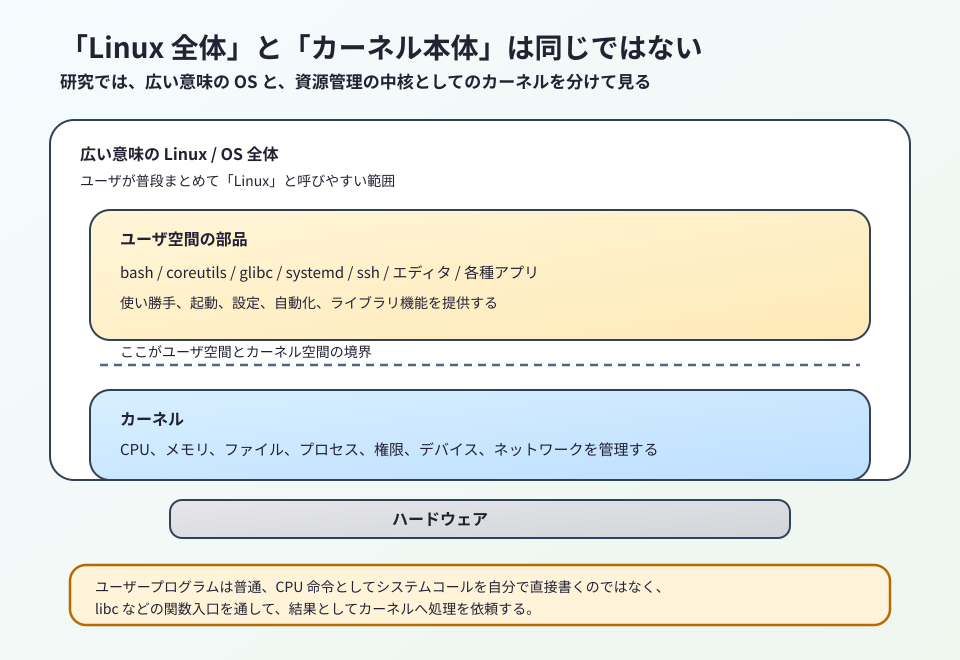
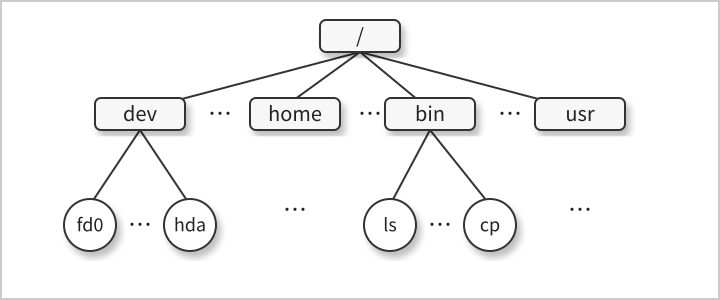
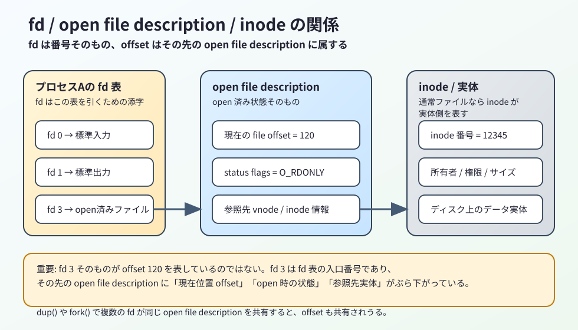

# UmuOSの為のC言語１（上級）　２章　基礎概念

このノートは、第2章に出てくる Linux システムプログラミングの基礎概念を、現在の Linux / glibc / gcc / 
clang / C17 を前提に研究しやすい形へ組み替えたものです。
原文は広い話題を一気に並べていますが、ここでは単なる用語集として眺めるのではなく、
後続章で `open()`、`fork()`、`execve()`、`mmap()`、`signal`、`pthread` などを読むための土台として整理します。

## 今回扱う範囲

- 原文対応: 2.1 から 2.20 までの第2章全体
- 今回の主題: カーネル、シェル、ユーザ、ファイル、I/O、プロセス、メモリ、IPC、時間、端末といった基礎概念を現在の 
Linux 視点でつなぎ直すこと
- UmuOS視点の着眼点: どこがカーネル責務か、どこが libc の仲介か、どこからがシェルやユーザ空間の約束事かを
混同しないこと

## 2章の研究観点

この章は項目数が多いですが、研究上は次の4本柱で読むと整理しやすくなります。

- プログラムは直接ハードウェアを触っているのではなく、カーネルが持つ資源管理の上で動いている
- C ソース、実行ファイル、プロセス、スレッドは似て見えても役割が異なる
- パス名、ファイルディスクリプタ、標準入出力、環境変数のような日常的な概念も、背後には明確な層構造がある
- POSIX で共通化される部分と Linux 固有で強くなる部分を分けて読むと、後で API の可搬性を判断しやすい

ここで一度、`POSIX API`、`libc`、`システムコール` の位置関係を図で固定しておくと、後続の章をかなり追いやすくなります。

```text
  Cプログラム
      |
      |  printf(), fopen(), malloc(), execvp()
      v
  libc（標準Cライブラリ / glibc など）
      |
      |  POSIX API の関数入口を提供する
      |  例: open(), read(), write(), fork(), execve()
      v
  システムコール境界
      |
      |  syscall 命令などでカーネルへ入る
      v
  Linux カーネル
      |
      |  fd表、仮想メモリ、プロセス、権限、デバイスを管理する
      v
  ハードウェア
```

この図の読み方で大事なのは次の点です。

- `POSIX API` は「こういう関数や動作を提供する」という仕様の層であり、実装そのものの名前ではない
- `libc` は、その仕様に沿った関数入口をユーザ空間で提供する実装層である
- `システムコール` は、ユーザ空間からカーネル空間へ処理を依頼するための境界である
- したがって `open()` のような関数は、ソースコード上では libc の関数として呼び、その一部が結果として
システムコールへ到達する、と考えると混同しにくい
- 一方 `printf()` のように、POSIX システムコール名と1対1に対応しない libc 機能もあるため、
「libc の関数 = すべて直接システムコール」ではない

とくに重要なのは、「いま自分が見ているものは何の単位か」を常に言い直せることです。

- ソースコードなのか、実行ファイルなのか
- プロセスなのか、スレッドなのか
- 標準 C ライブラリなのか、POSIX API なのか
- カーネルの機能そのものなのか、シェルが提供する使い勝手なのか

この切り分けが曖昧なままだと、後続章で出てくる I/O、権限、メモリ、シグナルの議論が全部同じ階層に見えてしまいます。

## 2.1 オペレーティングシステムのコア：カーネル

### 2.1.1 「OS」と「カーネル」をまず分ける

日常会話では「Linux」が広い意味で使われますが、研究では次の2つをまず分けた方が良いです。

- 広い意味の OS: カーネルに加えて、シェル、コマンド群、ライブラリ、設定、サービス管理機構まで含む全体
- 狭い意味の OS: CPU、メモリ、デバイス、ファイルシステム、プロセスなどの資源を管理する中核ソフトウェア

この狭い意味の中心がカーネルです。



Linux システムプログラミングで `open()` や `fork()` を研究するとき、直接相手をしている本体はカーネルです。
一方で、普段の開発では bash、glibc、coreutils、systemd なども一緒に使っているため、体感としては全部まとめて
「Linux」に見えます。

このズレを放置すると、どこからどこまでがカーネル責務なのか見えなくなります。

### 2.1.2 カーネルが引き受けている仕事

カーネルの仕事は多いですが、後の章へつながる重要部分は次の通りです。

- CPU時間の配分
- 仮想メモリ管理
- ファイルシステム管理
- プロセス生成と終了処理
- デバイスアクセスの抽象化
- ネットワーク処理
- システムコール API の提供

ここで大切なのは、カーネルは単なる「便利関数集」ではないという点です。
カーネルは有限な資源を安全に分配する調停者です。

たとえば `read()` は「ファイルを読む関数」に見えますが、実際には次の要素が背後にあります。

- 呼び出し元プロセスにその fd を使う権限があるか
- その fd が何を指しているか
- その対象が通常ファイルなのか、端末なのか、パイプなのか、ソケットなのか
- 読み取り位置や待ち状態をどう扱うか

つまり、システムコールは単なる命令ではなく、資源管理付きの入口です。

### 2.1.3 ユーザモードとカーネルモード

現在の CPU は、少なくともユーザモードとカーネルモードを分けます。

- ユーザモード: 一般プログラムが動く制限付きの実行状態
- カーネルモード: 特権命令や全メモリ空間へのアクセスが可能な実行状態

この分離の意味は非常に大きいです。
もし任意のプログラムが自由にハードウェア制御レジスタや他プロセスのメモリを触れたら、1つのバグでシステム全体が壊れます。

したがって、通常の C プログラムは次の形でしか強い処理に入れません。

- ユーザ空間で glibc の関数を呼ぶ
- その内部または薄いラッパを経由してシステムコールへ入る
- CPU がモードを切り替え、カーネル側で要求を処理する

ここで「libc 関数」と「システムコール」を混同しないことが重要です。
たとえば `printf()` は標準 C ライブラリの関数であり、その内部で必要に応じて `write()` などへ到達します。
一方 `read()` や `fork()` は POSIX / UNIX 系 API として見える関数ですが、実体としてはカーネル境界を越える操作です。

### 2.1.4 プロセス視点とカーネル視点は違う

普段コードを書くとき、私たちはプロセスの視点で考えます。

- このファイルを開く
- このメモリを確保する
- この子プロセスを起動する
- この端末へ出力する

しかし厳密には、プロセスがそれを直接行っているわけではありません。
より正確には「カーネルに依頼し、その結果として処理が成立している」です。

この見方に切り替えると、次のような理解がしやすくなります。

- `fork()` は自分で自分を増殖させる魔法ではなく、カーネルが新しいプロセス記述を作る処理
- `exit()` は消える命令ではなく、カーネルへ終了を通知し、資源回収を起動する入口
- ファイルアクセスはディスク上の場所を直接触ることではなく、VFS とファイルシステム実装を通じた抽象操作

この視点は UmuOS を考えるときにも有効です。API 設計を考えるときは、プロセス側に何を見せ、カーネル側に何を隠すかが
本質になるからです。

### 2.1.5 カーネル実行ファイル名は本質ではない

古い文脈では `/boot/vmlinuz` のようなカーネル実行イメージ名が説明されます。
歴史としては面白いですが、現在の研究で本質なのはファイル名より次の点です。

- カーネルはブートローダからロードされる
- 起動後はプロセス一覧の1つとして見える通常プログラムではない
- ユーザ空間プログラムはシステムコール境界を通じてのみ中核機能へ入る

したがって、ここでは名前の由来を暗記するより、「ユーザ空間の通常プログラムとカーネルは存在様式が違う」と
押さえる方が重要です。

## 2.2 シェル

### 2.2.1 シェルはカーネルではなくユーザ空間プログラム

シェルはコマンドを読み取り、必要ならばパイプ、リダイレクト、環境変数展開、プロセス生成を組み合わせてプログラムを
実行するユーザ空間プログラムです。

ここで重要なのは、UNIX 系ではシェルがカーネルに埋め込まれていないことです。
つまり、シェルは交換可能な部品です。

- `sh`
- `bash`
- `dash`
- `ksh`
- `zsh`

これらは見た目が似ていても、対話機能や拡張構文に差があります。

### 2.2.2 研究で分けるべき3つの層

シェルを読むときは、次の3層を分けると整理しやすいです。

- POSIX sh として共通化された構文
- bash や zsh など各シェルの拡張構文
- カーネル機能をシェルが組み合わせて使いやすく見せている部分

たとえばパイプラインはシェル構文としては `cmd1 | cmd2` ですが、背後では次のような処理が必要です。

- `pipe()` でパイプを作る
- `fork()` でプロセスを増やす
- `dup2()` で標準入出力をつなぎ替える
- `execve()` 系で各コマンドを起動する

つまり、シェルは独自の魔法を持つというより、カーネル API を高水準に束ねる装置です。

### 2.2.3 ログインシェルと対話シェル

ログイン直後に開始されるシェルはログインシェルと呼ばれます。
ただし現在は GUI 端末、ssh、systemd のサービス起動、コンテナ内部起動など入口が多いため、
「最初のシェル」という直感だけで理解すると混乱しやすいです。

研究上は次のように見れば十分です。

- ユーザ認証やセッション確立後に、そのユーザ文脈で動くシェルがある
- そのシェルは環境変数、カレントディレクトリ、標準入出力などを引き継いでコマンドを起動する
- シェルスクリプトでは、対話拡張より POSIX 互換性の方が重要になる場面が多い

### 2.2.4 bash は事実上の標準に見えるが、仕様の中心ではない

Linux では bash に触れる機会が非常に多いですが、移植性を意識するなら「bash で動く」と「POSIX sh で動く」は別物です。

したがって今後シェル断片を扱うときは、次を意識すると良いです。

- 対話用途では bash 拡張が便利
- 配布スクリプトでは `/bin/sh` 前提の方が安全な場面が多い
- シェルの便利機能は C 言語やカーネル API の代替ではなく、呼び出しと接続の層である

## 2.3 ユーザとグループ

### 2.3.1 UID と GID は名前ではなく数値が本体

システム上のユーザやグループは、見た目には `root` や `tama` のような名前で扱われますが、カーネルが実際に
見ている本体は数値 ID です。

- UID: ユーザ ID
- GID: グループ ID

名前は人間向けの表示であり、パーミッション判定やプロセス属性では数値が効きます。

### 2.3.2 `/etc/passwd` と `/etc/group` は入口だが、全体ではない

古典的 UNIX の説明では `/etc/passwd` と `/etc/group` が中心に出てきます。
現在でも基本構造は重要ですが、実運用では NSS、LDAP、SSSD、systemd 系の統合などもあり、
情報源がローカルファイルだけとは限りません。

ただし研究の初期段階では、まず次を押さえれば十分です。

- ユーザにはログイン名、UID、主 GID、ホームディレクトリ、ログインシェルがある
- グループには名前、GID、所属ユーザ集合がある
- 認証情報と識別情報は別であり、パスワード実体は通常シャドウ側へ分離される

### 2.3.3 スーパユーザは万能だが、現在は細分化も進んでいる

伝統的には UID 0、通常は `root` が特権ユーザです。
この説明は今でも有効ですが、現在の Linux では capability による細分化も重要です。

したがって研究上は次の2段で理解すると良いです。

- 伝統 UNIX 的には「実効 UID 0 なら強い権限を持つ」
- 現代 Linux 的には「どの特権を必要とするかが capability 単位でも整理される」

後でシグナル送信、ポート bind、時刻変更、マウントなどを見るときに、この差が効いてきます。

## 2.4 単一ディレクトリ階層、ディレクトリ、リンク、ファイル

### 2.4.1 Linux は単一ディレクトリ木で資源を見せる

Linux では、見えるファイル群は原則として 1 本のディレクトリ木に収まります。
起点は `/` です。



ここで重要なのは、利用者から見える多くの対象が「パス名で到達できるもの」として統一されていることです。

- 通常ファイル
- ディレクトリ
- デバイスファイル
- ソケット
- パイプ
- シンボリックリンク
- 疑似ファイルシステム上のノード

この統一感は、UNIX 系の強さそのものです。

### 2.4.2 ファイルとは「普通の文書ファイル」だけではない

日常語のファイルはテキストや画像を連想しがちですが、UNIX 系の file はもっと広いです。

- 通常ファイル
- ディレクトリ
- シンボリックリンク
- キャラクタデバイス
- ブロックデバイス
- FIFO
- ソケット

したがって「ファイルを開く」と言ったとき、対象は必ずしもディスク上のテキストではありません。
この感覚が、後の I/O モデル理解に直結します。

### 2.4.3 ディレクトリは名前表である

研究上、ディレクトリは「物を入れる箱」と覚えるより、「名前と参照先を対応付ける表」と考えた方が実態に近いです。

この見方をすると、リンクの意味が整理しやすくなります。

- ハードリンク: 同じ実体へ別名を張る
- シンボリックリンク: 別のパス名を指す特別なファイル

シンボリックリンクは便利ですが、解決途中でリンク切れや循環参照の問題が入り込みます。
このため、パス解決の挙動を正確に理解することはセキュリティ上も重要です。

### 2.4.4 パス名は文字列だが、評価規則を持つ文字列である

パス名は単なる文字列ではありません。
スラッシュ区切りで左から評価され、途中要素はディレクトリでなければなりません。

- 絶対パス名: `/` から始まる
- 相対パス名: カレントワーキングディレクトリを基点に解釈される
- `.`: 現在ディレクトリ
- `..`: 親ディレクトリ

この性質のため、`chdir()`、`openat()`、シンボリックリンク、名前解決時の競合条件は密接に結びつきます。
原文時点より現在の実務で `openat()` 系が重視されるのも、この基点制御を改善するためです。

### 2.4.5 ファイル名の可搬性は文字コード問題だけではない

Linux では多くの文字をファイル名に使えますが、研究上は「使える」と「安全に扱える」を分ける必要があります。

- `/` と NUL は使えない
- シェル特殊文字は展開やクォートの問題を生む
- 先頭 `-` はコマンドオプションと衝突しやすい
- 他環境可搬性まで考えるなら保守的な文字集合の方が安全

つまり、ファイル名設計は単なる美観ではなく、シェル、ツール、移植性まで含んだ設計問題です。

### 2.4.6 所有者とパーミッションは後の全章に響く

ファイルには少なくとも次の属性があります。

- 所有ユーザ
- 所有グループ
- パーミッションビット

そして検査対象ユーザは通常、次の3区分で評価されます。

- owner
- group
- others

この基本はディレクトリでも効きますが、意味は少し変わります。

- ディレクトリの読み取り許可: 名前一覧を読める
- ディレクトリの書き込み許可: 名前の追加、削除、変更ができる
- ディレクトリの実行許可: 検索できる

とくに実行許可が「実行」ではなく「探索」を意味する点は、最初に強く意識しておいた方が後で混乱しません。

## 2.5 ファイルI/Oモデル

### 2.5.1 UNIX 系 I/O の核は統一インタフェース

UNIX 系 I/O の大きな強みは、対象が違っても似た操作で扱えることです。

- `open()`
- `read()`
- `write()`
- `close()`
- 必要に応じて `lseek()`

通常ファイル、端末、パイプ、ソケット、デバイスで細部は違いますが、入口の形はかなり共通化されています。
この統一感があるから、シェルのリダイレクトやパイプも強力になります。

### 2.5.2 EOF は特別な文字ではない

研究初期で混乱しやすい点ですが、UNIX 系で EOF は「ファイル中に入っている特殊文字」ではありません。
読み取りの結果として、もうデータが供給されないことが分かる状態です。

具体例で言い直すと、EOF は次のように現れます。

- 通常ファイル: ファイル末尾まで読み切ったあと、次の `read()` が 0 を返す
- パイプ: 書き込み側がすべて閉じられ、もう新しいデータが来ないとき、`read()` が 0 を返す
- 端末: 対話入力で行頭の `Ctrl-D` などにより、「いま渡せる入力はもうない」と端末側が判断すると、`read()` が 
0 を返すことがある

つまり EOF は「この 1 文字を読んだら終わり」という記号ではなく、I/O 系が「これ以上読めるデータはない」と知らせる結果です。

`read()` で見ると、典型的には次の形になります。

```c
ssize_t nread;

nread = read(fd, buffer, sizeof(buffer));

if (nread > 0) {
    /* nread バイト読めた */
} else if (nread == 0) {
    /* EOF: もう読めるデータがない */
} else {
    /* エラー */
}
```

ここで重要なのは、`0` は「0 バイトしか入っていなかった」のではなく、「読み取り操作の結果として終端状態に到達した」
という意味だという点です。

とくに端末では `Ctrl-D` を「EOF という文字を打ち込んだ」と誤解しやすいですが、そうではありません。
それは端末ドライバに対する入力終了の合図であり、条件がそろうと結果として読み手に EOF が見える、という関係です。

この理解は、通常ファイルだけでなくパイプや端末を扱うときにも重要です。

### 2.5.3 ファイルディスクリプタは I/O の手がかり

ファイルディスクリプタは、オープン済み対象を指す小さな非負整数です。
研究上は単なる番号として覚えるより、「プロセスごとの fd 表の添字」と考えた方が理解が進みます。



ここで分けたいのは、fd 番号そのものと、その先にある open 済み状態です。

- `fd` はプロセスごとの fd 表を引くための番号
- `open file description` は現在のオフセットや open 時の状態を持つ open 済み状態
- `inode` は通常ファイルなら、その実体側の属性やデータに結び付く

したがって、ファイルオフセットは fd 番号そのものではなく、fd の先にある open file description 側に属します。

とくに重要なのは標準の3本です。

- 0: 標準入力
- 1: 標準出力
- 2: 標準エラー出力

シェルのリダイレクトは、この 0, 1, 2 をつなぎ替える文化の上にあります。

### 2.5.4 stdio はシステムコールそのものではない

`fopen()`、`fgets()`、`fprintf()`、`fclose()` などは標準 C ライブラリの I/O です。
一方 `open()`、`read()`、`write()`、`close()` は低い層の UNIX 系 I/O です。

この2層は混同しやすいですが、研究では明確に分ける必要があります。

- stdio は `FILE *` を扱い、バッファリングや書式化機能を持つ
- システムコール系は fd を扱い、より低い粒度で制御する

今後の章では両者を行き来するので、この段階で区別を固定しておくのが重要です。

## 2.6 プログラム

### 2.6.1 ソースコード、実行ファイル、プロセスは別物

研究では「プログラム」という語が曖昧になりやすいため、最初に分けます。

- ソースコード: 人間が編集するテキスト
- 実行ファイル: コンパイル、リンク後の機械語を含むファイル
- プロセス: 実行中のインスタンス

同じ実行ファイルから複数プロセスを起動できるので、実行ファイルとプロセスは1対1ではありません。

### 2.6.2 スクリプトは「直接 CPU が実行する機械語」ではない

シェルスクリプトのようなテキストは、通常はインタプリタが読んで実行します。
このため、見た目には実行可能でも、実態としては別プログラムが解釈しています。

この差は `execve()` の挙動、シバン、権限、エラー原因の切り分けで効いてきます。

### 2.6.3 フィルタという UNIX 的設計単位

標準入力から読み、標準出力へ結果を流す小さな変換器をフィルタと呼びます。

- `cat`
- `grep`
- `tr`
- `sort`
- `wc`
- `sed`
- `awk`

これは単なるコマンド分類ではなく、UNIX の「小さな部品をパイプでつなぐ」という設計思想そのものです。

### 2.6.4 `argc` と `argv` は最初に正しく理解する

コマンドライン引数は、C17 でも変わらず重要です。
最小の確認コードを置いておきます。

```c
#include <stdio.h>

int main(int argc, char *argv[]) {
    int index;

    /*
     * argc は引数個数です。
     * argv は各引数を指す文字列配列です。
     * argv[0] は通常、起動名またはその一部です。
     */
    printf("argc = %d\n", argc);

    for (index = 0; index < argc; index++) {
        printf("argv[%d] = %s\n", index, argv[index]);
    }

    return 0;
}
```

ここで重要なのは、argv が「文字列本体の配列」ではなく、「文字列へのポインタの配列」だという点です。
この理解は後で `execve()` 系を読むときに不可欠です。

## 2.7 プロセス

### 2.7.1 プロセスは実行中のプログラムであり、属性の束でもある

プロセスとは単に「いま動いているプログラム」です。
ただし研究上はそれだけでは足りません。
プロセスは、コードが走っているだけでなく、多数の属性を抱えたカーネル管理対象です。

- PID
- PPID
- 仮想アドレス空間
- オープン fd 群
- カレントワーキングディレクトリ
- UID / GID 群
- 環境変数
- シグナル設定
- リソース制限

この「属性の束」という見方を持つと、fork 後に何が引き継がれ、exec 後に何が残るかを整理しやすくなります。

### 2.7.2 メモリレイアウトは概念図として理解する

教科書ではテキスト、データ、ヒープ、スタックに分けて説明されます。
現在でも概念整理には有効です。

- テキストセグメント: 実行コード
- データセグメント: 静的記憶域の一部
- ヒープ: `malloc()` などで伸びる動的領域
- スタック: 関数呼び出しごとの自動変数や復帰情報

ただし現実の Linux プロセス空間は共有ライブラリ、mmap 領域、ガードページ、TLS なども含み、もっと複雑です。
したがってこの4分割は「入口として有効な近似」と理解するのが良いです。

### 2.7.3 `fork()` と `execve()` は分けて考える

UNIX 系プロセス制御の核心は `fork()` と `execve()` の分離です。

- `fork()` は現在プロセスを複製して子プロセスを作る
- `execve()` は現在プロセスのプログラム像を別内容へ置き換える

この2段構えのため、シェルは次のように柔軟に起動できます。

- 子プロセスだけ標準入出力を付け替える
- 環境変数を調整する
- カレントディレクトリを変える
- その後で外部コマンドへ置き換える

つまり `fork()` と `execve()` の分離は、起動前の細工を可能にする設計です。

### 2.7.4 `exec()` は総称であって単独の関数名ではない

実務で「exec する」と言うことは多いですが、これは `execve()` およびそのラッパ群をまとめた言い方です。
ここを曖昧にすると、man ページを引くときに迷います。

研究上は次のように整理すると良いです。

- カーネル境界の本体は `execve()`
- 使い勝手のために `execl()`、`execv()`、`execvp()` などの C ライブラリ関数群がある

### 2.7.5 PID、PPID、終了ステータス

各プロセスには PID があり、通常は親の PID も持ちます。
また終了時には終了ステータスが生成され、親は `wait()` 系でこれを回収します。

ここで大切なのは、終了コードと終了ステータスを雑に混ぜないことです。

- `_exit(status)` に渡す値はプログラム側が明示する終了コード
- 親が `wait()` 系で受け取る情報は、シグナル終了も含んだ終了ステータス

シェルでは通常、0 が成功、0 以外が何らかの失敗を意味します。

### 2.7.6 実 UID と実効 UID は別物

権限周りで最重要なのは、誰が起動したかと、何の権限で資源アクセス判定を受けるかが一致しない場合があることです。

- 実 UID / 実 GID: もともとの所属
- 実効 UID / 実効 GID: 資源アクセス検査で主に使われる ID
- 追加グループ: 補助的な所属グループ集合

set-user-ID 実行ファイルを読むときは、この差が本体です。

### 2.7.7 特権は root だけで終わらない

Linux では capability により特権が細分化されています。
そのため、現代 Linux を研究するなら「root かどうか」だけでは不十分です。

たとえば、ある操作に必要なのは UID 0 全体ではなく、特定 capability だけかもしれません。
この見方は、古典 UNIX より現在の Linux を精密に理解するのに役立ちます。

### 2.7.8 `init` は概念としては PID 1、実装名は固定ではない

古い説明では `/sbin/init` がすべての祖先と書かれます。
概念としては正しいですが、現在の Linux では PID 1 の実体は systemd など別実装であることが普通です。

重要なのはパス名ではなく、PID 1 が次の役割を持つことです。

- システム立ち上げ初期のユーザ空間起点
- 孤児化した子孫の引き取り先
- サービス群の起動、監視、停止の中心

したがって研究上は「PID 1 の役割」を押さえれば十分です。

### 2.7.9 デーモン、環境、リソース制限

長寿命でバックグラウンド動作し、通常は制御端末を持たないプロセスをデーモンと呼びます。
また、プロセスは環境変数群とリソース制限も持ちます。

- 環境変数は親から子へ継承される設定・伝達経路
- `PATH` や `HOME` は典型例
- `setrlimit()` は fd 数、CPU 時間、仮想メモリ量などの上限管理に使う

このあたりは脇役に見えますが、実際にはプロセスの再現性、権限境界、運用安全性に強く効きます。

## 2.8 メモリマッピング

### 2.8.1 `mmap()` は「ファイルを読む別 API」以上のもの

`mmap()` は自プロセスの仮想アドレス空間へ新しいマッピングを作る仕組みです。
これは単に I/O の別表現というだけでなく、Linux の仮想メモリ機構そのものに接続する入口です。

マッピングは大きく2種類あります。

- ファイルマッピング
- 無名マッピング

ファイルマッピングでは、ファイル内容がページ単位で仮想メモリへ対応付けられます。
無名マッピングでは、背後に通常ファイルを持たないゼロ初期化メモリを確保できます。

### 2.8.2 shared と private は可視性の差

`mmap()` の理解で重要なのは、共有するのか、自分だけの変更に閉じるのかです。

- `MAP_SHARED`: 変更が他の共有者や背後ファイルへ見える方向
- `MAP_PRIVATE`: 読み取りは元を共有しつつ、書き込みは copy-on-write で私有化される方向

この違いは、単なる性能差ではなく、意味論の差です。
共有メモリ IPC をしたいのか、ファイルをランダムアクセス風に読みたいのかで選択が変わります。

### 2.8.3 現在の Linux での読みどころ

研究上は次の用途が重要です。

- 実行ファイルや共有ライブラリのロード
- 大きなファイルの一部をメモリとして扱う I/O
- プロセス間共有メモリ
- ヒープとは別系統の大きな領域確保

つまり `mmap()` は特殊機能ではなく、プロセス空間の一級構成要素です。

## 2.9 スタティックライブラリと共有ライブラリ

### 2.9.1 ライブラリは「関数の倉庫」ではなく再利用単位

ライブラリは、複数プログラムで使うコードをまとめる再利用単位です。
現在の Linux では主にスタティックライブラリと共有ライブラリを区別します。

### 2.9.2 スタティックリンクは自己完結だが重くなりやすい

スタティックリンクでは、必要なオブジェクトコードが最終実行ファイルへ取り込まれます。

利点は次の通りです。

- 実行時依存が少ない
- 配布先環境差の影響を受けにくい

欠点は次の通りです。

- 実行ファイルが大きくなりやすい
- 同じコードが多数の実行ファイルへ重複しやすい
- ライブラリ更新を反映するには再リンクが必要

### 2.9.3 共有ライブラリはコード共有と更新容易性が強み

共有ライブラリでは、実行ファイルは「実行時にこのライブラリが必要」という情報を持ち、実行時リンカがロードと解決を行います。

この方式の利点は次の通りです。

- 複数プロセスでコードページを共有しやすい
- 実行ファイルを小さくしやすい
- ライブラリ更新の反映が比較的容易

ただし同時に、ABI 互換性、配置先、バージョン衝突といった新しい問題も生みます。

### 2.9.4 研究では ELF と動的リンカの存在を意識する

現在の Linux では ELF 形式と動的リンカの理解が重要です。
ここでは詳細に踏み込みませんが、関数呼び出しが常に単独の実行ファイル内で完結しているとは限らない、という感覚を持っておくことが大切です。

## 2.10 プロセス間通信と同期

### 2.10.1 IPC は「別プロセスだから何も共有できない」を埋める

プロセスは互いに独立した仮想アドレス空間を持つため、何もしなければ直接メモリを共有できません。
その隔たりを埋める仕組みが IPC です。

主な手段は次の通りです。

- シグナル
- パイプと FIFO
- ソケット
- ファイルロック
- メッセージキュー
- セマフォ
- 共有メモリ

### 2.10.2 通信と同期は別だが、実務では絡み合う

IPC を考えるときは、データを渡したいのか、順番をそろえたいのかを分けると整理しやすいです。

- 通信: データを届ける
- 同期: いつ読んでよいか、いつ書いてよいかをそろえる

共有メモリは高速ですが、同期を別途きちんと設計しないと壊れやすい典型です。

### 2.10.3 Linux では選択肢が多すぎる

UNIX 系は歴史的経緯から IPC の手段が多く、かなり重複があります。
したがって研究上は「全部覚える」より、どの要件に何を使うかで整理する方が有効です。

- 親子で単純に流すならパイプ
- 同一ホスト内で双方向かつ柔軟なら UNIX ドメインソケット
- 大量共有なら共有メモリ
- 単発通知ならシグナル

## 2.11 シグナル

### 2.11.1 シグナルは非同期イベント通知

シグナルはソフトウェア割り込みとも呼ばれ、プロセスへ非同期イベントを通知します。

- 端末からの割り込み
- 子プロセスの終了
- タイマ満了
- 不正メモリアクセス
- 他プロセスからの通知

ここで大切なのは、シグナルは普通の関数呼び出しのように都合の良い場所で来るとは限らないことです。

### 2.11.2 ディフォルト動作、無視、ハンドラ

シグナル受信時の基本動作は次の3系統です。

- ディフォルト動作に任せる
- 無視する
- ハンドラを登録して独自処理する

ただし、何でも安全にハンドラ内でできるわけではありません。
シグナルハンドラは非同期割り込み文脈に近いため、再入性と async-signal-safe の制約が強く効きます。

### 2.11.3 「保留」と「ブロック」を分けて理解する

シグナルが生成されても、直ちに処理されるとは限りません。

- 保留: まだ配送完了していない状態
- ブロック: そのシグナルを一時的に受け取らない設定

この理解は、競合条件を避けるための `sigprocmask()`、`sigsuspend()`、`ppoll()`、`signalfd()` などを読む土台になります。

## 2.12 スレッド

### 2.12.1 スレッドは「同じプロセス内の実行流」

スレッドは、同一プロセス内で資源の多くを共有しながら並行実行する流れです。

- アドレス空間を共有する
- グローバルデータやヒープを共有する
- それぞれ独自のスタックを持つ

この共有のしやすさが強みであり、同時にデータ競合の原因でもあります。

### 2.12.2 POSIX スレッドと標準 C スレッドは同一ではない

ここは現在の研究で重要です。

- `pthread_*()` は POSIX スレッド API
- `thrd_*()` は C11 / C17 の標準スレッド API

Linux 実務では依然として pthread が中心ですが、規格上の所属は標準 C と POSIX で別です。
この線引きを意識すると、可搬性の見積もりがしやすくなります。

### 2.12.3 共有は楽だが、正しさは難しい

スレッドの利点は共有のしやすさですが、共有のしやすさはそのまま破壊のしやすさでもあります。

- mutex
- 条件変数
- read-write lock
- アトミック操作

これらを使わずに共有変数を触ると、見えにくい壊れ方をしやすくなります。

## 2.13 プロセスグループとジョブコントロール

### 2.13.1 シェルは複数プロセスをまとめて扱う必要がある

パイプライン 1 本でも、内部では複数プロセスが走ります。
シェルがこれらを一括で停止、再開、前面化するための単位がプロセスグループです。

したがってジョブコントロールは、単なる対話機能ではなく、シグナル配送や端末制御と深く結び付いた機構です。

### 2.13.2 グループ単位でシグナルを飛ばせることが重要

Control-C でパイプライン全体を止められるのは、カーネルがフォアグラウンドプロセスグループ全体へシグナルを送れるからです。
つまりジョブコントロールは、見た目にはシェル機能でも、実体としてはカーネル支援を必要とします。

## 2.14 セッション、制御端末、制御プロセス

### 2.14.1 ジョブのさらに外側にセッションがある

セッションは、複数のプロセスグループを束ねる単位です。
対話シェルは通常、自分をセッションリーダとするセッションの中でジョブを管理します。

### 2.14.2 制御端末は「どの対話文脈に結び付くか」を決める

端末との結び付きは次の挙動に影響します。

- どのジョブが前面か
- キーボード入力がどこへ届くか
- 端末切断時に誰へ `SIGHUP` が飛ぶか

このため、デーモン化や ssh 越しの実行、端末多重化、端末エミュレータの挙動を理解するとき、セッション概念が効いてきます。

## 2.15 疑似端末

### 2.15.1 疑似端末は「端末らしく見える通信路」

疑似端末は master と slave のペアで成り立ちます。
slave 側は端末として振る舞い、master 側はそれを遠隔操作する窓口になります。

この仕組みのおかげで、端末指向プログラムを本物の物理端末なしで扱えます。

### 2.15.2 現代では非常に身近な基盤

疑似端末は特殊用途ではありません。

- ターミナルエミュレータ
- ssh
- screen
- tmux
- expect 系自動化

これらの多くは疑似端末なしでは成立しません。

## 2.16 日付と時刻

### 2.16.1 実時間と CPU 時間を分ける

時間という語も曖昧なので、最低でも次は分ける必要があります。

- 実時間: カレンダ時間または経過時間
- CPU 時間: そのプロセスが実際に消費した CPU の時間

CPU 時間はさらに次へ分かれます。

- ユーザ CPU 時間
- システム CPU 時間

この区別がないと、遅い原因が待ちなのか、計算なのか、カーネル処理なのか切り分けられません。

### 2.16.2 Epoch は UNIX 的な時間表現の基点

UNIX 時間は通常、UTC 1970-01-01 00:00:00 からの経過として扱われます。
ただし実務では、次も常に意識した方が安全です。

- タイムゾーン変換
- 夏時間
- 単調増加時間と実時刻の違い

測定用途では `CLOCK_MONOTONIC` 系、表示用途では実時間系、という使い分けが重要になります。

## 2.17 クライアント－サーバアーキテクチャ

### 2.17.1 処理を要求側と提供側に分ける設計

クライアントは要求を送り、サーバは共有資源や機能を提供します。
この分離はネットワーク越しに限りません。同一ホスト内でも成立します。

研究上の重要点は、サーバという語が「常駐プロセス」「共有資源管理」「複数クライアント対応」という要素を持ちやすいことです。

### 2.17.2 サーバ化の利点は資源の一元化

サーバ方式の利点は次の通りです。

- 共有資源を一元管理できる
- 権限制御を集中できる
- 異種環境から同じ窓口へアクセスさせやすい

この見方を持つと、データベース、HTTP サーバ、印刷サービス、認証サービスが同じ設計系譜にあることが見えやすくなります。

## 2.18 リアルタイム性

### 2.18.1 リアルタイムは「速い」より「期限内」

リアルタイム性とは、単に高速であることではなく、定められた時間内に応答できることです。

したがって、平均性能だけ高くても最悪遅延が大きければ不十分な場合があります。

### 2.18.2 Linux では汎用性との両立として考える

Linux は伝統的な意味での専用リアルタイム OS とは異なる出発点を持ちます。
そのため、研究上は次のように捉えると整理しやすいです。

- 汎用マルチユーザ OS としての都合がある
- その上でスケジューリング、タイマ、メモリロック、優先度制御などを強化してきた
- POSIX リアルタイム拡張は、その整理軸を与える

### 2.18.3 用語の使い分けに注意する

英語の real time は、単に実時間の意味でも、リアルタイム制御の意味でも使われます。
研究ノートでは次のように分けると安全です。

- 実時間: カレンダ時刻や経過時間
- リアルタイム: 締切応答性を持つシステム特性

## 2.19 /procファイルシステム

### 2.19.1 `/proc` はカーネル内部状態への観測窓

`/proc` は通常の永続ファイル置き場ではなく、カーネルが状態を見せるための疑似ファイルシステムです。

- システム全体情報
- カーネル設定
- 実行中プロセス情報

これらがファイルとして観測できるため、通常の `cat`、`grep`、`read()` で扱えます。

### 2.19.2 Linux 研究では非常に実用的

`/proc` の重要性は、単に便利というだけではありません。
カーネルが持つ内部状態を、ユーザ空間から比較的一般的な I/O で観測できるからです。

たとえば次のような確認に使います。

- `/proc/<pid>/maps`
- `/proc/<pid>/fd`
- `/proc/<pid>/status`
- `/proc/meminfo`
- `/proc/sys/...`

ただしこれは POSIX 標準ではなく、Linux 依存が強い点に注意が必要です。

## 2.20 章のまとめ

第2章を現在の Linux / C17 研究として読み替えると、要点は次の通りです。

- カーネルは資源管理の中心であり、システムコールはその入口である
- シェルはカーネルではなく、ユーザ空間で起動、接続、自動化を担うプログラムである
- ユーザ、グループ、権限、パーミッションは数値 ID とカーネル検査に基づく
- ファイル、ディレクトリ、リンク、パス名はすべて後の I/O とセキュリティ理解の土台である
- stdio と fd ベース I/O は層が異なる
- プロセス、スレッド、IPC、シグナル、端末、時間は別々の話ではなく、同じ実行環境を別角度から見たものである
- `/proc` や capability のような Linux 的特徴を、POSIX 共通部分と分けて捉える必要がある

## UmuOSへの接続

この章を UmuOS 設計へ返すなら、重要なのは次の点です。

- カーネル責務とユーザ空間責務を最初から分離する
- 「ファイルらしく見せる」「fd で統一する」のような一貫した抽象化を重視する
- プロセス属性、権限、環境、カレントディレクトリのような周辺状態も API の一部として扱う
- 実装を増やす前に、どの資源が誰の所有物で、どの境界で切り替わるかを言語化する
- 将来の拡張を考えるなら、POSIX 互換層と OS 固有機能層を分けて設計する

## 第2章の最終まとめ

第2章は、Linux システムプログラミングの地図記号を一通り確認する章です。
ここで扱ったカーネル、シェル、ユーザ、ファイル、I/O、プロセス、スレッド、シグナル、端末、時間といった概念は、それぞれ独立の雑学ではありません。
すべて、1つの Linux システムの上で、誰が資源を持ち、誰が何を要求し、どこで境界を越え、どう観測できるかを別の角度から説明したものです。

この見取り図を持っておくと、今後 `open()`、`dup2()`、`fork()`、`execve()`、`wait()`、`mmap()`、`kill()`、`sigaction()`、`pthread_create()`、`socket()` などを読むときに、それぞれを単発 API ではなく、同じ実行モデル上の部品として研究しやすくなります。