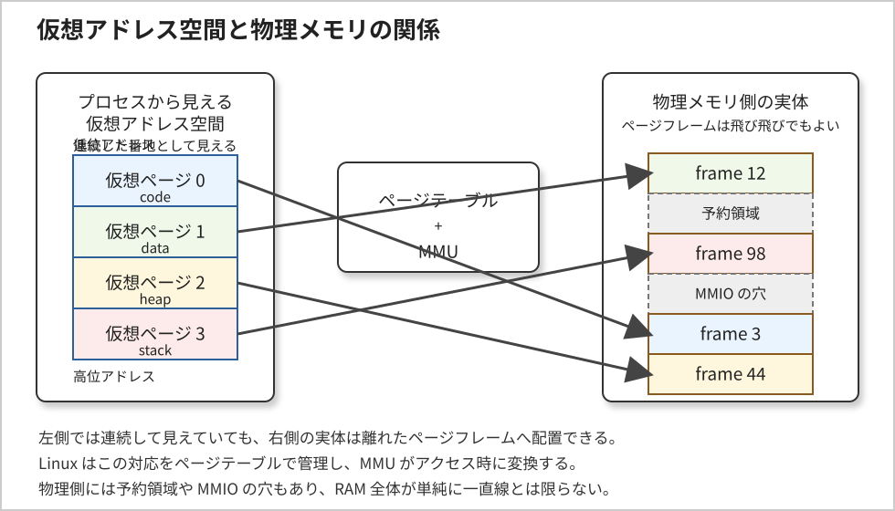
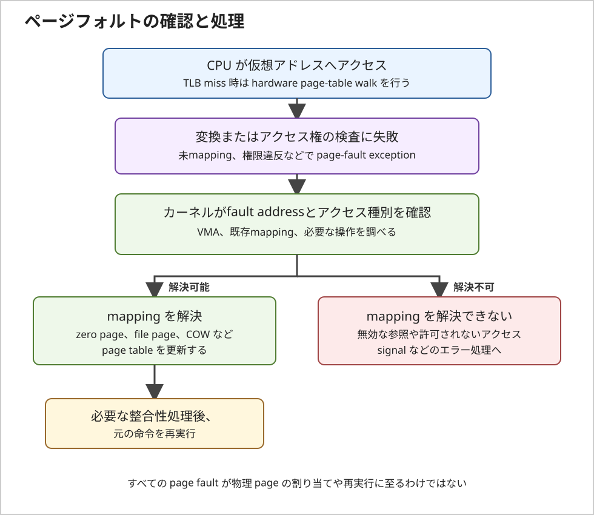

# UmuOSの為のC言語６（上級）　6章　プロセス

このノートでは、Linuxプログラミングインターフェイス第6章を、現在の Linux / POSIX / C17 を前提に研究します。
このファイルでは一度に章全体を扱わず、節ごとに整理します。現在は原文 6.1「プロセスとプログラム」と
6.2「プロセス ID と親プロセス ID」、6.3「プロセスのメモリレイアウト」、
6.4「仮想メモリ管理」、6.5「スタックとスタックフレーム」、
6.6「コマンドラインパラメータ（argc と argv）」、
6.7「環境変数」を扱います。

プロセスを理解する入口は、ディスク上にあるプログラムと、実行中のプロセスを別のものとして捉えることです。
実行ファイルはプロセスを構成する材料を持ちますが、プロセスはそれに加えて、実行状態やカーネルが管理する資源を持ちます。

## 今回扱う範囲

- 原文対応: 6.1 プロセスとプログラム、6.2 プロセス ID と親プロセス ID、6.3 プロセスのメモリレイアウト、6.4 仮想メモリ管理、6.5 スタックとスタックフレーム、6.6 コマンドラインパラメータ、6.7 環境変数
- 今回の主題: 実行可能ファイルとプロセスの違い、PID / PPID、仮想メモリ、スタック、`argc` / `argv`、環境の継承と操作を整理すること
- C17 の着眼点: C言語規格が定める範囲と、Linux / POSIX / ELF が定める範囲を混同しないこと
- UmuOS視点の着眼点: 起動時の `/init` が `exec` で `switch_root` に置き換わっても PID 1 のプロセスとして続く流れを、プログラムとプロセスの違いに結びつけること

## 今回の研究観点

- プログラムファイルは保存された実行イメージであり、プロセスはその実行に必要な状態と資源を持つ実体である
- 1つの実行ファイルから複数の独立したプロセスを起動できる
- PID は実行中のプロセスを識別する値であり、実行ファイルの識別子ではない。終了後に再利用されることもある
- プロセスはユーザ空間のメモリだけでなく、識別情報やファイルディスクリプタなどのカーネル管理情報も持つ
- メモリ領域の名前は概念整理に役立つが、C17 が変数の物理的な配置先を固定するわけではない
- 仮想メモリはアドレス空間の分離、保護、共有を可能にし、仮想アドレスを物理ページフレームへ対応付ける
- スタックフレームは関数呼び出しを考えるモデルであり、C17 はスタックへの具体的な配置を保証しない
- `argc` は引数の数、`argv` は文字列ポインタ列であり、元のシェル入力文字列そのものではない
- 環境変数はプロセスごとの `name=value` 情報であり、親の変更が既存の子へ自動反映される共有領域ではない
- C17 は Linux のプロセス、PID、ELF 形式を定義しない。それらは OS、POSIX、ABI などの仕様に属する

## 6.1 プロセスとプログラム

### 6.1.1 プログラムとプロセスは「保存されたもの」と「実行中のもの」

プログラムは、実行時にプロセスを構成するための命令や情報を含むファイルです。
これに対してプロセスは、プログラムの実行中の姿であり、カーネルが実行に必要な資源と状態を管理する単位です。

| 観点 | プログラムファイル | プロセス |
|---|---|---|
| 存在する場所 | ファイルシステム上 | 実行中のシステム内 |
| 主な内容 | 命令、初期データ、実行形式の情報など | 実行状態、仮想アドレス空間、識別情報、利用中の資源など |
| 複数存在の例 | 同じ実行ファイルを1つ置く | そのファイルから複数のプロセスを起動する |

したがって、「実行ファイルが1つある」ことと「プロセスが1つだけ動く」ことは同じではありません。
同じプログラムを異なる引数で複数回起動すれば、それぞれ別の実行状態を持つプロセスになります。

### 6.1.2 実行可能ファイルが持つ情報

Linux で一般的な実行可能ファイル形式は ELF（Executable and Linking Format）です。
ELF ファイルには、ローダが実行イメージを組み立てるための情報や、機械語命令、データなどが含まれます。

- **形式・対象の情報**: ELF のクラス、機械種別、実行形式の種別など
- **機械語命令と実行開始位置**: CPU が実行する命令列と、実行開始に関する情報
- **データの初期値**: 実行イメージへ取り込まれる初期化済みデータなど
- **シンボル・再配置情報**: リンカやデバッガ、動的リンク処理で利用される情報
- **共有ライブラリ・動的リンク情報**: 実行時に必要なライブラリや動的リンカに関する情報

すべての実行ファイルに、デバッグ用シンボルなどが残っているとは限りません。
また、ELF のセクションやセグメントが実行時にどう扱われるかは、C17 ではなく ELF ABI と OS のローダ側の規約で決まります。

手元の実行ファイルを調べる場合は、たとえば次のようなコマンドでヘッダ、ロード対象、動的リンク情報を観察できます。

```sh
readelf -h ./program
readelf -l ./program
readelf -d ./program
```

`-h` は ELF ヘッダ、`-l` はプログラムヘッダ（ロード対象の情報）、`-d` は動的セクションを表示します。
シンボルの有無を調べる場合は `readelf -s ./program` も使えますが、実行時に必須の情報とデバッグ用情報は分けて考えます。

### 6.1.3 1つの実行ファイルから複数のプロセスを作れる

たとえば、次のように同じプログラムを異なる引数で起動できます。

```sh
./worker input-a &
./worker input-b &
```

シェルはそれぞれの起動に対して実行環境を用意します。2つの実行は同じファイルを元にしていても、
プロセスとしては別々の実行状態を持ちます。引数、実行中の位置、開いているファイルなどは、それぞれの起動条件や処理によって異なり得ます。

実装上、読み取り専用のプログラムコードに対応する物理メモリページが共有されることはあります。
しかし、それはメモリ使用を効率化する仕組みであり、プロセスの識別や論理的なアドレス空間が同一になることを意味しません。

### 6.1.4 プロセスはカーネルが管理する実行単位

プロセスは実行ファイルそのものではなく、プログラムを実行するためのユーザ空間と、実行を支えるカーネル管理情報を含む抽象です。

```text
実行可能ファイル
  ├─ 機械語命令・初期データ・実行形式の情報
  └─ 実行時に必要となるライブラリ情報
          │
          │ OS が実行イメージを用意する
          ▼
プロセス
  ├─ ユーザ空間のメモリと実行中の CPU 状態
  └─ カーネルが管理する状態・資源
      ├─ プロセス識別情報
      ├─ 仮想メモリの管理情報
      ├─ ファイルディスクリプタ
      ├─ シグナル関連の状態
      ├─ 資源使用量と上限
      └─ カレントワーキングディレクトリなど
```

この図は概念上の分類です。Linux 内部でこれらすべてが1つの構造体や1つのメモリ領域にまとまっている、という意味ではありません。
カーネルは複数の管理構造を通じてプロセスの実行状態と資源を扱います。

### 6.1.5 C17 と Linux の責務の境界

C17 は、C プログラムの翻訳や実行環境、`main` 関数など、言語処理系が提供する範囲を定めます。
一方、PID、プロセスの生成、ファイルディスクリプタ、ELF のロード方法は C17 の規定ではありません。

このため、C17 で書いたプログラムが Linux 上で動くときは、少なくとも次の層を分けて考えます。

1. **C17**: 言語構文、型、式、関数など
2. **POSIX / Linux API**: プロセスやファイルなど OS 資源を操作するインタフェース
3. **Linux と実行形式の ABI**: ELF の解釈、メモリ配置、システムコール境界など

「C17 相当で書く」とは、古い C の書き方を現代の型・宣言・エラー処理に整えることです。
Linux のプロセス機構そのものを C17 の機能として扱う、という意味ではありません。

### 6.1.6 この節で固定したいこと

- プログラムファイルは実行の材料であり、プロセスは実行状態と資源を含む
- 1つの実行ファイルから複数のプロセスを起動できる
- プロセスの管理対象には、ユーザ空間だけでなくカーネル側の状態も含まれる
- C17、POSIX / Linux API、ELF ABI は別の仕様層として読む

## 6.2 プロセス ID と親プロセス ID

### 6.2.1 PID は実行中プロセスを識別する値

プロセス ID（PID）は、カーネルが実行中のプロセスを識別するために使う整数値です。
システムコールや管理用インタフェースで対象プロセスを指定するときにも使われます。

PID はプログラムファイルに付く番号ではありません。同じ実行ファイルを複数回起動すれば、起動ごとに別のプロセス ID が割り当てられます。
また、プロセスが終了すると、その PID は後のプロセスに再利用され得ます。したがって、PID を永続的な識別子や安全な一意性の保証として扱ってはいけません。

Linux では PID namespace ごとに見える PID の番号空間があります。同じプロセスでも、どの namespace から観察するかによって PID が異なることがあります。
このため、書籍にある歴史的な上限値を前提にせず、PID の範囲や割り当て方は実行環境の仕様として扱います。

### 6.2.2 getpid() と getppid() で現在の関係を調べる

`getpid()` は呼び出し元プロセスの PID を返し、`getppid()` はその時点の親プロセスの PID（PPID）を返します。
どちらも POSIX の関数で、C17 自体の機能ではありません。

```c
#define _POSIX_C_SOURCE 200809L
#include <inttypes.h>
#include <stdio.h>
#include <sys/types.h>
#include <unistd.h>

int main(void)
{
    pid_t pid = getpid();
    pid_t ppid = getppid();

    printf("pid=%jd ppid=%jd\n", (intmax_t)pid, (intmax_t)ppid);
    return 0;
}
```

`pid_t` は POSIX がプロセス ID 用に定める型です。具体的な整数型を決め打ちせず、PID / PPID の変数には `pid_t` を使います。
表示では `intmax_t` に変換して `%jd` で出力し、`pid_t` の実装上の型と `printf()` の書式指定子を直接結びつけないようにしています。

`getpid()` と `getppid()` は通常の Linux / POSIX 環境では失敗を返すインタフェースではありません。
したがって、戻り値を `-1` と比較して `errno` を調べる形のエラー処理はしません。

### 6.2.3 PPID は親プロセスを示すが、親子関係は変化する

`getppid()` が返すのは直接の親プロセスの PID です。祖先全体を一度に返すものではありません。
プロセス間の親子関係は、概念上、次のような木構造で表せます。

```text
PID namespace 内の init
└─ shell
   └─ worker
```

親プロセスが子プロセスより先に終了すると、子は孤児プロセスになります。
Linux では、孤児プロセスは最も近い生存中の child subreaper に引き取られ、該当するプロセスがなければ、その PID namespace の init プロセスに引き取られます。
そのため「常にシステム全体の PID 1 が親になる」とは限らず、PID namespace と subreaper の有無を考慮します。

また Linux では、親プロセスが別の PID namespace にいる場合、`getppid()` が `0` を返すことがあります。
これは通常の PPID が 0 という意味ではなく、現在の namespace から親を PID で表せない場合の挙動です。

### 6.2.4 PID をファイル名の一意性や安全性の代わりにしない

PID を一時ファイル名に含める方法は、名前の衝突を減らす用途には使われてきました。
しかし PID は再利用されるため、それだけでファイル名の一意性や排他的な作成を保証することはできません。

一時ファイルを安全に作る場合は、既存ファイルの確認と作成を競合しない形で行う API を使います。
ファイル名に PID を付けるだけの方法を、排他制御やアクセス制御の代わりにしてはいけません。

### 6.2.5 UmuOS の起動時に見る PID 1

UmuOS の起動では、initramfs の `/init` が PID 1 として動き、`exec` により `switch_root` へ実行イメージを置き換える構成が記録されています。
この置き換えは新しいプロセスの生成ではないため、実行するプログラムが変わっても、プロセスとしての PID 1 は引き継がれます。

起動段階ごとの PID 1 の実行ファイル名は、次のように観察できます。

```sh
cat /proc/1/comm
ps -p 1 -o pid,ppid,comm
```

ここでは「PID 1 だからプログラムも常に同じ」と考えず、PID が表すプロセスと、その時点で実行しているプログラムを分けて確認します。

### 6.2.6 この節で固定したいこと

- `getpid()` は自プロセスの PID、`getppid()` は直接の親プロセスの PID を返す
- PID の型は `pid_t` を使い、具体的な整数型や上限値を決め打ちしない
- PID は実行中の識別値であり、終了後の再利用や PID namespace による見え方の違いがある
- 親が終了した場合の引き取り先は、Linux では child subreaper や PID namespace の init に依存する
- UmuOS の PID 1 は、`exec` によるプログラム置換後も同じプロセスとして続く

## 6.3 プロセスのメモリレイアウト

プロセスのメモリレイアウトを説明するとき、text、data、BSS、heap、stack という区分がよく使われます。
これはメモリの用途を理解するための概念モデルです。現代 Linux の実際のプロセスは、ページ単位で管理される多数の仮想メモリ領域
（mapping）で構成され、古典的な5区分どおりの単純な連続配置になるとは限りません。

### 6.3.1 代表的な領域の役割

| 領域 | 主な役割 | 現代 Linux での見方 |
|---|---|---|
| text / code | プログラムの機械語命令 | ELF のロード対象として仮想アドレス空間へ対応付けられる。通常は書き込み不可の権限で実行される |
| 初期化済み data | 初期値を持つ静的記憶域期間のオブジェクト | 初期値を実行イメージから引き継ぐ領域。実際の配置はリンカと ABI に依存する |
| BSS | 初期値を明示しない静的記憶域期間のオブジェクト | C の規則では起動時にゼロ初期化される。実行ファイルに全ゼロの内容を格納せず、領域の大きさとして表現できる |
| heap | 実行中に確保する動的オブジェクト | `malloc()` などの実装が管理する領域。`brk()` だけでなく `mmap()` が使われる場合もある |
| stack | 関数呼び出しや実行時状態を支える領域 | ABI と実装が管理する。自動記憶域期間の変数が必ずすべて stack に実体化するわけではない |
| その他の mapping | 共有ライブラリ、ファイル、匿名メモリなど | Linux では `mmap()` 等により多様な領域が同一の仮想アドレス空間へ配置される |

「BSS に置かれる」といった説明は典型的な実装モデルです。
C17 が規定するのはオブジェクトの記憶域期間や初期化の意味であり、ELF の BSS など特定セクションへの配置ではありません。

### 6.3.2 C の記憶域期間と実際の配置を分ける

C17 のオブジェクトは、記憶域期間によって寿命や初期化の規則が決まります。
その概念と、実行時に使われる仮想アドレス領域の名前は関連しますが、同じ分類ではありません。

- **静的記憶域期間**: ファイルスコープのオブジェクトや `static` オブジェクト。明示的な初期化子がなければ C の規則でゼロ初期化される。典型的には data または BSS に対応する
- **自動記憶域期間**: 通常のブロック内ローカル変数など。関数呼び出しの終了まで有効だが、コンパイラがレジスタに保持したり、最適化で記憶域自体をなくしたりできる
- **割付け記憶域期間**: `malloc()` などで確保したオブジェクト。どの仮想領域から供給するかはアロケータ実装に依存する
- **スレッド記憶域期間**: C17 の `_Thread_local` オブジェクト。通常の data / BSS と同じ配置だと決めつけず、TLS と ABI の仕組みとして扱う

次の例は、それぞれの記憶域期間を見分けるためのものです。コメントの領域名は典型例であり、コンパイラや ABI が保証する配置先ではありません。

```c
#include <stdio.h>
#include <stdlib.h>

int zero_initialized_global;
int initialized_global = 42;
static int zero_initialized_static;
static int initialized_static = 7;

int main(void)
{
    int automatic_value = initialized_global;
    int *allocated_value = malloc(sizeof *allocated_value);

    if (allocated_value == NULL) {
        return EXIT_FAILURE;
    }

    *allocated_value = automatic_value + zero_initialized_static + initialized_static
                       + zero_initialized_global;
    printf("%d\n", *allocated_value);
    free(allocated_value);
    return EXIT_SUCCESS;
}
```

`automatic_value` が必ず物理的な stack 上に置かれる、`allocated_value` が指す先が必ず連続する heap の一部である、
といった実装上の推測を C の保証として扱ってはいけません。
また、`malloc()` が返した領域の寿命は `free()` までであり、実装がどのカーネル機構を使ったかとは別の契約です。

### 6.3.3 heap と program break は同じ意味ではない

古典的な説明では、heap の上端を program break と呼び、`brk()` / `sbrk()` によりその位置を変更します。
しかし、これは Linux の低水準インタフェースの説明であり、C の動的メモリ管理そのものではありません。

現代の C プログラムでは、通常 `malloc()`、`calloc()`、`realloc()`、`free()` を使います。
glibc などのアロケータは要求サイズや内部状態に応じて `brk()` や `mmap()` 等を使い分けるため、
「malloc の全領域は1本の連続した brk heap にある」とは限りません。
アロケータを使うプログラムが直接 `brk()` / `sbrk()` を操作すると、管理状態を壊すおそれがあるため混在させません。

### 6.3.4 セグメントという言葉の読み分け

この節の text / data / BSS は、プロセスの仮想メモリを用途別に説明する歴史的・論理的な呼び方です。
x86 のハードウェアセグメンテーションとは別の概念であり、Linux の仮想メモリ管理の中心であるページングとも区別します。

ELF では **section** と **segment** も異なります。section は主にリンカや解析ツールが扱う構成単位で、
実行時にロードする範囲はプログラムヘッダの segment（`PT_LOAD` 等）で表現されます。
したがって、`size` コマンドの text / data / bss の値だけから、プロセス実行中の全メモリ使用量を求めることはできません。

古い UNIX 環境に存在した `etext`、`edata`、`end` のようなシンボルは、C17 や POSIX が保証するものではありません。
移植可能な C プログラムから、これらを標準の境界マーカーとして使わないようにします。

### 6.3.5 実行ファイルと実行中プロセスを観察する

```sh
size ./program
readelf -l ./program

pid=1234
cat "/proc/$pid/maps"
```

- `size` は主に実行ファイル内の text / data / bss の大きさを表示する。stack、実行時 heap、共有ライブラリ等を含むプロセス全体の使用量ではない
- `readelf -l` は ELF のプログラムヘッダを表示し、ロード対象の segment を調べる手掛かりになる
- `/proc/<PID>/maps` は Linux 固有で、指定したプロセスの仮想メモリ mapping とアクセス権を観察できる。例の `1234` は対象 PID に置き換える

`/proc/self/maps` は、そのパスを開いたプロセス自身を指します。
たとえば `cat /proc/self/maps` では、観察対象は通常 `cat` プロセスです。別プロセスを調べる場合は `/proc/<PID>/maps` を指定します。

実行時の仮想アドレスは、ASLR、実行形式、ローダ、カーネル設定などで変わり得ます。
図や一度の観察で得たアドレスを、固定配置として一般化しないことが重要です。

### 6.3.6 UmuOS での観察点

UmuOS は Linux カーネル上でユーザー空間を起動する構成なので、プロセスのメモリ配置は Linux の仮想アドレス空間として観察します。
起動後に PID 1 の mapping を見ると、実行中プログラムだけでなく、共有ライブラリや stack 等も別々の mapping として現れることがあります。

```sh
cat /proc/1/maps
```

ここで表示される範囲は仮想アドレスの対応付けであり、各領域の全ページがその時点ですでに物理 RAM に常駐している、という意味ではありません。
仮想アドレスと物理メモリの対応やページの割り当て時期は、後続の仮想メモリ管理の節で分けて扱います。

### 6.3.7 この節で固定したいこと

- text / data / BSS / heap / stack は、まず用途を整理する概念モデルとして読む
- C17 が定める記憶域期間やゼロ初期化と、ELF / ABI が決める実際の配置先は別の層である
- `malloc()` の実装は `brk()` だけに依存するとは限らず、利用側は標準ライブラリの契約に従う
- ELF の `size` と実行中プロセスの `/proc/<PID>/maps` は、別の観察対象を示す
- Linux のプロセスメモリはページ単位の仮想 mapping として理解し、固定アドレス図を保証とみなさない

## 6.4 仮想メモリ管理

仮想メモリは、プロセスが使うアドレス空間と、RAM 上の物理アドレス空間を分けて管理する仕組みです。
プロセスが見る仮想アドレスは、ページ単位で物理メモリのページフレームなどへ対応付けられます。
そのため、仮想アドレス空間が連続して見えても、対応する物理ページフレームは連続しているとは限りません。

### 6.4.1 仮想ページと物理ページフレーム

仮想アドレス空間は固定サイズの仮想ページに、物理メモリは同じ粒度のページフレームに分けて管理します。
対応付けはページテーブルに記録され、CPU 内の MMU（Memory Management Unit）が仮想アドレスを変換するときに利用します。



図 6.4-1 仮想ページと物理ページフレームの対応

図では仮想ページが連続した番地として見える一方、物理ページフレームは離れた位置にあります。
これは概念図であり、色やページ番号が特定の Linux 実機の配置を示しているわけではありません。

ページテーブルは、仮想アドレス空間の全ての番地に実体を割り当てる表ではありません。
有効な mapping がある範囲だけを管理し、広い未使用領域にはページテーブルエントリが存在しないことがあります。
ページサイズはアーキテクチャと設定に依存するため、4 KiB などの値を固定値としてコードへ埋め込まないようにします。

### 6.4.2 ページフォルトは「ディスクから読むこと」と同義ではない

CPU が仮想アドレスを参照したとき、ページテーブルに必要な mapping がない、またはアクセス権に反する操作をした場合、
CPU はページフォルト例外を発生させ、カーネルへ制御を渡します。
カーネルは fault address、アクセス種別、仮想メモリ領域の情報などを調べ、要求を解決できるか判断します。



図 6.4-2 ページフォルトが解決される場合とエラーになる場合

ページフォルトのうち、カーネルが正常に解決できる例には次があります。

- まだ物理ページを割り当てていない匿名メモリへの初回アクセス
- ファイルに対応付けたページの読み込み
- copy-on-write による書き込み時のページ複製
- 適切な条件でのスタック領域の拡張

したがって、ページフォルトが起きたからといって、必ずスワップ領域からディスク読み込みが発生したとは限りません。
有効な mapping がなく、またはアクセス権で許可されない操作を解決できない場合は、Linux は通常 `SIGSEGV` などの形でプロセスへ通知します。
ページフォルト例外そのものと、アプリケーションへ配送されるシグナルは別の段階です。

Linux の仮想メモリ領域は VMA（Virtual Memory Area）として管理されます。
プロセスのページテーブルにまだ物理ページが結び付いていなくても、VMA が示す範囲とアクセス条件に基づいて
カーネルが遅延割り当てなどを行い、実行を継続できる場合があります。

### 6.4.3 仮想メモリが提供するもの

- **プロセス間の分離**: 通常、他プロセスの仮想アドレスを直接参照できないようにする
- **メモリ保護**: mapping ごとに読み取り、書き込み、実行の許可を設定する
- **安全な共有**: 共有ライブラリ、読み取り専用コード、`mmap()` や共有メモリなどで同じ物理ページを複数プロセスから利用できる
- **物理配置の抽象化**: プログラムやリンカが物理 RAM の具体的な位置や連続性を前提にしなくてよい
- **需要に応じた割り当て**: 必要になったページだけを物理メモリへ用意でき、全仮想アドレス範囲を常時 RAM に置く必要がない

共有と保護はページ単位で組み合わせられます。たとえば同じ読み取り専用コードページを複数プロセスが共有しながら、
各プロセスのデータページは別々に保持できます。

### 6.4.4 ページサイズを実行環境から取得する

C17 は OS のページサイズを定めません。POSIX の `sysconf()` を使う場合は `_SC_PAGESIZE` を問い合わせます。

```c
#define _POSIX_C_SOURCE 200809L
#include <errno.h>
#include <stdio.h>
#include <stdlib.h>
#include <unistd.h>

int main(void)
{
    long page_size;

    errno = 0;
    page_size = sysconf(_SC_PAGESIZE);
    if (page_size == -1) {
        if (errno != 0) {
            perror("sysconf");
        } else {
            fputs("page size is indeterminate\n", stderr);
        }
        return EXIT_FAILURE;
    }

    printf("page size: %ld bytes\n", page_size);
    return EXIT_SUCCESS;
}
```

`sysconf()` は `long` を返します。`-1` はエラーの場合だけでなく、問い合わせた値が不確定な場合にも使われ得るため、
`errno` を事前に 0 にして戻り値と合わせて判定します。
ここで取得するページサイズは、アプリケーションが使う page-aligned 操作の判断材料であり、C 言語のオブジェクト配置を決める値ではありません。

### 6.4.5 UmuOS での観察点

UmuOS のユーザー空間プロセスについては、Linux の `/proc/<PID>/maps` で仮想メモリ mapping を観察できます。
たとえば PID 1 では、実行形式、共有ライブラリ、stack などの領域を確認できます。
この表示は仮想アドレスの範囲とアクセス権を示すもので、RAM 上に常駐している物理ページ一覧ではありません。

仮想アドレスから物理ページへの対応付けやページフォルトの処理を調べるときは、次の違いを分けて読みます。

- `/proc/1/maps`: ユーザー空間の仮想 mapping
- ページテーブルと MMU: 仮想ページを物理ページフレームへ変換する仕組み
- ページフォルト: mapping の追加や権限違反などをカーネルが処理する契機

### 6.4.6 この節で固定したいこと

- 仮想アドレスと物理アドレスは別であり、対応付けはページテーブルと MMU が担う
- 仮想ページと物理ページフレームは1対1に隣接して並ぶとは限らない
- ページフォルトは正常に解決される場合があり、必ずディスク I/O や `SIGSEGV` を意味するわけではない
- 仮想メモリは分離、保護、共有、需要に応じた割り当てを可能にする
- ページサイズや物理配置は実行環境に依存し、C17 の固定値ではない

## 6.5 スタックとスタックフレーム

関数呼び出しの連なりを理解するため、実行中の関数ごとに使われる領域をスタックフレームとして考えます。
関数呼び出しで新しいフレームが必要になり、関数から戻るとその呼び出しに対応するフレームが不要になります。
これは実行時の制御を説明するモデルであり、C17 が具体的な「スタック」というメモリ領域を規定しているわけではありません。

### 6.5.1 入れ子の関数呼び出しは複数のフレームを持つ

`main()` が `doCalc()` を呼び、その中で `square()` を呼んでいる間は、概念上、呼び出し元のフレームを残したまま
呼び出された関数のフレームが追加されます。関数から戻ると、その呼び出しの実行状態へ戻ります。

```text
高位アドレス
┌─────────────────────────────┐
│ C runtime の起動処理（概念上）│
├─────────────────────────────┤
│ main() の呼び出し状態         │
├─────────────────────────────┤
│ doCalc() の呼び出し状態       │
├─────────────────────────────┤
│ square() の呼び出し状態       │ ← 現在実行中のフレーム
└─────────────────────────────┘
          ↓ フレームが追加される方向
低位アドレス
```

図 6.5-1 下位アドレスへ伸びる構成を例にした概念図

この図は Linux/x86-64 でよく見られる下位アドレス方向へのスタック成長を単純化したものです。
実際の方向やフレーム構造は CPU アーキテクチャと ABI に依存し、すべての Linux 環境で同じとは限りません。
再帰呼び出しでも概念上は呼び出しごとに別の実行状態が必要ですが、最適化により機械語上の形が変わる場合があります。

### 6.5.2 フレームに含まれ得る情報

スタックフレームに関連付けられる情報には、次のようなものがあります。

- 関数の引数や自動記憶域期間のローカル変数
- 呼び出し元へ戻るための情報
- ABI が必要とする保存レジスタや一時領域

ただし、これらが必ずすべてメモリ上のフレームに置かれるわけではありません。
引数や戻り値がレジスタで受け渡されたり、ローカル変数がレジスタに保持されたり、最適化で変数自体が消えたりすることがあります。
関数呼び出しの正確な配置は ABI とコンパイラのコード生成規則に属します。

### 6.5.3 C のオブジェクト寿命とスタックの実装を混同しない

通常のブロック内ローカル変数は自動記憶域期間を持ち、そのブロックの実行が終わると寿命を終えます。
この寿命の規則は C の意味ですが、そのオブジェクトが実際にスタックメモリへ置かれることまでは保証しません。

一方、`static` ローカル変数やファイルスコープのオブジェクトは静的記憶域期間を持ち、関数呼び出しごとのフレームとは別の寿命です。
したがって、「関数を抜けたらローカル変数は消える」という説明は、自動記憶域期間のオブジェクトの寿命を指し、
物理メモリ上のバイトが直ちに消去されるという意味ではありません。

### 6.5.4 ユーザスタックとカーネルスタック

ユーザスタックはプロセスのユーザ空間にある実行用の領域です。
これに対してカーネルスタックは、カーネルがカーネルコードを実行するために管理する領域であり、ユーザスタックとは別です。

Linux ではカーネルスタックはプロセス全体で1本というより、カーネル内の実行主体である task / thread ごとに管理されます。
システムコールを呼び出したとき、カーネル内部の関数がユーザスタックをそのままカーネルスタックとして使うわけではありません。
切り替えの詳細はアーキテクチャに依存します。

### 6.5.5 フレームの追加・削除とメモリ使用量

関数から戻ると、そのフレームは論理的には不要になります。しかし、スタックに対応する仮想メモリ mapping が直ちに縮小したり、
以前使った内容がゼロクリアされたりするとは限りません。後続の関数呼び出しで同じ領域が再利用されることもあります。

そのため、「フレームが解放された」という説明と、「プロセスの仮想メモリ領域が OS に返却された」という説明は分けます。
また、C プログラムでスタックポインタやローカル変数の並びを固定前提にしたり、スタック方向を前提にポインタ演算したりしてはいけません。

### 6.5.6 UmuOS での観察点

UmuOS の `/init` や PID 1 の処理もユーザ空間のプログラムなので、関数呼び出し時にはその実行環境のユーザスタックを使います。
システムコールを通じて Linux カーネルへ入ると、カーネル側はユーザスタックとは別のカーネル実行用スタックを使います。
この境界を意識すると、ユーザー空間の関数呼び出しとカーネル内部の処理を同じスタックとして混同せずに済みます。

### 6.5.7 この節で固定したいこと

- スタックフレームは関数呼び出しと復帰を説明するための概念モデルである
- フレームに引数、ローカル変数、復帰情報などが関係するが、具体的な配置は ABI と最適化に依存する
- C17 が規定するのはオブジェクトの寿命であり、全ローカル変数がスタックに置かれる保証ではない
- Linux のユーザスタックとカーネルスタックは別の領域であり、後者は task / thread ごとに管理される
- フレームの論理的な解放は、仮想メモリ領域の即時縮小や内容消去を意味しない

## 6.6 コマンドラインパラメータ（argc と argv）

ホスト環境から C の `main()` へ渡されるコマンドライン引数は、個数 `argc` と文字列ポインタ列 `argv` で受け取ります。
ここで扱うのは、シェルが処理した後にプログラムへ渡る引数であり、入力されたコマンド行全体を1本の文字列として受け取る仕組みではありません。

### 6.6.1 argc と argv の基本形

ホスト環境を持つ C プログラムで一般的に使う形は次のとおりです。

```c
int main(int argc, char *argv[])
```

関数の仮引数に書いた `char *argv[]` は、関数型では `char **argv` として扱われます。
`argc` は引数要素の個数、`argv[i]` は NUL 終端文字列を指すポインタです。
通常は `argv[0]` がプログラム名に対応し、`argv[argc]` は配列の終端を示すヌルポインタです。

```text
コマンド: ./inspect "hello world" '*.c'

argc = 3
argv[0] ──> "./inspect\0"
argv[1] ──> "hello world\0"
argv[2] ──> "*.c\0"
argv[3] ──> NULL
```

図 6.6-1 `argc` と `argv` の対応例

`argc` は通常 `argv[0]` を含む個数です。ただし C の規則では `argc` は 0 でもよく、
`argc > 0` の場合に `argv[0]` がプログラム名を表します。プログラム名を用意できない環境では空文字列になる場合もあります。
したがって、`argv[0]` を無条件に参照するより、`argc > 0` を確認して扱う方が堅実です。

### 6.6.2 引数を C17 の型で走査する

```c
#include <stdio.h>
#include <stdlib.h>

int main(int argc, char *argv[])
{
    for (int i = 0; i < argc; ++i) {
        printf("argv[%d] = %s\n", i, argv[i]);
    }

    return EXIT_SUCCESS;
}
```

ループ条件を `i < argc` とすれば、終端用の `argv[argc]` を `%s` へ渡さずに済みます。
`argv[argc] == NULL` は配列を NULL ポインタで終端する規則ですが、個数が分かっている通常の走査では `argc` を境界として使えます。

別の関数で引数を使う場合は、`argc` と `argv` をその関数へ明示的に渡します。
C の `main()` の仮引数はその関数の引数であり、他の関数から暗黙に参照できるグローバル変数ではありません。

### 6.6.3 シェルの引用符や展開はプログラム起動前に処理される

たとえば次のコマンドでは、引用符はシェルが取り除き、空白を含む文字列は1つの引数になります。
単引用符で囲んだ `*.c` は、シェルのパス名展開を受けず、その文字列のまま渡ります。

```sh
./inspect "hello world" '*.c'
```

一方、引用符なしで `*.c` を指定した場合、シェルが一致するファイル名へ展開してからプログラムを起動する場合があります。
そのため、`argv` からシェルへ入力した引用符や、展開前のワイルドカード表記を復元することはできません。

### 6.6.4 argv[0] は実行ファイルの絶対パスとは限らない

`argv[0]` はプログラム名として使われる慣習がありますが、実行ファイルの絶対パスであることや、実際のファイル名と一致することは保証されません。
特に `exec` 系の呼び出しでは、呼び出し元が `argv[0]` の文字列を指定します。

同じ実行ファイルを別の名前で起動し、`argv[0]` に応じて動作を変える設計は可能です。
ただし、想定外の名前、空文字列、パスを含む値にも対応し、`argv[0]` を認証や安全性の根拠にしないようにします。

### 6.6.5 引数の参照範囲と OS 固有の観察

`main()` の引数は、そのままでは `main()` の外から使えません。必要な関数へ値を渡すか、アプリケーション設計上必要なら状態を明示的に保持します。
GNU C ライブラリの `program_invocation_name` などの拡張変数や、Linux の `/proc/<PID>/cmdline` は C17 の機能ではありません。

Linux の `/proc/<PID>/cmdline` は、引数文字列を NUL 区切りで観察するための入口です。
これは移植可能な C API ではなく、実行中のプロセスが引数領域を書き換える場合もあるため、元の起動コマンドを常に完全に保存する記録と見なしてはいけません。

引数と環境変数の合計サイズには OS の制限があります。POSIX の `ARG_MAX` や `sysconf(_SC_ARG_MAX)` が参照手段ですが、
実際の上限や Linux での計算は実行環境に依存します。古い Linux の固定バイト数を前提にせず、巨大な引数列を無制限に渡せると考えないようにします。

### 6.6.6 UmuOS での観察点

UmuOS 上では Linux 固有の `/proc/1/cmdline` を使い、現在 PID 1 として動いているプログラムの引数を確認できます。
引数の境界は NUL バイトなので、表示時に改行へ置き換えると読みやすくなります。

```sh
tr '\0' '\n' < /proc/1/cmdline
```

PID 1 が `exec` で別のプログラムへ置き換わった後は、その時点のプログラムの引数が観察対象です。
初期の `/init` に渡された引数を、後続の PID 1 が常にそのまま保持しているとは限りません。

### 6.6.7 この節で固定したいこと

- `argc` は引数の個数、`argv` は各引数を指す文字列ポインタ列である
- `argv[argc]` はヌルポインタであり、文字列終端の `'\0'` とは別物である
- シェルの引用符除去や展開はプログラム起動前に行われ、`argv` はその処理後の値を受け取る
- `argv[0]` は慣習的なプログラム名だが、実行ファイルの絶対パスや真の識別子とは限らない
- C17 の `main()` 引数、POSIX の起動規約、Linux の `/proc` 情報を異なる層として扱う

## 6.7 環境変数

環境は、プロセスに付随する `name=value` 形式の文字列群です。
シェルや親プロセスから起動されるプログラムへ設定を引き継ぐ手段として広く使われます。
ただし、環境は複数プロセス間で常時共有される領域ではありません。

### 6.7.1 環境はプロセス起動時に引き継がれる

シェルでは、変数を設定しただけの状態と、子プロセスへ渡す環境変数として export した状態を区別します。

```sh
UMU_MODE=research
export UMU_MODE

UMU_MODE=temporary command
```

最初の2行は、後続の子プロセスへ `UMU_MODE` を渡す設定です。
最後の形式は、通常その `command` の実行環境だけに値を加え、シェル自身の変数を同じ値に変更するものではありません。
シェルの種類によって細部は異なりますが、`env` や `printenv` も環境の確認・構成に使えます。

親から子へ渡る環境は、起動時点で引き継がれる値です。子プロセスが後から環境を変更しても、その変更が親や既に起動済みの兄弟プロセスへ自動的に伝わることはありません。
`fork()` で作られた子は環境を引き継ぎ、`execve()` は呼び出し側が指定した環境を新しいプログラムへ渡します。

```text
親プロセスの環境
  PATH=/usr/bin:/bin
  UMU_MODE=research
          │ 起動時に引き継ぐ
          ▼
子プロセスの環境
  PATH=/usr/bin:/bin
  UMU_MODE=research

子が setenv() で値を変更しても、親の環境は変わらない
```

図 6.7-1 プロセス起動時の環境の引き継ぎ

### 6.7.2 C から環境を参照する

C17 標準ライブラリの `getenv()` は、指定した名前の環境値を返します。
存在しない名前の場合はヌルポインタです。

```c
const char *mode = getenv("UMU_MODE");

if (mode != NULL) {
    printf("UMU_MODE=%s\n", mode);
}
```

`getenv()` の戻り値は環境内の文字列を指すことがあるため、呼び出し側で書き換えてはいけません。
また、値が後続の環境操作や別の `getenv()` 呼び出しの後も有効だと仮定せず、長く保持する必要があれば自分の領域へコピーします。

POSIX 環境では `environ` という `char **` を通じて環境全体を走査できます。
環境ポインタ列はヌルポインタで終端しますが、`argc` のような要素数はなく、並び順にも意味はありません。
`environ` は ISO C17 の標準機能ではないため、個別の値だけ必要なら標準 C の `getenv()` を優先します。

```c
#define _POSIX_C_SOURCE 200809L
#include <stdio.h>
#include <unistd.h>

extern char **environ;

int main(void)
{
    for (char **entry = environ; *entry != NULL; ++entry) {
        puts(*entry);
    }

    return 0;
}
```

`int main(int argc, char *argv[], char *envp[])` のような3引数形式は、広く見られるものの ISO C17 や POSIX の標準 `main()` 形式ではありません。
可搬性を重視するなら `environ` も POSIX 拡張として明示的に扱います。

### 6.7.3 setenv() と unsetenv() で環境を変更する

環境変数を設定・削除するときは、文字列の所有権が明確な POSIX の `setenv()` / `unsetenv()` を使います。

```c
#define _POSIX_C_SOURCE 200809L
#include <stdio.h>
#include <stdlib.h>

int main(void)
{
    const char *mode = getenv("UMU_MODE");

    if (mode != NULL) {
        printf("before: %s\n", mode);
    }

    if (setenv("UMU_MODE", "research", 1) == -1) {
        perror("setenv");
        return EXIT_FAILURE;
    }

    if (unsetenv("UMU_MODE") == -1) {
        perror("unsetenv");
        return EXIT_FAILURE;
    }

    return EXIT_SUCCESS;
}
```

`setenv(name, value, overwrite)` は `name=value` を作って環境へ登録し、引数の文字列を環境用にコピーします。
`overwrite` が 0 なら同名の値が既にある場合は変更せず、0 以外なら置き換えます。
`name` は空であってはならず、`=` を含められません。`value` の先頭に `=` を付ける必要はありません。

`unsetenv(name)` は指定した名前を削除します。どちらも成功時は 0、失敗時は -1 を返す POSIX 関数です。
ISO C17 の機能ではないため、利用するソースでは POSIX 機能検査マクロを適切に定義します。

### 6.7.4 putenv() は文字列の寿命を呼び出し側が負う

`putenv()` は `name=value` 形式の文字列へのポインタを環境へ追加します。
`setenv()` と違って文字列をコピーしないため、その文字列を指す領域は環境内で使われている間、有効なままにする必要があります。

```c
#define _XOPEN_SOURCE 700
#include <stdlib.h>

static char setting[] = "UMU_MODE=research";

int main(void)
{
    if (putenv(setting) == -1) {
        return EXIT_FAILURE;
    }

    return EXIT_SUCCESS;
}
```

この例では、`setting` が静的記憶域期間を持つため、`main()` の終了時に領域が消えません。
自動記憶域期間のローカル配列や、変更できない文字列リテラルを安易に渡すと、寿命や変更可能性の問題につながります。
通常はコピーを内部で管理する `setenv()` の方が扱いやすい選択です。

### 6.7.5 environ の直接変更と環境操作の注意点

`environ` やその要素を直接差し替えると、標準ライブラリの `getenv()` / `setenv()` / `unsetenv()` と整合しない状態を作るおそれがあります。
環境全体を空にする `clearenv()` は多くの UNIX で提供されますが、ISO C17 / POSIX の標準関数ではありません。
可搬性とライブラリ内部状態を保つため、環境の変更には標準化された `setenv()` / `unsetenv()` を使います。

環境はプロセス内で共有される状態なので、複数スレッドが同時に環境を変更・参照する設計には注意が必要です。
環境を変更するタイミングをスレッド起動前に限定するか、アプリケーション内で同期を設けます。

環境変数は親プロセスや起動元から渡される入力です。`PATH`、ロケール、ライブラリ設定などを安全性の根拠として無条件に信頼せず、
権限の高い処理では必要な値を検証し、不要な環境を引き継がない設計を検討します。

### 6.7.6 Linux 固有の環境観察と UmuOS

Linux では `/proc/<PID>/environ` から、そのプロセスの起動時に渡された環境領域を NUL 区切りで観察できます。
これは Linux 固有のインタフェースであり、`setenv()` などによる現在の環境変更が常にそのまま反映されるとは限りません。
C プログラム内で現在の値を調べる場合は `getenv()` を使います。

UmuOS のシェルや起動スクリプトから実行されるプログラムも、起動元から環境を受け取ります。
たとえば `printenv` でシェルの環境を確認し、`NAME=value command` で特定の起動だけに設定を渡すと、
親シェルの状態と子プロセスの状態を分けて観察できます。

### 6.7.7 この節で固定したいこと

- 環境は `name=value` の集合であり、プロセス起動時に子へ引き継がれる
- 親・子は別々の環境状態を持ち、子の変更は親や既存プロセスへ自動反映されない
- ISO C17 の `getenv()` と POSIX の `environ` / `setenv()` / `unsetenv()` / `putenv()` を区別する
- `getenv()` の戻り値を直接変更・長期保持せず、必要なら自分の領域へコピーする
- `putenv()` は文字列をコピーしないため、環境に登録した文字列の寿命を管理する
- 環境は外部入力であり、並行変更やセキュリティ上の信頼境界に注意する

